# Keep社区内容表达与互动反馈研究报告

基于帖子文本、点赞与评论网络的综合分析

组别：第【待填写】组　　小组成员及学号：【待填写】

报告编写日期：2026年10月20日。帖子观测期为2020年11—12月（UTC），评论记录最晚延续至北京时间2021年8月26日。

## 摘要

本研究使用课程提供的Keep社区数据，考察帖子如何获得点赞，以及评论如何表达回应、连接用户。现有分析覆盖100位作者的9,532条帖子和11,595条去重评论。结果显示，**原始点赞差异不足以支持直接复制某类表达方式的内容策略**。在控制作者、发帖日期与内容形式等因素后，五项核心文本特征的联合检验未达到统计显著水平；主题回归也未在有效正文子样本中提供明确的额外关联证据。这些结果限定了当前数据能够支持的判断，并不证明内容表达没有作用。[2][3][4]

评论分析呈现出另一类较为清晰的样本内特征：评论普遍较短，其他用户更常使用鼓励或赞许词，帖主更常使用感谢词；明确回复主要由帖主发出，互动接收也较为集中。这些发现共同描绘了围绕帖主展开的交流，但尚不足以证明存在固定的“鼓励—感谢”回应链条，更不能据此判断交流质量、运动坚持或平台留存已经改善。[5][6]

据此，当前较有依据的管理方向是改善内容评价和互动统计的口径，分别衡量帖子反馈、参与范围与回应结构。表达提示、帖主回应支持或同伴互助等方案可以作为后续验证对象，其效果仍需单独评估。报告将样本内统计结果作为已核验的事实，将对差异形成机制的讨论明确表述为可能解释，将尚未实施的业务方案列为待验证假设。

## 1. 研究题目

研究题目为《Keep社区中的内容表达与互动反馈》。本研究将“反馈”分为两个观察层面：帖子层面以累计点赞数衡量已经记录到的反馈，评论层面分别观察语言内容和用户之间的回应指向。这样的划分使同一条研究主线能够贯穿全文，同时避免将不同统计单位混为一谈：一条帖子可以获得多次点赞，一位用户可以反复发表评论，一次明确回复也不等同于一次独立用户参与。

研究围绕三个问题展开。RQ1是“样本帖子、表达方式及点赞如何分布”，主要由第三章的描述统计和第四章的编码后特征分布回答；RQ2是“不同文本特征与点赞是否相关”，由第四章的词典主回归、敏感性检验、帖子主题分析及主题回归共同回答；RQ3是“采集到的评论主要表达什么、如何连接用户，互动集中在哪里”，由第五章的评论文本与互动网络分析回答。**帖子主题始终用于解释帖子正文的内容模式，评论文本始终用于描述回应语言**，两者分别服务于不同研究问题。

数据仅来自课程提供的两份Keep CSV，未使用数据目录中的其他数据集。文件名虽含“2022”，实际帖子时间字段对应2020年11—12月（UTC），转换为北京时间后，末尾少量记录跨至2021年1月1日。课程样本的抽样机制、统一采集时点和完整曝光记录均不明确，因此研究对象是这批已观测帖子与评论，而非Keep平台总体或当前经营情况。[1]

数据清洗、变量构建、模型估计与核查的完整过程保存在项目代码、结果文件和已执行Notebook中。正文按研究问题组织证据，图表与方法文件保留相互对应的关系，便于读者从结果追溯到具体口径。课程要求及配套交付物的对应关系列于文末附录。

## 2. 研究问题的意义

本研究的核心价值在于区分“看起来更受欢迎的表达”和“控制可观测差异后仍有证据支持的关联”。在已有结果中，若干词典命中组的原始平均点赞高于未命中组，但作者内比较并未保留同样的判断。由此可见，高赞内容中出现某类词语，并不足以证明使用该词语能够提高反馈。对于内容运营而言，这一差别决定了经验总结能否进入评价标准或干预方案；对于课程研究而言，它说明描述统计与回归分析承担的是连续但不同的任务。[2][3]

只观察点赞，还无法回答社区交流发生在谁与谁之间。评论次数可以由少数用户的重复发言累积形成，常见短句也可能集中于有限的参与者。将评论语言与用户关系分别展开，能够进一步判断样本中的互动表现为广泛的横向交流，还是主要围绕帖主展开的回应。这一问题有助于评价互动分布，但现有数据没有提供交流质量、用户满意度或运动行为变化，因而不能把关系活跃直接解释为这些结果的改善。[5][6]

全文据此形成两条相互补充的论证线。第一条从样本分布出发，将帖子文本转为结构化特征，再检验其与点赞的条件关联；第二条从评论的可见语言出发，解释互动对象、角色分工与接收分布。前者为内容评价提供约束，后者为互动统计提供细分视角。两条线在“如何理解社区反馈”这一问题下汇合，但本研究没有估计“文本表达影响评论关系，评论关系进一步带来点赞”的因果链条，也没有比较内容与关系各自的因果贡献。

## 3. 描述性统计分析

### 3.1 正文覆盖存在系统差异，样本可见性构成分析的首要边界

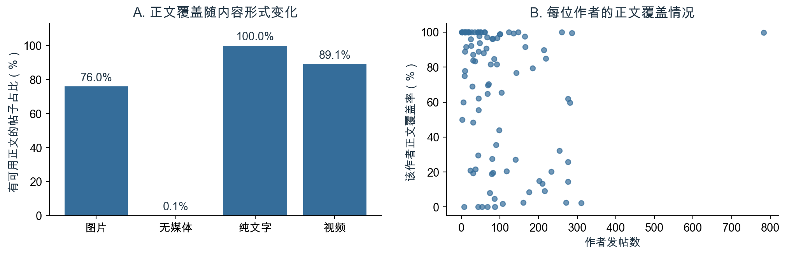

图1　不同内容形式的正文覆盖率，以及100位作者的发帖数与正文覆盖率。覆盖按原始content是否存在可见字符界定。

| 数据环节 | 既有核查结果 | 对分析的影响 |
| --- | --- | --- |
| 帖子主键 | 9,532条帖子ID唯一，涉及100位作者 | 帖子作为回归的观察单位 |
| 评论去重 | 原始13,511行，删除1,916行重复ID后保留11,595条；重复记录无字段冲突 | 保留不同ID下的重复短句 |
| 评论关联 | 所有去重评论均可关联帖子，覆盖1,323帖 | 未覆盖帖子不能赋为零评论 |
| 正文可用性 | 3,984帖无可用正文，5,548帖有可见字符；清理后非空正文为5,414条 | 全样本回归保留正文可用状态变量 |
| 点赞与浏览 | 8,286帖的点赞大于记录浏览数，统计口径不能确认 | 不计算点赞率，不以浏览数作为曝光量 |

来源：[1][2][4]。

正文缺失与内容形式存在明显对应。图片帖的正文覆盖率为76.0%，视频帖为89.1%，纯文字帖为100.0%，无媒体帖则仅为0.1%。作者之间同样存在差异：5位作者没有任何可用正文，26位作者的帖子均有正文，作者正文覆盖率的中位数为84.3%。这些是既有统计能够确认的分布事实；记录生成或采集逻辑可能参与形成差异，但现有资料不足以判断具体原因。[4]

这一覆盖结构意味着，文本分析面对的是不同程度可见的内容，而不是所有帖子表达的完整记录。图片中的文字和视频语音未进入正文变量，没有可用正文也不等于帖子没有表达。现有模型通过保留正文可用状态、控制内容形式并比较仅可见正文的设定，减少简单删去缺失记录带来的解释混淆，但这些做法不能恢复缺失内容，也不能证明缺失过程已经得到充分控制。对于业务评价，较稳妥的使用方式是把文本结论限定在相应的数据范围内：全样本词典回归说明当前编码下的条件关联，主题分析说明满足有效词项要求的正文模式，评论分析说明实际采集到的回应。把这些范围写清楚，比将缺失记录视为低质量内容或零互动更符合现有证据。

### 3.2 点赞呈长尾分布，内容形式差异需要在同一比较条件下理解

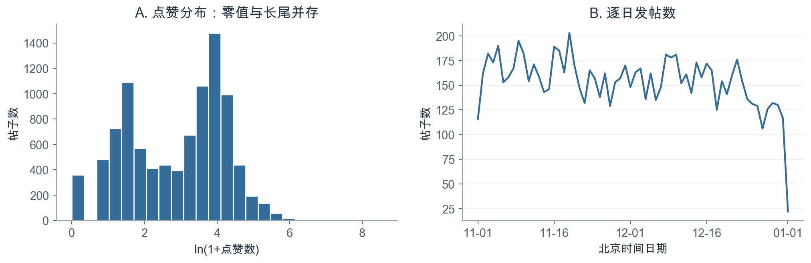

图2　全部9,532帖的点赞分布与北京时间逐日发帖数。首末本地日期均为不完整日，末端下降不能解释为活跃度骤降。

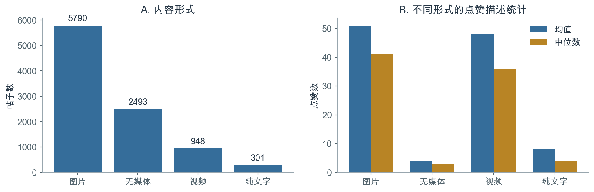

图3　原始contentTypeStr所定义的内容形式及其点赞均值、中位数；内容形式不等同于是否有可用正文。

| 内容形式 | 帖子数 | 样本占比 | 平均点赞 | 点赞中位数 |
| --- | --- | --- | --- | --- |
| 图片 | 5,790 | 60.7% | 51.03 | 41 |
| 无媒体 | 2,493 | 26.2% | 3.91 | 3 |
| 纯文字 | 301 | 3.2% | 7.94 | 4 |
| 视频 | 948 | 9.9% | 48.05 | 36 |

来源：[2]中的media_summary.csv；图2对应descriptive_statistics.csv与summary.json。

样本帖子的平均点赞为37.05，中位数为25，最大值为5,126，零点赞比例为3.8%。均值高于中位数、少量帖子获得很高点赞，与图2呈现的长尾分布一致。作者发帖量也不均衡，发帖数中位数为66，最多的一位发布783帖。由此，帖子均值同时受到高赞记录和高产作者构成的影响，不能直接代表一个典型作者的通常表现。[2]

图片和视频帖在原始点赞均值及中位数上均高于另外两类，但该结果尚未分离作者、业务类别和具体内容的差异。一种合理解释是，不同形式的帖子由不同作者、在不同情境下发布，比较时因而混合了多种条件；视觉内容或曝光机会也可能相关，但没有相应测量支持进一步归因。基于这一认识，后续回归控制内容形式，并通过作者固定效应转向同一作者不同帖子之间的比较。对于运营决策，当前证据可以支持在内容评估中区分媒体形式、同时观察均值与中位数，却不能支持把“改用图片或视频”当作已经验证的增赞措施。描述统计首先回答反馈差异在哪里，第四章再检验所选文本特征能否在这些差异之外提供明确关联，两者之间不应直接跨越到策略因果判断。

## 4. 非结构化数据的结构化与回归分析

### 4.1 词典特征覆盖有限，语义解释需要保留边界

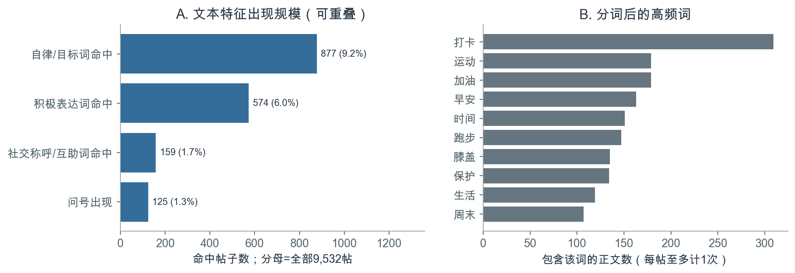

图4　文本特征命中数及高频词。各项特征可重叠；高频词以含该词的帖子数计量，每帖至多计一次。

| 结构化变量 | 操作性定义 | 命中帖数 | 全部帖子占比 | 有作者内变动的作者数 |
| --- | --- | --- | --- | --- |
| 正文长度 | 清理后非空白字符数，回归使用ln(1+长度) | 不适用 | 不适用 | 不适用 |
| 自律或目标词 | 命中“坚持”“打卡”“目标”等词，或“第N天”模式 | 877 | 9.2% | 76 |
| 社交称呼或互助词 | 命中“大家”“一起”“谢谢”等词 | 159 | 1.7% | 42 |
| 积极表达词 | 命中“开心”“喜欢”“哈哈”等词 | 574 | 6.0% | 64 |
| 问号 | 正文含半角或全角问号 | 125 | 1.3% | 32 |

来源：[2]中的text_features_summary.csv；完整词表与匹配规则见[7]。

既有处理先还原换行，再移除URL、成对课程分享后缀、方括号表情标记与空白，随后生成长度和词典变量。每个词典维度命中任一项记为1，同一词重复出现不累加，不同维度允许重叠；话题标签作为独立元数据，不拼接进正文参与匹配。另以jieba分词并过滤停用词，统计帖内去重后的词项文档频数。该流程将原始语言转成可进入回归的结构化数据，同时保留正文可用状态、话题、表情与课程分享标记等辅助控制。[7]

图4中的“打卡”“运动”“加油”等词与运动记录语境相符，但词典命中并不直接测量自律水平、情绪强度或线上互助意图。已有语义边界检查形成40个“帖子—特征”单元，由Codex辅助完成，未采用独立人工双编码：例如，“完成”可能描述画作进度，“一起”可能叙述线下活动，问号也可能用于反问。这些例子揭示了字面规则的误报与遗漏，却不能据此估计总体准确率。低频特征又只有部分作者提供0与1之间的变化，作者内比较的信息相对有限。因此，本研究将这些变量视为范围明确的文本代理，而不把可复现性等同于语义效度。业务上可以用它们辅助检索或描述内容，若要据此评价表达质量、识别真实支持需求，仍需额外的语义标注与验证；现有回归只检验这些既定规则与点赞之间的关系。

### 4.2 原始组间差异没有转化为明确的主回归证据

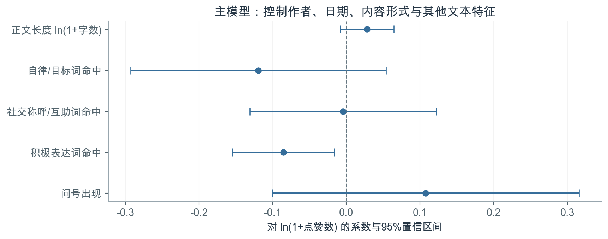

图5　M3五项核心文本系数和按作者聚类的95%置信区间。图中为未经多重检验调整的区间，校正结果见下表。

| 核心变量 | 系数 | 聚类标准误 | 原始95%置信区间 | 原始p值 | BH校正q值 |
| --- | --- | --- | --- | --- | --- |
| 正文长度ln(1+字数) | 0.028 | 0.018 | [-0.008, 0.064] | 0.130 | 0.293 |
| 自律或目标词 | -0.119 | 0.087 | [-0.293, 0.054] | 0.176 | 0.293 |
| 社交称呼或互助词 | -0.004 | 0.064 | [-0.131, 0.122] | 0.946 | 0.946 |
| 积极表达词 | -0.086 | 0.035 | [-0.155, -0.016] | 0.016 | 0.079 |
| 问号 | 0.108 | 0.105 | [-0.100, 0.316] | 0.307 | 0.383 |

来源：[3]。因变量为ln(1+点赞数)，主模型使用9,532帖、100位作者。

四类二元特征的命中组均有更高的原始平均点赞。例如，社交称呼或互助词命中帖平均为89.96，未命中帖为36.16。然而，这种组间比较混合了作者和帖子情境。已有分析依次估计基础关联模型、作者固定效应模型以及作者与日期固定效应模型M3。M3还控制内容形式、业务类型、发帖时段和辅助文本标记；作者内不变的性别、会员等属性由作者固定效应吸收。标准误按作者聚类，采用小样本修正，以99个推断自由度计算p值和区间，对五项核心系数进行BH多重检验校正。[2][3]

主模型写作：ln(1+点赞ᵢₜ) = αᵢ + δᵈ + β′Xᵢₜ + γ′Zᵢₜ + εᵢₜ。其中，i表示作者，t表示帖子，d表示北京时间发帖日期；X为表中五项核心文本特征，Z为上述帖子层面控制项。该设定估计给定控制条件后的统计关联，未识别因果效应。

**五项核心系数的联合检验p=0.130，现有证据不足以支持它们整体具有明确关联。**主模型R²为0.688，但相对于保留相同控制项、仅去掉五项核心文本特征的模型，R²只增加0.065个百分点，不能将较高的总体拟合度归功于这些文本变量。积极表达词的系数为负，原始p值达到5%水平，校正后q值则为0.079。其点估计对应“1+点赞数”条件几何均值约低8.2%，不是点赞算术均值的直接下降幅度，更不是使用积极表达造成的损失。原始均值与条件系数方向不同，说明比较口径会影响判断，但尚未识别造成差异的具体机制。作者受众、内容情境和未记录的曝光均可能相关，模型无法逐一确认。由此，较有依据的业务判断是暂缓把单一词汇纳入增赞规则，而不是反向要求用户减少积极表达；该结论既保留了统计结果，也避免把探索性关联改写为行为指令。

### 4.3 多种检验限定了负关联的解释强度

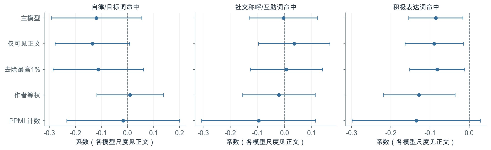

图6　三类词汇在不同设定下的系数与原始95%聚类置信区间。OLS与PPML对应不同的条件均值尺度，系数不能直接视为同一估计量。

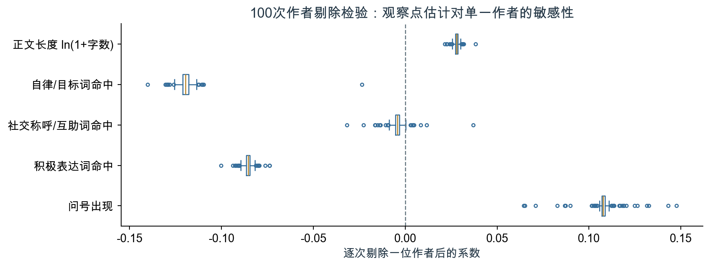

图7　依次剔除一位作者后，五项核心文本系数的分布。箱体表示中间50%，散点表示箱须之外的结果。

| 积极表达词的补充设定 | 样本量 | 系数 | 原始95%置信区间 | 原始p值 |
| --- | --- | --- | --- | --- |
| 仅可见正文 | 5,548 | -0.090 | [-0.164, -0.015] | 0.019 |
| 去除点赞最高1% | 9,436 | -0.082 | [-0.152, -0.012] | 0.022 |
| 作者等权 | 9,532 | -0.128 | [-0.219, -0.036] | 0.007 |
| PPML计数模型 | 9,532 | -0.135 | [-0.299, 0.028] | 0.103 |

来源：[3][4]。补充设定用于检查敏感性，表中p值不是新增检验家族校正后的结果。

仅可见正文设定检验缺失正文的处理是否影响结果，去除最高1%点赞的设定检验极端值影响，作者等权设定降低高产作者在总体估计中的权重。PPML则以原始点赞数建模，考察算术条件期望的对数关系。几种OLS设定保留了积极表达词的负系数，但PPML的区间包含零。既有逐作者剔除分析进一步显示，100次重新估计中该系数均为负，范围为[-0.100, -0.074]；社交称呼或互助词的系数则在部分剔除后改变符号。[3][4]

这些检验支持的是对结果边界的更精确描述。负向OLS点估计并非由某一位作者单独决定，也没有因去除少数高赞帖子而消失；但符号稳定不能消除多重检验问题，不能替代计数模型的不同结果，更不能解决词典语义和遗漏变量限制。由于OLS刻画对数变换后的反馈，PPML刻画原始计数的条件期望，两者不显著程度的差别也不能简单解释为某个模型“正确”、另一个模型“错误”。综合证据后，积极表达的负关联适宜保留为待进一步解释的探索性发现，尚不适合进入内容奖惩或自动化推荐规则。更有价值的后续问题是：在统一曝光和观察窗口下、经过语义验证的表达变量是否仍呈相似关系。这个问题尚未得到回答，现有结果也没有给出相应业务收益或风险的量化估计。

### 4.4 帖子主题揭示内容模式，增量关联证据有限

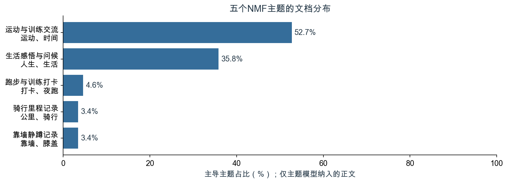

图8　主题模型子样本中五类主导主题的占比。主题依据词项和正文内容命名，不使用点赞结果。

| 帖子主题 | 主导文档数 | 主导占比 | 回归系数 | 原始95%置信区间 | 原始p值 | BH校正q值 |
| --- | --- | --- | --- | --- | --- | --- |
| 靠墙静蹲记录 | 85 | 3.4% | -0.315 | [-0.636, 0.005] | 0.054 | 0.107 |
| 骑行里程记录 | 85 | 3.4% | 0.018 | [-0.523, 0.558] | 0.948 | 0.948 |
| 运动与训练交流 | 1,302 | 52.7% | 基准 | 不适用 | 不适用 | 不适用 |
| 跑步与训练打卡 | 113 | 4.6% | -0.471 | [-1.048, 0.105] | 0.108 | 0.144 |
| 生活感悟与问候 | 885 | 35.8% | -0.144 | [-0.278, -0.010] | 0.035 | 0.107 |

来源：[4]。主导主题为每帖权重最大的成分；回归使用连续主题权重，系数对应相对基准主题的1单位权重变化。

词典回答“是否出现指定表达”，主题模型补充回答“正文主要谈论什么”。已有分析对至少含3个过滤后有效词的2,478条正文构建TF-IDF文档—词项矩阵，以非负矩阵分解（NMF）提取五个主题；8条成分贡献接近零的正文不作强制归类，最终2,470帖、86位作者进入描述和回归，词表含1,046项。TF-IDF在此用于构建主题模型的词项表示，随后校正NMF成分的尺度并归一化文档权重；权重表示相对贡献，不是主题后验概率。主题数在首次拟合前固定，未依据点赞结果选择。每帖的权重可分布于多个主题，表中的主导分类仅用于描述。[4]

运动训练和生活感悟构成该子样本中的主要内容模式，部分较小主题的文档则集中于特定作者：靠墙静蹲主题的最大作者贡献91.8%的主导文档，骑行里程主题对应比例为68.2%。这一事实提示，主题既反映内容，也可能反映特定作者持续使用的记录方式，不能直接解释为用户需求偏好。既有主题回归在相同有效正文子样本中保留词典特征与控制项，加入四个主题权重，联合检验p=0.166，四项BH校正后均未达到5%水平。三次初始化的前10关键词平均Jaccard为1.000，只说明初始化稳定，不能替代抽样稳定性或语义效度检验。主题回归还以拟合后的主题为给定输入，没有计入主题估计本身的不确定性。对业务而言，这些主题可帮助理解已见正文、整理内容类别，但不足以据此确定推荐优先级；其样本范围也不同于全样本主回归，两类有限证据不能当作同一检验的重复验证。至此，RQ2的字面表达与帖子主题两部分均已完成，下一章转向评论本身。

## 5. 评论文本与互动网络分析

### 5.1 评论以短表达为主，高频用语的用户覆盖存在差异

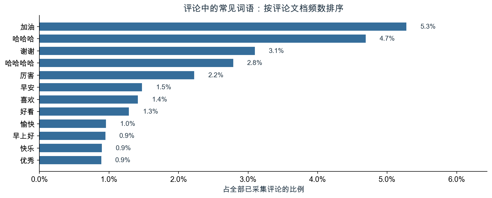

图9　以11,595条去重评论为分母，展示常见词的评论文档频数占比；词语至少覆盖5位发言用户，各词可以共现。

| 观察维度 | 既有结果 | 解释口径 |
| --- | --- | --- |
| 评论长度 | 清理后字符数中位数6，75分位数10 | 描述移除URL、方括号标记等后的长度 |
| 标记或符号 | 1,373条，占11.8% | 清理后不含汉字、字母或数字 |
| 常见词“加油” | 612条评论，431位用户 | 每条评论内至多计一次 |
| 常见词“谢谢” | 359条评论，53位用户 | 词项频数，不等同于完整感谢词类 |
| 重复表达 | 3,362条评论具有重复的标准化文本 | 不同评论ID下保留，不按重复短句删去 |

来源：[5]。

评论文本覆盖2,910位发言者，全部去重评论均有原始内容。既有处理统一全半角与空白，移除URL和方括号标记，再进行分词、停用词过滤与评论内词项去重；同时保留不同ID下的重复短句以及84次自我互动。图9因而描述的是所采集评论的字面表达，不是独立用户人数，也不与后续排除自我事件的网络分母混用。[5][8]

较短的评论和常见的鼓励、感谢用语，支持把轻量回应视为样本中的一个可见特征，但无法单凭长度判断交流是否深入。“加油”与“谢谢”的频数和用户覆盖进一步说明，同样进入高频列表的词语，其参与基础可能不同：前者覆盖更广的发言者，后者可以由较少用户反复使用。这里可以提出一种合理解释，即部分短句承担了简便回应或维持交流的功能，但现有统计没有识别用户动机，也没有衡量接收者是否感到被支持。仅标记或符号的记录也可能传递含义，本次文字规则不能还原其语境。对社区评价而言，应同时保留事件次数、去重用户覆盖和重复表达信息，避免将短句累计量直接解释为参与广泛或交流优质。这个判断来自统计单位的差别，而不是对短评论价值的否定；评论角色的进一步区分将在下一节说明谁更常使用哪些字面表达。

### 5.2 发言角色对应不同表达，但尚未验证固定回应链条

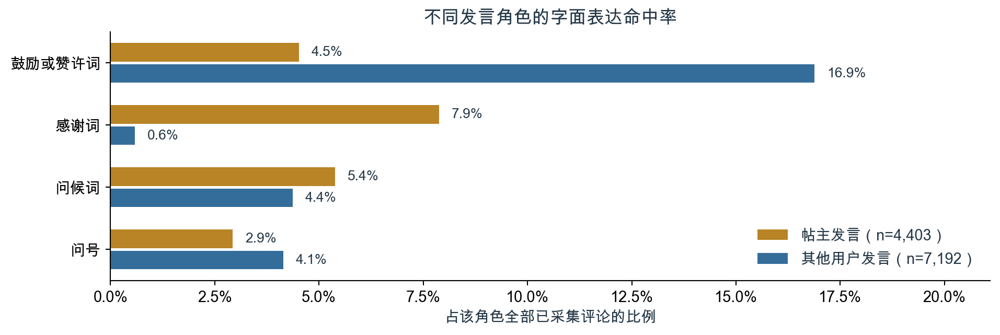

图10　按发言者是否为所属帖子作者分组，比较四项字面特征；分母为各角色的全部已采集评论，各项可以重叠。

| 字面特征 | 全部评论命中数 | 全部评论占比 | 其他用户命中率 | 帖主命中率 |
| --- | --- | --- | --- | --- |
| 鼓励或赞许词 | 1,413 | 12.2% | 16.9% | 4.5% |
| 感谢词 | 389 | 3.4% | 0.6% | 7.9% |
| 问候词 | 551 | 4.8% | 4.4% | 5.4% |
| 问号 | 427 | 3.7% | 4.1% | 2.9% |

来源：[5]。其他用户发言为7,192条，帖主发言为4,403条；角色按每条评论与所属帖子的关系界定。

鼓励或赞许词包括“加油”“厉害”“优秀”等，感谢词包括“谢谢”“感谢”等，问候词包括“早安”“晚安”等，问号按字符匹配。完整词表在首次统计前固定，不使用点赞指标调整，各维度允许重叠。同一用户在自己的帖子中属于帖主，在其他人的帖子中可以属于其他用户，因此角色对应的去重人数不能直接相加。这套角色口径还包含根评论和自我互动，不等同于后文只针对非自我明确回复的角色分布。[5][8]

已经确认的事实是，在所选规则下，其他用户发言更常命中鼓励或赞许词，帖主发言更常命中感谢词。一种与结果相容的解释是，评论双方在交流中承担了不同的语言角色：参与者提供赞许，帖主表达回应或感谢。但本研究没有逐线程检验词语的先后对应，也没有使用独立人工标注判断表达是否真诚、是否回应了具体内容，因此尚不能将这一解释写成已经验证的“鼓励—感谢”链条。未命中也不等于没有相应语义，问号不能直接当作真实提问。对业务的实际启示是，衡量互动内容时可先区分发言角色，避免将总体感谢词频或鼓励词频当作所有参与者的共同倾向；若要设计回应模板或支持提示，应先确认具体语境与接收体验。现有结果提供了值得进一步观察的角色差异，没有估计任何提示方案对交流质量或留存的效果。

### 5.3 多数节点处于同一弱连通分量，接收事件较为集中

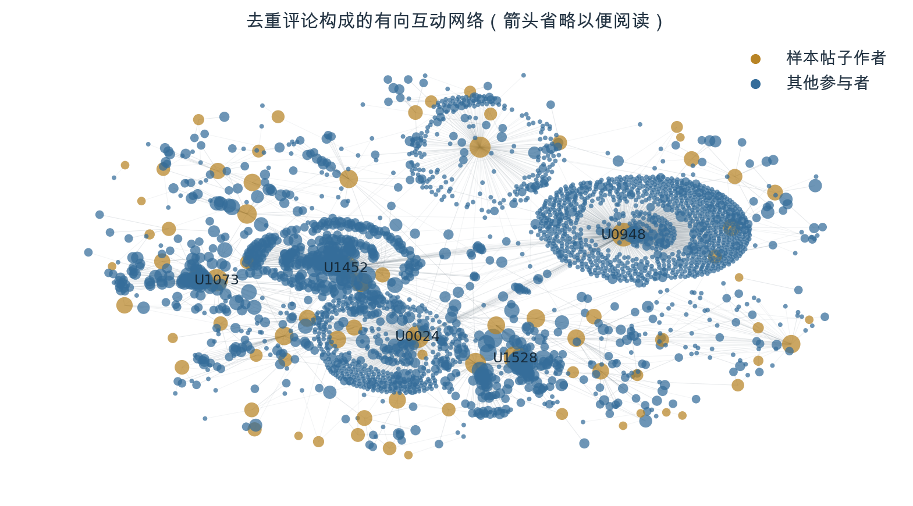

图11　全部2,932个有边节点、4,069条有向边。图中为便于阅读省略箭头；金色为样本帖子作者，蓝色为其他参与者，节点大小按接收事件数的对数缩放，仅标注前5位接收者。

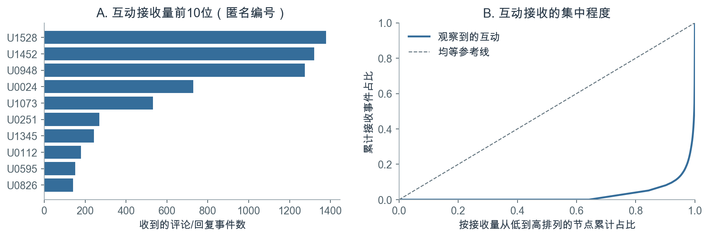

图12　接收事件前10位与累计接收分布。排序按边权，分母为11,511次非自我互动事件，同一用户的多次事件分别计数。

| 网络指标 | 既有结果 | 具体含义 |
| --- | --- | --- |
| 互动事件 | 11,511次 | 6,609次根评论及4,902次明确回复 |
| 有边节点与有向边 | 2,932个节点、4,069条边 | 同一发送者—接收者的事件合并为加权边 |
| 最大弱连通分量 | 2,768个节点，占94.4% | 忽略方向后的连接范围 |
| 整体互惠率 | 49.6% | 有反向边的有向边占比，不按事件加权 |
| 仅明确回复的互惠率 | 29.9% | 改变建边范围后的结果 |
| 前10位接收占比 | 54.0% | 按事件数排序后的接收份额 |
| 样本作者接收占比 | 61.3% | 事件接收对象为样本帖子作者 |

来源：[2][6]。

网络将评论转换为用户之间的有向事件。根评论指向帖主，明确回复优先使用replyUserId确定对象，缺失时利用已观测的直接回复评论识别；84次自我互动排除，同一用户对的多次事件累计为边权。既有核查没有发现无法确定指向或早于发帖的评论。网络指标中的用户既包括发送者也包括接收者，因此节点数与前文的评论发言人数含义不同。图面采用固定随机种子的弹簧布局，节点距离仅用于展示连接关系。[6][9]

较大的弱连通分量表明，大部分有边节点在忽略方向后可以通过路径连接，但这并不意味着每位参与者之间都有直接互动。与此同时，接收事件的集中说明交流数量没有均匀分配到所有用户。两种现象可以并存：网络覆盖较广的参与者，却仍围绕少数接收对象展开。样本来自100位作者的帖子，根评论又按规则指向帖主，这种采集与建边方式会使作者及其活跃互动对象更容易成为中心。因此，集中度既是样本内可确认的结构特征，也受到观察边界塑造，不能外推为平台影响力排名。整体互惠率与仅明确回复互惠率的差异进一步表明，网络口径会改变对交流结构的判断，两者节点集合也并不相同。业务使用时应区分连接范围、事件集中度与独立参与人数；若据此识别服务负担或交流机会，仍需补充更完整的互动和用户体验信息，不能单凭中心性认定某个账号创造了更高质量的社区价值。

### 5.4 帖主承担多数明确回复，时间窗口会改变网络描述

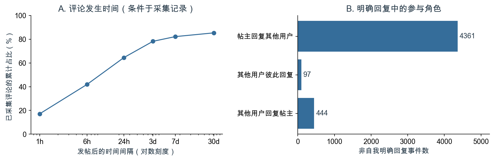

图13　已采集评论的发生时序，以及4,902次非自我明确回复的角色分布；时序分母为全部11,595条去重评论。

| 观察窗口 | 非自我事件数 | 有边节点数 | 有向边数 | 互惠率 | 前10位接收占比 |
| --- | --- | --- | --- | --- | --- |
| 全部已采集互动 | 11,511 | 2,932 | 4,069 | 49.6% | 54.0% |
| 发帖后7天内 | 9,451 | 1,376 | 2,278 | 74.1% | 48.3% |

来源：[4][6]。

在明确回复中，帖主回复其他用户占89.0%，其他用户回复帖主占9.1%，其他用户彼此回复占2.0%，舍入后合计可能略偏离100%。时序统计显示，已采集评论中64.5%发生在发帖后24小时内，82.2%发生在7天内，间隔中位数为11.3小时。6,609个外来根评论线程中，57.0%观察到帖主参与回复；在这些已观察到帖主回复的线程中，首次回复距离根评论的中位间隔为2.05小时。上述比例均以实际采集记录为基础，未观测到回复不能解释为实际没有回复。[4]

角色分布支持“当前显式交流主要围绕帖主展开”的判断，与上一节的集中接收结构相容；但不能据此推断其他用户缺乏交流意愿，也不能认定帖主回应产生了更高点赞。首周网络具有更高互惠率和较低前10位接收占比，说明纳入晚期记录会改变结构描述。其可能原因包括晚期参与者和互动类型不同，但这类构成机制尚未单独验证。两种窗口中的节点和边集合发生变化，指标差异不是同一群体互惠行为的时间趋势；7天截点也不能证明所有帖子都获得了完整的首周采集。业务上，围绕帖主的回应结构值得在服务设计中关注，但现阶段应优先固定相对观察窗口、区分根评论与明确回复，并清楚说明帖主回应时延的条件分母。这样才能避免把观测更久、记录更全或反复回复的差异误当作运营改善，为未来评价回应支持方案建立可比较的基线。

## 6. 结果与解释

### 6.1 两类证据分别刻画内容反馈与回应关系

| 研究问题 | 已有证据能够支持的判断 | 尚不能成立的推断 |
| --- | --- | --- |
| RQ1：分布 | 点赞、作者发帖量、正文覆盖和内容形式均存在差异 | 原始均值差异等于形式或词语的效果 |
| RQ2：文本关联 | 主回归与主题回归在各自范围内均缺少明确的关联证据 | 表达完全无效，或应减少积极表达 |
| RQ3：评论内容与关系 | 字面表达具有角色差异，互动围绕帖主且接收集中 | 已验证鼓励—感谢链条，或已改善交流质量与留存 |

来源：[2]—[6]的综合解释；右栏为证据边界，不是新增检验结论。

从RQ1到RQ2，研究的关键进展是比较条件的变化。描述统计呈现样本中已记录的差异，回归则在可观测条件和作者内比较下检验其中一部分文本特征。两者结果不同，提醒内容评价不能停留在高赞样本的表面共性。主题分析扩大了对正文内容模式的描述范围，也保留了有效正文筛选、作者模板和测量不确定性的限制。这些分析尚未提供可直接用于提升点赞的表达规则，但进一步明确了内容评价能够依赖的证据范围。

从评论文本到评论网络，研究得到的是对同一批回应的两个侧面描述。角色间语言差异与帖主主导明确回复相互呼应，使“围绕帖主展开的交流”成为一个与结果相容的解释。不过，前者以评论中的规则命中为单位，后者以用户指向事件和边为单位，并未逐条验证二者之间的对应。更不能再跨一步，把这种结构解释成对帖子点赞的促进机制：评论在发帖后形成，研究未确定其与累计点赞的先后关系，也未将网络指标放入点赞回归。对决策者而言，这种区分有实际价值：内容评价需要更可靠的曝光、表达测量和比较条件，互动评价需要人数、次数、角色和时间窗口；它们回答不同问题，可以共同描述社区，却不能用一类指标替代另一类证据。保留这一层次关系，能够使后续方案分别对准尚未解释的内容反馈和已经观察到的回应结构，而不把未经验证的机制写入既定结论。

### 6.2 数据与测量边界决定结论的适用范围

| 证据层次 | 已具备的基础 | 仍然缺失的信息 |
| --- | --- | --- |
| 样本与观察 | 输入校验、评论去重、时间解析、ID关联和范围说明 | 抽样框、统一采集时点、完整评论覆盖 |
| 表达测量 | 可复现的词典、主题和评论规则 | 独立语义效度验证、图片文字与视频语音 |
| 条件比较 | 作者和日期固定效应、作者聚类、多重检验及敏感性比较 | 真实曝光、随时间变化的作者条件、完整内容质量指标 |
| 业务结果 | 点赞及已观测评论的内容和结构 | 交流体验、运动坚持、留存及干预效果 |

来源：[1]—[9]。缺失信息用于限定结论，不构成对其实际取值或作用的估计。

已有独立核查记录支持主要数值和数据转换过程的一致性，已执行Notebook也保留了可审阅的输出。这类核查回答的是“现有口径是否被正确执行”，并不自动回答抽样是否具有总体代表性、文本规则是否充分表达语义或模型是否识别了因果。样本内计算可靠与业务解释充分之间仍存在距离，二者需要分别评价。

尤其需要谨慎理解不显著结果。置信区间与多重检验反映当前样本、变量和设定下的不确定性，没有检出明确关联，并不等于任何表达、视觉内容或交流方式都没有价值。低频特征提供的作者内变化较少、正文缺失以及语义代理的局限，都可能影响可识别的信息，但本研究没有量化它们各自造成的影响，不能将有限证据全部归因于其中某一项。主题子样本与全样本的范围不同，评论记录又具有独立的覆盖边界，跨分析比较时必须保留这些条件。由此形成的管理原则是，让证据强度决定应用范围：现有结果可以用于整理内容和互动的评价口径，可以提出需要验证的运营问题，但不足以支持强制性表达规则、平台总体排名或效果承诺。下一章据此区分可先落实的统计规范和需要额外研究的服务方案，使建议的确定程度与依据相匹配。

## 7. 建议

### 7.1 先改进评价口径，再决定是否干预表达与回应

| 当前判断依据 | 建议改进 | 使用条件 |
| --- | --- | --- |
| 原始差异与条件比较不一致 | 内容评价同时记录作者、媒体形式、曝光与反馈窗口 | 暂不将词典命中或主导主题作为增赞规则 |
| 词项频数与用户覆盖不同 | 同时报告评论事件数、去重参与人数与重复表达情况 | 不把累计短句数等同于参与广度 |
| 根评论、明确回复和时间窗口影响网络指标 | 固定建边规则，分别展示角色与窗口下的结果 | 不将样本接收排序外推为平台影响力 |

表中为依据现有结果提出的管理建议，其实施效果尚未评估。

内容评价宜从可比较的记录开始。现有词典和主题可以作为辅助描述，但在获得更完整的曝光与内容信息之前，不宜直接用于奖惩、优先推荐或要求用户改变用词。与其根据个别系数制定表达规范，更可行的起点是统一记录帖子观察窗口，区分媒体形式和正文可用状态，并在相同范围内解释反馈差异。这一建议旨在降低误用现有结果的风险，不代表已经证明某套评价体系能带来更高点赞。

互动评价则应将“发生多少次”“多少人参与”“谁回应谁”分别呈现。评论事件体现活动量，去重用户体现覆盖面，帖主与其他用户的角色分布体现回应结构，任一维度都不能独立代表交流质量。实际使用中，应在结果旁固定注明是否排除自我互动、根评论如何指向、明确回复如何识别，以及时间窗口和未采集记录如何处理；帖主回复时延也应保留只针对已观察到回应线程的条件说明。这样做的价值是使不同报告和不同阶段的统计能够被正确理解，而非追求某个网络指标本身更高。若以后确需评价回应服务，还应增加对接收体验和内容有效性的测量；在这些信息尚缺时，可以关注结构差异、提出服务问题，但不能把互惠率或感谢词增长直接解释为服务成功。

### 7.2 后续验证优先补齐观察与测量，再评估具体业务方案

| 优先方向 | 对应的待解决问题 | 后续验证对象 |
| --- | --- | --- |
| 观察范围 | 当前差异是否受到曝光、采集与累计时长影响 | 统一窗口、真实曝光及更完整的评论记录 |
| 语义测量 | 字面规则是否准确描述目标含义 | 隐藏反馈指标的独立双人标注与一致性评价 |
| 服务方案 | 表达提示或回应支持是否改善明确业务结果 | 预先确定对照、评价口径与适用人群的干预研究 |

本表为后续研究安排，相关工作和业务效果均未在本项目中完成。

数据完善应优先服务于当前论证中的关键缺口。补充真实曝光和统一反馈窗口，有助于建立更可比的帖子反馈口径；补充完整评论，有助于区分未回应与未观测。语义验证可在隐藏点赞等结果信息的条件下，由两位编码者依据事先确定的标准独立判断，再检查误报、遗漏和一致性。在此基础上，才适合讨论扩展图片文字、视频语音或更细的回应类型，而不是仅通过增加标签数量来放大解释范围。

具体业务方案应作为假设进入后续研究。例如，减少表达负担的提示是否改善内容反馈，帮助帖主处理回应是否改善交流体验，同伴互助是否扩大其他用户之间的参与，均需要单独验证。若采用对照研究，可考虑以作者为分配单位，并预先界定点赞、独立互动人数及回复质量等评价口径，同时讨论用户间互动可能造成的组间影响。这些安排是方法建议，不是已实施的实验。现有研究没有估计干预效果、样本量要求、成本收益或最优阈值，因此不宜给出相应目标值。后续工作的优先顺序应是先让观测和测量更可信，再判断是否存在值得推广的变化；只有具体方案在清楚的适用范围内得到验证，才能把本文的探索性认识转化为明确的运营决策。

## 附录：课程要求与成果对应

| 作业要求 | 本报告中的对应内容 | 既有配套材料 |
| --- | --- | --- |
| 小组成员、研究题目 | 首页保留真实信息占位，第一章明确题目与范围 | code/project_config.json中的成员与分工占位 |
| 研究意义 | 第二章说明内容反馈与评论互动的研究价值 | 既有汇报背景与研究问题 |
| 完整分析过程与描述统计 | 第一、三章说明输入、去重、关联、缺失、时间与分布 | 分析过程.ipynb及其HTML、结果文件与代码 |
| 非结构化数据转结构化后回归 | 第四章说明预处理、词典编码、固定效应、推断与主题回归 | 主分析及扩展实验Notebook、词典和模型结果 |
| 至少一种文本或网络分析 | 第四章帖子主题；第五章评论文本及互动网络 | 评论文本分析Notebook、网络结果和原有图表 |
| 解释与建议 | 第六章区分事实与机制，第七章提出有条件的建议 | 原有结果和核查记录 |
| 每位成员汇报本人完成部分 | 需按真实贡献填写成员、分工并组织汇报 | 演示文稿.pptx、演示PDF、汇报讲稿.txt |
| PDF、PPT及必要材料提交 | 新版报告另存，旧版及其配套文件保留 | 项目目录及本地课程提交包 |

成员姓名、学号与实际贡献尚未确定，不能以建议分工代替已完成的个人工作。每位成员仍须参与本人部分的汇报，并依据真实贡献独立完成互评。课程作业原文注明11月10日23:59提交、11月15日前互评，但未注明年份，实际期限应以课程通知为准。[10]

## 结论

在本课程样本中，帖子反馈具有明显异质性，正文覆盖也不均衡。字面表达与内容主题分别提供了可复现的文本表示，但其回归结果尚不足以支持明确的增赞判断。积极表达词的探索性负关联受到多重检验、模型尺度和测量边界的共同限制，不宜解释为改变表达即可改变点赞。

已采集评论呈现短表达、角色差异、帖主主导明确回复与集中接收并存的特征。这些发现有助于描述反馈如何被表达和分配，但没有证明固定的语言回应链条，也没有识别评论关系对点赞、留存或运动行为的因果影响。

本研究能够确认的是这批数据中的条件关联和互动结构，能够提出的是与这些证据相匹配的评价问题。更广泛的机制判断与业务效果评估，仍需要更完整的观察、更可靠的语义测量和后续验证。

## 参考文献与证据来源

[1] 课程提供资料. Keep社区帖子与评论数据及字段字典[DS]. [出版地不详]: [发布者不详], [年份不详]. 文件：sample_post_2022.csv、sample_comment_2022.csv、KeepData_dictionary.pdf. 数据来源、实际时间与校验值见[DATA.md](DATA.md).

[2] 本项目小组. Keep社区主分析汇总与描述统计[DS]. 2026. 文件：[summary.json](results/summary.json)、[descriptive_statistics.csv](results/descriptive_statistics.csv)、[media_summary.csv](results/media_summary.csv)、[text_features_summary.csv](results/text_features_summary.csv). 以项目已有结果为准。

[3] 本项目小组. Keep社区词典回归及模型比较结果[DS]. 2026. 文件：[regression_coefficients.csv](results/regression_coefficients.csv)、[model_fit.csv](results/model_fit.csv). 主分析的独立数值核查见[核查记录](validation/numerical_checks.json).

[4] 本项目小组. Keep社区正文覆盖、主题及敏感性扩展结果[DS]. 2026. 文件：[extension_summary.json](results/extension_summary.json)、[extension_topics.csv](results/extension_topics.csv)、[extension_topic_regression.csv](results/extension_topic_regression.csv)、[extension_author_influence_summary.csv](results/extension_author_influence_summary.csv). 计算过程见[扩展实验](扩展实验.html).

[5] 本项目小组. Keep社区评论文本分析结果[DS]. 2026-10-19. 文件：[comment_text_summary.json](results/comment_text_summary.json)、[comment_text_terms.csv](results/comment_text_terms.csv)、[comment_text_features.csv](results/comment_text_features.csv). 计算过程见[评论文本分析](评论文本分析.html).

[6] 本项目小组. Keep社区评论网络、回应角色与观察窗口结果[DS]. 2026. 文件：[summary.json](results/summary.json)、[extension_comment_roles.csv](results/extension_comment_roles.csv)、[extension_comment_timing.csv](results/extension_comment_timing.csv)、[extension_window_networks.csv](results/extension_window_networks.csv). 建图过程见[分析过程](分析过程.html).

[7] 本项目小组. 帖子文本预处理与词典编码规则[CP]. 2026. 文件：[analyze.py](code/analyze.py)、[text_dictionary.json](code/text_dictionary.json)、[stopwords.txt](code/stopwords.txt). 语义边界抽查由Codex辅助完成，不作为独立人工效度验证。

[8] 本项目小组. 评论文本字面规则与处理口径[CP]. 2026-10-19. 文件：[comment_text_config.json](code/comment_text_config.json)、[analyze_comment_text.py](code/analyze_comment_text.py). 独立数值复核见[评论文本核查记录](validation/comment_text_checks.json).

[9] 课程提供资料. 内容分析与自然语言处理：14、18、24—28页；社交网络分析简介：32—37页；Social Network Influencial：30、35页[Z]. [出版地不详]: [发布者不详], [年份不详]. 本地课程讲义及放置说明见[references/README.md](references/README.md).

[10] 课程提供资料. 小组项目作业[Z]. [出版地不详]: [发布者不详], [年份不详]. 本地文件：小组项目作业.pdf. 本报告依据其报告内容、展示及提交要求编排。
