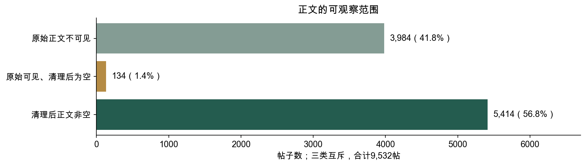
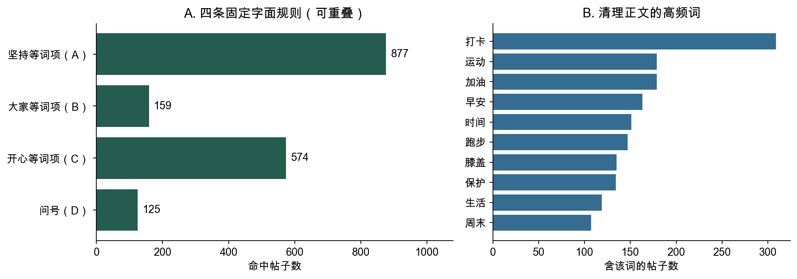
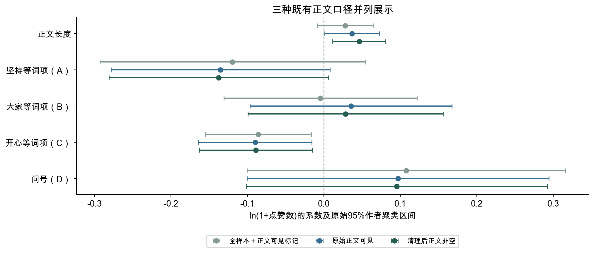
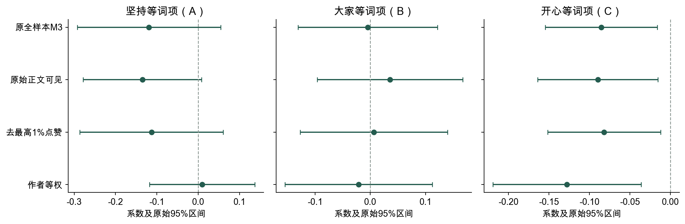
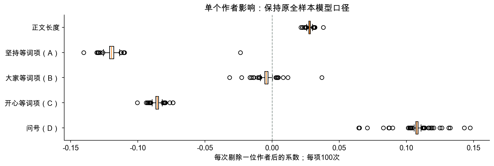
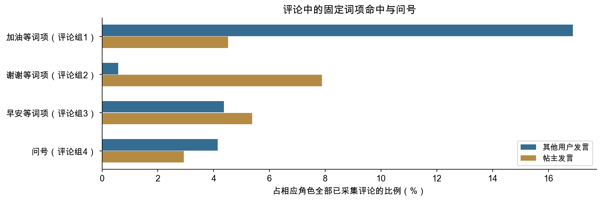
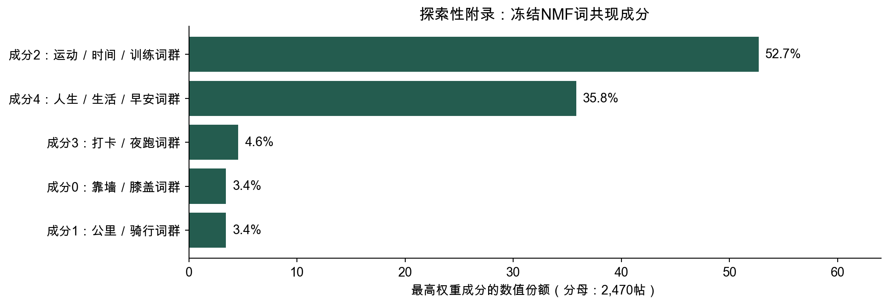

# Keep社区帖子特征与互动反馈

**可观察字面特征、点赞关联与评论互动结构｜2026年10月29日**

**摘要**

本研究使用课程提供的9,532条帖子与11,595条去重评论，分析正文可观察范围、媒体形式和tag分布，比较固定词项、问号及正文长度与累计点赞的条件关联，并描述已采集评论的词项、直接回复和用户连接。主研究的测量对象是字面可观察特征，不再把固定词项或自动成分作为真实内容类别、人格、情绪或社会支持的测量。

正文清理后非空的帖子有5,414条；其中71.9%未命中四条固定规则。规则可以交叉命中，也不覆盖全部表达，未命中率不是分类错误率。三种既有正文口径并列报告：全样本、原始正文可见与清理后非空模型的五项联合p值分别为0.130、0.067与0.040。后者长度和开心等词项（C）的模型内BH q均约0.048，但这些口径是在原结果后补充比较的，不能据此追认为事前唯一主模型，或声称具有稳定增赞效果。

在4,902次明确回复中，89.0%由帖主发给其他用户；接收事件数相近的两个账号，发送者人数分别为53和1,091。评论次数、参与人数和直接回复覆盖提供不同的互动描述，均不直接等于真实社会支持或关系质量。

本轮未进行人工语义复核。候选内容框架、NMF成分、旧成分回归、多阈值及AI识别器均移入明确的探索性附录；400条文本的AI重建与留出预检验暴露了范围门控和过度检出问题，未形成可供正式类别效应分析的语义真值。主研究按当前可观察范围完成，人审手册及工具保留为有资源时的后续材料。

## 1. 研究背景、问题与范围

### 1.1 从运动社区中的发言与反馈出发

Keep的帖子同时含有正文、媒体和平台元数据。用户可能发布很短的记录，也可能在评论区与其他账号往来。只比较高赞帖常见用词，容易把作者、媒体和累计观察时间的差别一并归入文案。本研究因此分开描述样本覆盖、正文特征的条件关联，以及采集到的回复连接。

既有运动社区研究为讨论线上参与提供背景[1]，词项计数和文本矩阵方法提供可复核工具[2–4]。这些文献不能替本样本验证某个词组对应的心理构念。本报告把解释限制在已记录的字面特征、点赞与互动结构。

### 1.2 三个研究问题

| 问题 | 本轮问题 | 证据与章节 |
| --- | --- | --- |
| RQ1 | 样本的正文可观察范围、媒体形式、tag和点赞如何分布？ | 覆盖、媒体、tag与点赞描述；第3章 |
| RQ2 | 固定词项命中、问号和正文长度与点赞是否存在条件关联，结论对样本口径及控制项如何变化？ | 冻结模型、口径及控制项对照；第4章 |
| RQ3 | 已采集评论的字面线索、直接回复方向及用户连接如何分布？ | 评论词项、直接配对和有向网络；第5—6章 |

### 1.3 本轮正式研究与探索材料的边界

主研究保留既有清理、固定词表、匹配方法、控制项与估计值，不重新选择统计结果，也不添加新的p值。所有正文模型并列披露；原M3是历史全样本设定，正文可见与非空口径是已有补充比较，均不因显著性被追认为事前唯一主模型。

本轮未进行人工语义复核，已完成的计算核查不称为语义效度验证。候选分类不进入正式RQ或主研究结论；旧NMF成分和分类重建仅在探索性附录记录其方法、结果与失败。未来若有资源，可使用现有手册与独立标注工具开展新的语义研究；这不是本作业本轮交付的先决步骤。

## 2. 数据、可观察特征与分析方法

### 2.1 数据来源和清理口径

研究使用课程提供的帖子表、评论表和字段说明。9,532帖来自100位作者，帖子发表于2020年11—12月（UTC）；北京时间末端跨至2021年1月1日。11,595条去重评论最晚延续至2021年8月26日。文件名中的“2022”不代表观测年份。

| 核查项 | 已有结果 | 本轮解释 |
| --- | --- | --- |
| 帖子与评论主键 | 帖子ID唯一；评论ID重复1,916行，无字段冲突 | 评论按ID去重，保留11,595条 |
| 原始正文 | 5,548帖有可见字符，3,984帖不可见 | 未记录正文不能视为原帖没有内容 |
| 清理正文 | 5,414帖非空；134帖原始可见但清理后为空 | 与全样本、原始可见口径并列 |
| 评论覆盖 | 去重评论均能关联帖子，分布在1,323帖下 | 其余帖子评论覆盖未知，不填成零评论 |
| 点赞与浏览 | 8,286帖点赞数高于记录浏览数 | 不计算点赞率，使用累计点赞 |
| 时间、媒体和长尾 | 累计观察时长未知，未读取图像或语音内容 | 不以正文补出媒体语义；保留极端值敏感性 |

正文清理还原转义换行，移除URL、成对的课程分享后缀和方括号表情，并统一空白；原始hashTags字段不拼入基本正文。没有正文的全样本记录将字面特征设为0，并加入原始正文可见标记；该处理描述记录状态，不能恢复缺失内容或校正非随机缺失。

### 2.2 正文的四条规则列全词项，不作为语义分类

正文长度为ln(1+清理后非空白字符数)。以下规则按固定子串或已冻结模式匹配，任一命中记1，重复出现不累加。A含下表末项正则模式，其余词项作字面子串匹配；B、C和D先对词项作正则转义再匹配，不是按分词频率编码。A、B、C、D可以交叉命中，既不互斥，也不完备。它们不直接测量人格、情绪、真实提问或社会支持。

A—C最初按词语的直观含义编制，缺少独立词表评审和语义验证。本版仅将它们沿用为固定、可复算的探索性操作指标；中性改名不补上理论或经验效度，也不表明三组词项是语料自然形成的分类。本轮未因显著性保留、增删词项，既有匹配规则不变。

| 字面特征 | 全部固定词项／模式 | 操作与边界 |
| --- | --- | --- |
| 坚持等词项命中（A） | 坚持、自律、打卡、目标、计划、努力、加油、挑战、突破、完成、进步、不放弃、全勤、第[0-9一二三四五六七八九十百千]+天 | 末项为既有正则模式，其余按子串；不判断否定、反讽、意图或行为真实性。 |
| 大家等词项命中（B） | 大家、朋友们、小伙伴、你们、一起、互相、互勉、共勉、陪伴、谢谢、感谢、请教、求助、求推荐 | 任一子串命中记1；未处理否定、反讽或上下文含义。 |
| 开心等词项命中（C） | 开心、快乐、高兴、幸福、喜欢、美好、满足、舒服、棒、赞、愉快、美滋滋、哈哈、嘻嘻、嘿嘿 | 任一子串命中记1；未处理否定、反讽或上下文含义。 |
| 问号出现（D） | ?、？ | 任一问号出现记1；修辞问句会命中，无问号的提问可能漏掉。 |

同一条“加油”可能用于自我提醒或给别人留言；“谢谢”也不能证明已经发生互助。规则名称仅帮助读者辨认所列词项。数值共线性与语义含义是不同问题，低VIF不证明四项是独立心理维度。

辅助控制沿用原始正文可见状态、有无原始tag、表情数量、课程分享标记、媒体形式、业务类型和发帖时段。原始tag是用户选择的元数据，不能作为正文语义的标准答案。

### 2.3 点赞模型与三种正文口径并列

因变量为ln(1+点赞数)。原M3同时放入正文长度、A—D、已记录控制项、作者固定效应及北京时间发帖日期固定效应。作者固定效应调整不随帖子变化的作者间差别，日期固定效应调整同日共有差别；标准误按各模型实际包含的作者聚类，保留有限样本修正及t／F推断[5]。

原全样本9,532帖／100位作者、原始正文可见5,548帖／95位作者、清理后非空5,414帖／95位作者均报告。每个模型内的五项系数用Benjamini–Hochberg方法作BH校正，并列五项联合检验[6]。模型内BH不覆盖所有口径、控制项和探索分析，因此q=0.048不构成对整个研究探索过程的统一校正。

作者支持、少帖作者、tag身份与拼接、完整设计矩阵VIF、最高1%点赞剔除、作者等权、PPML和逐作者剔除沿用既有冻结结果。这些检查说明比较对处理方式如何变化，不能修复缺失曝光、累计时长或语义测量。

### 2.4 评论的字面规则、直接配对与网络

评论按ID去重，统一全半角与空白，移除URL和方括号标记。词项每条评论至多计一次，各组可交叉命中，分母为相应角色全部已采集评论。为使规则可复核，完整列出原评论词表；组名只指词项集合。

| 评论字面规则 | 全部固定词项 |
| --- | --- |
| 加油等词项（评论组1） | 加油、棒棒、真棒、太棒、很棒、厉害、优秀、佩服、精彩、漂亮、好看、点赞、好赞 |
| 谢谢等词项（评论组2） | 谢谢、感谢、多谢、谢啦、谢了、感恩 |
| 早安等词项（评论组3） | 早安、晚安、早上好、晚上好、下午好、中午好、周末好、节日快乐、新年快乐、生日快乐 |
| 问号（评论组4） | ?、？ |

直接配对以其他用户发给帖主的根评论为起点，要求所属帖子、reply、replyUserId和parentId共同匹配，在根评论后168小时内取最早观测到的帖主直接回复。未采到直接回复不等于实际上没有回复。

有向网络以账号为节点、发送者指向接收者：根评论按所属帖子指向帖主，明确回复指向被回复账号。同向多次事件合并为边权，排除84次自我互动。全部事件、仅明确回复与发帖后7天三种范围分别描述。评论词项与网络均不度量真实支持、情感或关系质量，也不放入发帖前点赞模型。完整配对、窗口和互惠口径见附录A。

## 3. 正文可观察范围、媒体、tag与点赞分布

本章回应RQ1，说明可以观察哪些正文、媒体和元数据，以及点赞分布的范围，为第4章的关联比较和第5—6章的评论描述确定分母。

### 3.1 正文覆盖随内容形式变化，评论记录集中在部分帖子

文字记录的覆盖随内容形式和作者而变化。9,532 帖中，5,548 帖有可见正文，3,984 帖无可用正文；清理后仍非空的正文为5,414 条。图片帖的正文覆盖率为76.0%，视频帖为89.1%，纯文字帖为100.0%，无媒体帖仅为0.1%。100 位作者中，5 位完全没有可用正文，26 位每帖都有正文，正文覆盖率中位数为84.3%。文本分析因此主要呈现正文较充分的内容形式与作者的表达。

图1　不同内容形式的正文覆盖率，以及100 位作者的发帖数与正文覆盖率。覆盖按原始正文是否存在可见字符界定。

原M3以全部帖子为历史比较范围；原始正文可见和清理后非空口径同时列出。3,984帖的原始正文不可见，另有134帖清理后为空。图片文字和视频语音尚未观察，不能用缺失标记或现有正文规则补齐。

图2　按原始正文可见与清理状态划分，三类互斥，合计9,532帖。图中表示记录可观察范围，不是语义类别。

评论数据覆盖的是已采集到的互动。原始13,511 行按评论ID 去重，删除1,916 行无字段冲突的重复记录后，剩下11,595 条，全部能够关联到帖子，分布在1,323 帖下；其余帖子的评论情况记为覆盖未知。不同ID 下的相同短句仍然保留，以记录不同账号或时点实际发生的发言。

按实际时间字段，帖子发表于2020 年11—12 月（UTC）；转换成北京时间后，末端少量帖子跨至2021 年1 月1 日。评论最晚延续至2021 年8 月26 日。分析范围为课程提供的这批历史样本，抽样机制和统一采集时点未提供，全文据此讨论样本中的内容与互动。

### 3.2 点赞分布有长尾，作者发帖量也不均衡

样本包含100 位作者的9,532 条帖子。平均每帖获得37.05 个赞，中位数为25，最高一帖达到5,126，零点赞占3.8%。均值高于中位数，反映少量高反馈帖子将平均水平向上拉；中位数则更贴近分布中间的帖子。作者发帖数中位数为66，最多一位发布783帖，高产作者的内容习惯因而会在按帖统计的结果中出现更多次。

图3　全部9,532 帖的点赞分布与北京时间逐日发帖数。首末本地日期的观察时长均不足完整一天。

不同内容形式的反馈差别也很大。图片和视频帖的平均点赞分别为51.03 和48.05，纯文字帖为7.94，无媒体帖为3.91；中位数保留了相同的排序。读者实际看到的是，不同形式的帖子处在很不一样的反馈水平上。因此，讨论文字表达之前，必须把媒体形式及其对应的作者和内容情境纳入比较。

图4　按原始内容形式字段划分的帖子数、平均点赞与点赞中位数；内容形式与有无可用正文分别统计。

媒体形式对应着不同的累计点赞水平，后续文字比较据此同时控制媒体形式、作者和帖子情境。但样本中8,286 帖的点赞大于记录浏览数，两个字段的统计口径存在差异。完整媒体分组数值见附录A。

### 3.3 原始tag覆盖一半以上帖子，与正文可见并不相同

5,209帖带有原始tag，占54.6%，共269种；其中1,517帖没有原始正文。5,207帖只有一个tag，仅2帖有两个。有tag、正文可见和某条规则命中分别描述不同字段，不能相互替代。tag的身份控制和拼接比较在第4章单独报告，避免把平台活动标题中的固定用词当作原正文的新增表达。

## 4. 字面表达的关联对正文可观测范围敏感

### 4.1 原始均值有差异，但词典只能覆盖部分表达

以下原始均值沿用历史9,532帖的编码比较，“未命中”组包含没有观察到正文的记录，不能视为已经确认这些帖子不使用相应用词。未调整时，四项字面线索的命中组平均点赞均较高：坚持等词项（A）63.67对34.36，大家等词项（B）89.96对36.16，开心等词项（C）57.29对35.76，问号111.15对36.07。两组的作者、媒体和发帖情境并不相同，这些均值描述的是组别构成与反馈的共同差别，不能直接解释为措辞效果。

图5　指定字面特征的命中数与高频词。它们可重叠，词频以含该词的帖子数计，每帖至多一次。

| 字面线索 | 命中帖数 | 全部帖子占比 | 有作者内变化的作者数 | 完整原M3 VIF |
| --- | --- | --- | --- | --- |
| 坚持等词项命中（A） | 877 | 9.2% | 76 | 1.750 |
| 大家等词项命中（B） | 159 | 1.7% | 42 | 1.149 |
| 开心等词项命中（C） | 574 | 6.0% | 64 | 1.186 |
| 问号出现（D） | 125 | 1.3% | 32 | 1.112 |

非空清理正文中，只有1,523帖命中至少一项，3,891帖没有命中任何规则，占71.9%。71.9%是四条非完备规则的未命中比例，不是分类错误率。全样本未命中数为8,009，其中包含未观察到正文的记录。这不是“多数帖子没有表达”，而是说明指定词表只捕捉了局部线索。RQ2的结论因而必须限定为这些规则的关联，不能概括全部内容的作用。

四项全样本最大两两φ相关为0.119，作者内最大相关为0.085；完整M3的四项VIF为1.11—1.75，设计矩阵9,532×182且满秩。182帖同时命中至少两项。现有数值未呈现明显共线性，不支持仅因担心重复而合并规则；低VIF也不能证明语义独立或量表有效。[10]

### 4.2 原M3的估计可复算，但不能替代可观测正文中的比较

原全样本M3中，开心等词项（C）系数为−0.086，原始95%区间为[−0.155, −0.016]，原始p=0.016；对五项同时作BH校正后q=0.079。五项联合p=0.130，新增R²为0.065个百分点。这些是原设定下可以复算的结果。

图6　三种既有正文口径的五项系数与原始95%作者聚类区间；样本数、作者数和模型内BH q见下表及附录A。

原始算术均值与模型的对数条件关联也不在同一尺度，不能将方向差别单独归因于作者固定效应或某一个控制项。把研究对象限定为正文实际可见的帖子后，比较范围发生了变化。原始正文可见的5,548帖仍包含134条清理后为空的记录；非空清理正文为5,414帖。三个口径的结果并列如下：

| 正文口径 | 帖数／作者数 | 五项联合p | 长度BH q | 开心等词项（C）BH q |
| --- | --- | --- | --- | --- |
| 原全样本＋缺失标记 | 9,532／100 | 0.130 | 0.293 | 0.079 |
| 原始正文可见 | 5,548／95 | 0.067 | 0.106 | 0.093 |
| 清理后正文非空 | 5,414／95 | 0.040 | 0.048 | 0.048 |

在非空正文模型中，长度系数为0.046、开心等词项（C）系数为−0.089，两项在该模型内的BH q均约0.048，整组p约0.040。不能因此挑选这个模型来宣布稳定效果，也不能继续把全样本p=0.130概括为所有正文处理都没有关联。该重分析是在原结果之后开展，且没有对所有探索性模型统一校正；结果靠近阈值，仍受到正文可观察范围的选择限制。三种p值的变化不是系数之间差异的显著性检验，也不能证明非随机正文缺失已被解决。

本轮正式问题聚焦可观察的固定字面特征，三种正文口径并列解释。非空正文口径的p=0.040和两项q=0.048不被追认为事前确定的唯一主模型；全样本p=0.130也不被概括为文字普遍没有关联。三者都缺少实际曝光、完整媒体内容和统一累计观察时长，不能识别词项的因果作用。

### 4.3 少帖作者没有主导原字面结果，稀少特征的支持仍有限

全样本100位作者的发帖数最少1、中位数66、最多783。2位作者只发1帖；不超过10帖的14位作者合计80帖，占0.84%。单帖作者没有作者内变化，不为共同斜率提供这种信息，但少帖存在本身不使固定效应整体失效。

分别剔除发帖少于5帖或10帖的作者，原字面模型得到以下结果：

| 保留规则 | 帖数／作者数 | 五项联合p | 开心等词项（C）β／BH q |
| --- | --- | --- | --- |
| 原全样本 | 9,532／100 | 0.130 | −0.086／0.079 |
| 每位作者至少5帖 | 9,524／95 | 0.131 | −0.086／0.080 |
| 每位作者至少10帖 | 9,462／87 | 0.130 | −0.085／0.095 |

这些门槛没有实质改变原M3的统计判断，提示少帖作者不是这项结果的主要来源。不过，长度在93位作者内有变化，大家等词项（B）只有42位、问号只有32位；不能把100个作者理解为每个特征都有100个充分的变化来源。固定效应也不能排除同一作者随帖变化的曝光和内容差别。

### 4.4 原始话题标签值得控制，但拼进正文会改变测量

5,209帖有原始tag，占54.6%，共269种；其中1,517帖没有原始正文。原M3已经控制“有无标签”，并非没有考虑tag，但没有控制具体标签身份。

既有补充分析只依据频数与作者覆盖，选择至少30帖、至少5位作者使用的9个tag身份作为补充控制，并保留原正文编码。另把正文与tag拼接后重编码，作为测量范围变化的对照：

| 设定 | 五项联合p | 开心等词项（C）β／BH q | 实际比较 |
| --- | --- | --- | --- |
| 原M3 | 0.130 | −0.086／0.079 | 正文线索，已有has_tag |
| 加9个tag身份控制 | 0.102 | −0.083／0.088 | 正文范围不变，调整常见标签差别 |
| 正文＋tag重编码 | 0.173 | −0.070／0.167 | 被测文字范围改变 |

拼接后，坚持等词项（A）命中从877增到3,342帖，问号从125增到354帖。统一的“坚持 Keep 的那些天”或带问号的活动标题可以机械地增加命中，不能等同为作者在正文中表现了不同的真实行为或提问意图。原始tag本身也不保证与正文主题一致，因此用作并行元数据和敏感性对照，不作为语义标签的标准答案。

9个常见tag是控制项，不是新的九类内容。没有进一步加入标签数量，是因为5,207帖只有一个tag，仅2帖有两个；在有无tag之外加数量，额外变化几乎只来自这两帖。

### 4.5 方向相近，不等于所有统计判断都稳定

原有的原始正文可见、去除最高1%点赞、作者等权和逐作者剔除分析中，开心等词项（C）的点估计方向较一致；100次逐作者剔除均为负，范围为[−0.100, −0.074]。PPML计数模型也给出负向点估计，但原始区间跨零。

图7　从冻结结果表重画的A、B、C系数与原始95%作者聚类区间。原“仅可见正文”是5,548帖口径，不含本轮新增的5,414帖模型；不同尺度不能直接比较系数幅度。

图8　原全样本设定中逐一剔除作者后的系数分布。这项检查处理单个作者影响，不处理语义效度或正文非随机缺失。

因此，本章保留的判断是：开心等词项（C）的负向点估计在若干处理下相近，但整组证据与多重检验结论会随正文口径改变。数据提供的是受测量、样本和已记录控制条件限制的关联，不能据此建议通过减少开心等词项（C）来提高点赞。

## 5. 评论词项与观测直接回复的分布

### 5.1 短评论与重复词项有不同的用户覆盖

清理后评论字符数中位数为6、75分位数为10；1,373条只留下标记或符号，占11.8%。这些记录只支持评论长度与字面形式的描述，不能据此判断发言者的态度强度。

图9　以11,595条去重评论为分母展示常见词的出现占比。每条评论内同一词至多计一次，词项至少覆盖5位发言用户，各词可共同出现。

“加油”出现在612条评论中，涉及431位发言用户；“谢谢”出现在359条评论中，涉及53位用户。前者在更多用户之间出现，后者更集中于较少使用者。另有3,362条评论具有重复的标准化文本，按不同ID保留。评论次数和不同发言用户数应同时报告，不能把重复的短句直接当作更深的关系。

### 5.2 发言角色对应不同词项命中率

其他用户发言7,192条，帖主发言4,403条；同一用户可在不同帖子下切换角色。下表与图按每条评论的所属帖子定义角色，保留根评论、回复及84次自我互动。

图10　按发言者是否为所属帖子的作者分组，比较四组固定字面规则。分母为各角色全部已采集评论，各项可以重叠。

| 评论字面规则 | 全部命中数 | 全部占比 | 其他用户命中率 | 帖主命中率 |
| --- | --- | --- | --- | --- |
| 加油等词项（评论组1） | 1,413 | 12.2% | 16.9% | 4.5% |
| 谢谢等词项（评论组2） | 389 | 3.4% | 0.6% | 7.9% |
| 早安等词项（评论组3） | 551 | 4.8% | 4.4% | 5.4% |
| 问号（评论组4） | 427 | 3.7% | 4.1% | 2.9% |

评论组1在其他用户发言中的比例较高，评论组2在帖主发言中的比例较高。这是词项与角色的对应分布。评论组2包含“感谢”“多谢”等完整表中所列词项，因此命中数389大于“谢谢”单词项的359。它们不能直接证明已经发生真实支持，或将“感谢”解释为支持效果。

### 5.3 根评论的直接回复覆盖与回复词项应分开看

从6,609条其他用户发给帖主的根评论出发，按冻结规则查找根评论后7天内、明确指向该条评论及其作者的帖主回复。每条根评论只取最早符合条件的观测回复，共有3,568条根评论配到回复。

| 根评论的字面规则 | 根评论数 | 涉及帖主数 | 观测到7天内直接回复 | 已回复记录中，最早回复命中评论组2 |
| --- | --- | --- | --- | --- |
| 命中加油等词项（评论组1） | 1,180 | 54 | 513（43.5%） | 137（26.7%） |
| 未命中加油等词项（评论组1） | 5,429 | 77 | 3,055（56.3%） | 195（6.4%） |

直接回复比例以各组全部根评论为分母；最后一列仅以已观察到直接回复的根评论为分母，同一帖主可以进入两组。命中评论组1的根评论中，最早回复命中评论组2的比例在已回复记录中为26.7%，另一组为6.4%；换成全部根评论作分母则为11.6%和3.6%。

同一批记录中，评论组1命中组的观测直接回复覆盖为43.5%，低于未命中组的56.3%。这说明回复词项分布和直接回复覆盖可以走向不同。它不证明某组留言更容易被忽视或得到更高质量回应，因为帖主、具体情境与采集完整程度各不相同。本轮没有对此新选显著性检验，也不把未命中组视为语义上缺乏鼓励或未获得支持的对照组。

## 6. 评论区围绕帖主往来，互动量与人数需分看

### 6.1 评论指向和重复次数，构成用户间的关系网络

图11中的每个点是一位用户账号。线从评论发送者指向接收者：根评论按归属指向帖主，明确回复指向记录中的被回复用户。同一发送者向同一接收者评论多次，合并成一条有向边，次数累加为权重。十次同方向留言在图中对应一条权重为十的边，记录的是这对账号之间累计发生的事件。

排除84 次自我互动后，11,511 次评论事件合并为4,069 条有向边，涉及2,932 个有边账号。节点同时包含发送者和接收者，文本统计中的2,910 位发言者则只计算实际发出评论的用户。网络由此把每次发言放回到它所指向的对象上，呈现谁向谁留言或回话。

为回答不同问题，原有分析实际用了三种网络范围。

| 网络范围 | 节点与边 | 权重与所含事件 | 它主要帮助理解什么 |
| --- | --- | --- | --- |
| 全部已采集互动 | 2,932 个账号、4,069 条有向边 | 同方向事件次数为权重；包括6,609 次根评论及4,902 次明确回复 | 留言与回话合在一起，向谁集中 |
| 仅明确回复 | 1,074 个账号、1,271 条有向边 | 同方向重复回复合并为边；既有互惠统计不赋权、不计重复次数 | 去掉根评论归属后，明确回复关系是否双向存在 |
| 发帖后7 天内 | 1,376 个账号、2,278 条有向边 | 同方向事件次数为权重；包括该窗口内的根评论和明确回复 | 限定发帖后首周，结构描述如何变化 |

三类网络都排除自我互动，方向均为发送者指向接收者；首周网络来自全部已采集事件的时间截取。

图11　全部2,932 个有边节点与4,069 条有向边。为便于阅读，图中省略箭头；金色为样本帖子作者，蓝色为其他参与者，节点大小按接收事件数的对数缩放，仅标注前5 位接收者。位置按网络布局排列。

### 6.2 大多数账号可以间接连起来，实际回话却主要由帖主承担

忽略线的方向后，网络分为35 个互不相连的部分，其中最大部分包含2,768 个账号，占有边账号的94.4%。网络密度为0.0473%，即全部可能的有向账号配对中，实际出现直接连接的比例很小。这两项结果合起来呈现了一种“间接联系广、直接联系稀疏” 的结构：大多数账号能够通过已有连接串在一起，日常评论则发生在有限的账号关系中。

评论角色进一步说明这个结构里发生了什么。在4,902 次明确回复中，帖主回复其他用户4,361 次，占89.0%；其他用户回复帖主444 次，占9.1%；其他用户彼此回复97 次，占2.0%。采集到的明确回话，大部分是帖主在承接留言，其他参与者相互接话的事件份额很小。而根评论按规则指向帖主，因此结合根评论与明确回复，可以确定评论区围绕帖主展开的清晰特征。

评论区的活动主要由面向帖主的留言与帖主回话构成，其他用户彼此交流则是其中较少的一部分。同一条帖子下，多人留言形成了参与的广度，帖主持续回复形成了来回承接；这两种活动共同解释了样本中评论量的主要来源。横向回复的97 次事件，则记录了帖主之外参与者直接接话的部分。

### 6.3 同样接收很多评论，可能是接触面广，也可能是少数人反复往来

前10 位账号接收了54.0% 的非自我评论事件，样本帖子作者接收了61.3%。评论去向集中在部分账号上；进一步对照接收次数与发送者人数，可以看清这些接收量是怎样积累起来的。

图12　接收事件前10 位与累计接收分布。按接收事件次数排序，分母为11,511 次非自我事件，同一用户的多次事件分别计数。

现有匿名节点表提供了一个很直观的比较。U1528 收到1,378 次互动，发送者有53 位；U0948 收到1,275 次，发送者却有1,091 位。前者的接收量更多包含已有发送者的重复发言，后者的发送者覆盖面更广。不属于样本帖子作者的U0112 也收到180 次互动，但只来自4 位发送者，说明较高接收量还可能出现在很有限的账号往来中。

| 匿名账号 | 是否为样本帖子作者 | 接收事件次数 | 不同发送者人数 | 记录中更突出的特征 |
| --- | --- | --- | --- | --- |
| U1528 | 是 | 1,378 | 53 | 相对于人数，重复发来的事件较多 |
| U0948 | 是 | 1,275 | 1,091 | 与相近接收量相比，涉及更多不同发送者 |
| U0112 | 否 | 180 | 4 | 接收事件集中来自很少几位发送者 |

接收事件数为加权入度，不同发送者数为入度；统计同时包含根评论和明确回复。

多少个不同账号向其发来评论（入度），反映接收关系的范围；累计收到多少次评论（加权入度），反映事件量。将这两个中心性指标联系起来，U0948 突出的是较广的发送者覆盖，U1528 突出的是已有发送者的多次发言。两者在网络中承担的接收形态因此有所不同。

### 6.4 双向连接与首周窗口的结构差别

全部互动网络的互惠率为49.6%，表示近一半有向连接同时存在反方向的连接。例如，用户给帖主留言，帖主又回话给该用户，这对账号便形成双向连接。指标按账号之间是否存在双向关系计量[8]，每条连接贡献相同权重，概括了关系层面的往来。

只保留明确回复后，互惠率为29.9%。整体网络中，用户的根评论与帖主的回复可以组成一对双向连接；限定为明确回复后，其中一部分关系保留的是帖主发出的回话。两项互惠率的差异，使“留言加回话” 这一主要往来形式在结构上更加清楚。

图13　已采集评论距发帖的时间分布，以及4,902 次非自我明确回复的角色分布。时序比例以全部11,595 条去重评论为分母。

已采集评论中，64.5% 发生在发帖后24 小时内，82.2% 在7 天内，距发帖时间的中位数为11.3 小时，评论集中在发帖后的较早阶段。首周网络的互惠率为74.1%，前10 位接收占比为48.3%；全部记录对应为49.6% 和54.0%。首周记录呈现更多双向连接、较分散的事件接收；纳入较晚的账号和评论后，整体关系构成随之变化。

| 观察窗口 | 非自我事件数 | 有边账号数 | 有向边数 | 互惠率 | 前10 位接收占比 |
| --- | --- | --- | --- | --- | --- |
| 全部已采集互动 | 11,511 | 2,932 | 4,069 | 49.6% | 54.0% |
| 发帖后7 天内 | 9,451 | 1,376 | 2,278 | 74.1% | 48.3% |

互惠按边是否双向存在计量，接收占比按事件次数计量；每个窗口分别确定接收量前10 位账号。

在线程层面，6,609 个根评论线程中，57.0% 观察到帖主参与；在这些已参与线程里，最早观测到的帖主回复距根评论的中位时间为2.05 小时。这说明样本中相当一部分留言线程有帖主接话，且在已接话的线程里，回应时间的中位数约为两小时。互惠率描述账号关系的双向性，线程参与描述留言串里的承接，第5章的直接回复比例则定位到根评论本身；三种结果分别补充了交流过程的不同层面。

上述网络图与数值沿用既有冻结结果，本轮重新核对描述范围与术语，未重估网络或全面重审评论采集过程。根评论指向帖主是构网规则的一部分；连通、互惠和中心性描述观测连接，不等于真实友谊、社区凝聚力或社会支持。

## 7. 讨论、结论与后续资源

### 7.1 三个研究问题得到怎样的回答

RQ1显示，文字可观察范围随媒体与作者变化，累计点赞呈长尾，tag有无也不同于正文可见。正文、媒体和元数据应分别保留，不能因为没有记录到正文就补成没有内容。

RQ2显示，A—D与长度的关联取决于比较口径和已记录条件。开心等词项（C）的命中组原始平均点赞较高，而若干调整模型的点估计为负；原始算术均值和对数条件系数处在不同尺度，无法将差别归因于单一控制项。三种正文口径的联合p为0.130、0.067与0.040，应共同呈现；非空正文模型内q约0.048靠近惯用阈值，且不覆盖全部模型探索，不支持稳定增赞结论。

RQ3显示，评论中的固定词项随发言角色分布不同，明确回复以帖主发给其他用户为主，事件量与不同发送者人数反映不同接收形态。网络互惠和线程参与描述不同层面的连接，均不能直接作为真实支持或关系质量的测量。

### 7.2 当前结果可以怎样使用

本轮可交付的是明确分母、规则和模型条件的观察性报告。使用者可以据此检查某种比较是否混入了正文缺失、媒体构成或少数账号的重复发言；不能把高赞帖常用词当作推荐文案，也不能把负向系数改写成“减少开心用词能提高点赞”。

| 对象 | 目前可采用的做法 | 依据与条件 |
| --- | --- | --- |
| 研究小组 | 在报告中并列三种正文口径，公开全部词项及样本分母 | 字面关联会随观察范围改变，规则不穷尽表达 |
| 平台分析者 | 若获得新数据，统一发帖后7天曝光、反馈和不同参与者数 | 当前累计观察时长未知，次数与人数含义不同 |
| 后续研究者 | 有资源时使用候选手册与独立标注工具开展单独语义研究 | 本轮未进行人工语义复核；候选类别仅作探索 |
| 平台运营者 | 如评估表达或回复提示，以新设计的实验记录实际曝光和回应 | 当前观察性关联未识别干预收益 |

### 7.3 限制与交付边界

样本仅来自课程提供的100位作者，抽样机制和统一采集时点未知，不能代表Keep全平台。缺失正文、媒体内容未观察与评论采集缺口限制了可见范围。作者和日期固定效应不能消除随帖变化的曝光、粉丝变化、媒体内容与观察时长差别；点赞也不等于训练效果、自律程度或留存。

四条正文规则与四组评论规则是可交叉命中的字面规则，不是互斥、完备的语义分类，亦未完成本轮人工语义复核。低共线性和计算可复现均不建立语义效度。模型内BH只调整每个设定的五项检验，正文口径与其他补充分析未构成一个统一校正的检验家族。

本轮按可观察字面特征与互动关联的范围完成作业。探索性附录保留NMF、候选框架及失败的AI识别器，以说明为何没有正式报告真实主题占比或类别效应；其工具可供未来资源允许时使用。本轮不以补完人工分类作为结论或交付的前提。

## 附录A　字面模型与互动口径的完整证据

### A.1 三种既有正文口径的五项结果

每个区间均为原始95%作者聚类区间；BH q分别在各模型内对五项校正。全样本／原始可见／清理非空三个口径分别包含9,532／5,548／5,414帖及100／95／95位作者。以下全部估计沿用冻结结果，未追认任何一个口径为事前唯一主模型。

| 模型 | 字面特征 | β | 聚类SE | 原始95%区间 | 原始p | BH q |
| --- | --- | --- | --- | --- | --- | --- |
| 全样本 | 正文长度 ln(1+字数) | 0.028 | 0.018 | [−0.008, 0.064] | 0.130 | 0.293 |
| 全样本 | 坚持等词项命中（A） | −0.119 | 0.087 | [−0.293, 0.054] | 0.176 | 0.293 |
| 全样本 | 大家等词项命中（B） | −0.004 | 0.064 | [−0.131, 0.122] | 0.946 | 0.946 |
| 全样本 | 开心等词项命中（C） | −0.086 | 0.035 | [−0.155, −0.016] | 0.016 | 0.079 |
| 全样本 | 问号出现（D） | 0.108 | 0.105 | [−0.100, 0.316] | 0.307 | 0.383 |
| 原始可见 | 正文长度 ln(1+字数) | 0.037 | 0.018 | [0.001, 0.073] | 0.043 | 0.106 |
| 原始可见 | 坚持等词项命中（A） | −0.135 | 0.072 | [−0.278, 0.008] | 0.064 | 0.107 |
| 原始可见 | 大家等词项命中（B） | 0.036 | 0.066 | [−0.096, 0.167] | 0.593 | 0.593 |
| 原始可见 | 开心等词项命中（C） | −0.090 | 0.037 | [−0.164, −0.015] | 0.019 | 0.093 |
| 原始可见 | 问号出现（D） | 0.097 | 0.099 | [−0.100, 0.294] | 0.332 | 0.415 |
| 清理非空 | 正文长度 ln(1+字数) | 0.046 | 0.018 | [0.011, 0.081] | 0.010 | 0.048 |
| 清理非空 | 坚持等词项命中（A） | −0.137 | 0.072 | [−0.281, 0.006] | 0.060 | 0.101 |
| 清理非空 | 大家等词项命中（B） | 0.028 | 0.064 | [−0.099, 0.156] | 0.659 | 0.659 |
| 清理非空 | 开心等词项命中（C） | −0.089 | 0.037 | [−0.163, −0.015] | 0.019 | 0.048 |
| 清理非空 | 问号出现（D） | 0.096 | 0.099 | [−0.101, 0.292] | 0.338 | 0.422 |

### A.2 原有敏感性分析的保留范围

原有可见正文、最高1%剔除、作者等权与PPML结果仍在冻结结果表中，五项变量和控制项定义未改。原“仅可见正文”为5,548帖，不能与新增5,414帖混称。

| 补充设定 | 样本量 | 开心等词项（C）β | 原始95% 置信区间 | 原始p 值 |
| --- | --- | --- | --- | --- |
| 仅可见正文 | 5,548 | -0.090 | [-0.164, -0.015] | 0.019 |
| 去除点赞最高1% | 9,436 | -0.082 | [-0.152, -0.012] | 0.022 |
| 作者等权 | 9,532 | -0.128 | [-0.219, -0.036] | 0.007 |
| PPML 计数模型 | 9,532 | -0.135 | [-0.299, 0.028] | 0.103 |

本表保留各设定的原始区间和p 值；主分析的多重检验结果列于A.1。

OLS 刻画对数变换后反馈的条件均值，PPML 刻画原始点赞数的条件期望，两者分别对应各自尺度上的关联。逐作者剔除中，开心等词项（C）系数100 次均为负，范围为[-0.100, -0.074]；大家等词项（B）的系数则会变号。各检验分别检查正文缺失处理、极端值、高产作者权重、模型尺度及单一作者影响，情境解释以已有文本与记录字段为基础。

### A.3 评论配对、网络与时间口径

网络从100 位样本作者的帖子出发构建，根评论按归属指向帖主。节点表另保留PageRank，记录沿评论方向分配、同时考虑来源账号位置及其互动去向的结构评分[9]。

评论内容处理统一全半角和空白，移除URL 与方括号标记，再分词并过滤停用词；同一评论内同一词只计一次。四组评论字面规则按固定词表匹配，可相互重叠，分母为相应角色的全部已采集评论。文本统计保留不同评论ID 下相同的短句和84次自我互动；网络则排除自我互动，因此两者分母分别为11,595 和11,511。

直接配对要求回复由帖主发出，所属帖子一致，reply 字段指向该根评论，replyUserId 为根评论作者，parentId 也与该根评论匹配；回复发生在根评论之后或同一时刻，间隔不超过168 小时。每条根评论取该窗口内最早观测回复，实际无首时点并列。配对到的3,606 次窗口内直接回复对应3,568 条根评论；分析评论组2时，每条根评论只贡献一次观察。全部评论中有781 条明确回复引用的评论ID 未在表内出现，完整对话仍有缺口。

网络接收者优先按replyUserId 确定，缺失时只从确实已观测的被回复评论补识别；无回复指向的根评论归到帖主。既有网络核查中，接收者均可确定，事件时间均不早于发帖。全部网络及首周网络的边权为同方向事件累计次数；仅明确回复网络的既有互惠统计只使用去重后的有向连接。互惠率为具有反向边的有向边占比，每条有向边按相同权重计数。

时间口径须分别保留：评论时序和首周网络从发帖起算；直接配对的7 天从根评论起算；57.0% 的线程帖主参与比例包括线程内回复，以该线程全部已采集记录为范围。各项时间统计均以实际采集到的事件为基础。

### A.4 媒体分组的完整描述数值

| 内容形式 | 帖子数 | 样本占比 | 平均点赞 | 点赞中位数 |
| --- | --- | --- | --- | --- |
| 图片 | 5,790 | 60.7% | 51.03 | 41 |
| 无媒体 | 2,493 | 26.2% | 3.91 | 3 |
| 纯文字 | 301 | 3.2% | 7.94 | 4 |
| 视频 | 948 | 9.9% | 48.05 | 36 |

## 探索性附录B　旧NMF词共现成分与候选内容框架

本附录全部属于探索性材料，不回答主研究中的真实主题比例或类别效应。保留旧结果是为了公开测量限制；这些分析既没有被本轮升级为正式语义分类，也没有据其p值挑选新类数或阈值。

### B.1 模型捕捉到反复出现的词群，覆盖边界仍然明显

原NMF最终使用2,470帖、86位作者。各成分的最高权重份额如下；为避免将模型结果误读为经过验证的五类内容，新图使用中性的成分编号与关键词。

图14　原冻结模型中最高权重成分的数值份额。每帖取一个最大权重用于描述，比例不是人工语义分类的精度或覆盖率；回归使用连续权重。

原名称分别为静蹲、骑行、运动训练交流、跑步打卡、生活感悟问候。其中有具体运动项目、上位内容域，也有表达功能，层级并不一致。52.7%与35.8%只能保留为原成分2和成分4的主导份额，不能直接认定为这些比例的帖子在语义上确实属于两个真实类别。

五类覆盖完整性的疑问有依据，但不能把2,944条未入模正文直接当作五类之外的帖子。未入模部分既有被词数门槛排除的明确运动或问候短句，也有饮食、装备等遗漏领域和信息不足的记录。

### B.2 语义筛查发现具体错配，不能据此估计全样本错误率

此前核查固定随机种子，对每个原主导成分抽12帖，共60帖，另抽20条未入模的非空正文；抽样不使用点赞。单轮AI辅助筛查发现，60条中40条明确支持原名称、6条只部分支持、12条不支持被分配的名称、2条信息不足。

例如，山河保护人的感悟、囤口罩提醒被分到静蹲；餐食配菜和食品品牌推荐被分到运动训练交流；绘画进展、出行和学期结束感受被分到跑步打卡。高归一化权重不能排除这种错配，因为它只给出几个成分之间的相对份额，不是类别正确的概率。[11]

各成分等额抽取使小成分被有意放大，不能用60条的未经加权比例推断全样本错误率。“不支持分配到的名称”也不等于不属于其余四类。本轮未进行人工语义复核，不能声称已证明多数帖子都在五类之外。

### B.3 事后给作者等权，不能消除拟合阶段的模板影响

原静蹲成分的85条主导文档中，78条来自一位作者；骑行成分的85条中，58条来自一位作者。沿用旧成分标签再计算作者平均份额，静蹲由3.4%降至0.6%，骑行由3.4%变为2.9%。这些数值说明产量与作者平均构成不同，但没有重新估计词群，因而不能证明分类已摆脱作者习惯。

2,478条拟合正文里有2,374种不同清理文本，104条为完全重复行。保持同一TF-IDF词表及IDF，删除完全重复正文后，原来独立的静蹲成分不再单列，相关词进入更宽的打卡成分；另出现包含三明治、咖啡、鸡蛋、早餐等词的成分。将拟合目标调整为作者等权时，词群结构也变化。作者等权诊断仍保留原始IDF，不是完整解决作者偏重的新文本管线。

K=3、4、6、7、8的对照与上述结果一起保留，未根据点赞、显著性或单纯拟合误差挑选新K。旧三次随机种子产生相近关键词，只证明同一设定容易复现；它不能代替语义、删重或作者构成稳健性。新出现的词群同样尚未完成语义验证。

### B.4 连续权重可共存；二元多标记是另一种编码

原模型每帖有五项连续权重，合计为1，可以同时为正。带截距时省去成分2，是避免五项权重和为1带来的完全共线；省略不意味着语义互斥。回归系数表示其他权重和控制不变时，某一权重替代成分2权重的条件差异。

权重≥0.20的补充二元编码中，1,088帖有至少两个标记，成分2与成分4同时出现894帖。各标记比例合计145.9%，不能画成互斥饼图。五个标记同时进入回归时，设计矩阵171／171满秩，不能因存在五个变量就机械删除其中一个。

| 权重阈值 | 至少两个标记的帖数 | 五标记联合p | 最小BH q |
| --- | --- | --- | --- |
| 0.15 | 1,331 | 0.289 | 0.205 |
| 0.20 | 1,088 | 0.286 | 0.296 |
| 0.25 | 835 | 0.517 | 0.479 |

0.20取自1／5，只是便捷诊断；0.15与0.25用于观察阈值敏感性，并非语义金标准。三个阈值下都没有观测到“五项全零”组，二元系数不是相对于真实无主题组的差异。每个模型内五项BH也不覆盖整个阈值探索家族。给旧成分增加多标记没有修好其名称和覆盖问题，不能据此宣布已经获得新的真实主题回归。

### B.5 成分回归仍是探索性关联，作者支持应在子样本内核算

原连续成分模型的联合p=0.166，四项BH校正后均未达到5%。成分4的原始p=0.035、BH q=0.107，不能据此给真实内容类型作稳定反馈排序。区间以冻结成分为给定输入，未纳入NMF估计与阈值选择的不确定性。

主题子样本有10位单帖作者，作者发帖数中位数为14；40位不超过10帖，合计181帖。不能用全样本只有2位单帖作者来替这个子模型保证支持充分。

| 主题子样本内最低发帖数 | 保留帖数／作者数 | 原连续成分联合p |
| --- | --- | --- |
| 1 | 2,470／86 | 0.166 |
| 2 | 2,460／76 | 0.166 |
| 5 | 2,423／64 | 0.179 |
| 10 | 2,309／48 | 0.266 |

剔除少帖作者没有带来明确整组证据，但保留至少10条主题入模帖时只剩48位作者。它检查的是估计支持，并不修复成分的语义效度。也没有开展“开心等词项（C）×主题”的交互或分层检验，因此不能把开心等词项（C）的关联反转归因于生活问候帖。

### B.6 早期候选建议：未采用为最终分类

下表是较早修订阶段提出、未采用为最终分类的候选建议；它的层级与边界不是后续冻结规则。后续400条文本重建见探索性附录C及冻结码本，其中单独问候不自动赋内容领域。早期候选一级内容域只回答“谈什么”，运动项目放到子层；“怎么表达”另列记录、经验建议、求助、问候或推荐等目的。帖文允许多标记，并分别保留其他可辨识内容、信息不足和无可用正文。

| 候选内容域 | 拟覆盖的内容 |
| --- | --- |
| 运动与训练 | 训练、课程、运动过程、成绩与方法 |
| 饮食与营养 | 餐食、食谱、营养补充、食物推荐 |
| 身体状态、健康与恢复 | 疼痛、疾病、疲劳、康复和体重状态 |
| 日常生活与兴趣 | 工作学习、家庭、旅行、绘画、节日、生活感悟与问候 |
| 装备与产品体验 | 手环、鞋服、运动器材等体验或推荐 |
| 平台功能与社区活动 | 加入圈子、平台挑战、功能或服务体验 |
| 其他可辨识主题 | 正文语义可判断但目前类别无法表达的内容 |

这份框架尚未用于生成全样本新标签，也不是新增一组已验证回归结果。若未来开展独立语义研究，可由独立标注者使用覆盖作者、媒体、已入模和未入模帖的样本，讨论分歧、冻结边界并作留出核查；本轮没有开展人工语义复核，也不把该工作列为本次作业必须完成的步骤。没有足够正文时保持未知，不仅凭原始tag补出主题；类数与边界也不由点赞或p值决定。

### B.7 原连续成分回归及二元多标记口径

原TF-IDF词表含1,046项，NMF拟合2,478帖，8帖近零贡献被排除，最终2,470帖。连续权重在每帖合计为1，省略成分2作参照。下表名称仅用于对照历史结果，不表示类别已验证。

| 冻结成分 | 主导帖数 | 连续权重β | 原始95%区间 | 原始p | BH q |
| --- | --- | --- | --- | --- | --- |
| 成分0（旧称靠墙静蹲记录） | 85 | −0.315 | [−0.636, 0.005] | 0.054 | 0.107 |
| 成分1（旧称骑行里程记录） | 85 | 0.018 | [−0.523, 0.558] | 0.948 | 0.948 |
| 成分2（旧称运动与训练交流） | 1302 | 参照 | 不适用 | 不适用 | 不适用 |
| 成分3（旧称跑步与训练打卡） | 113 | −0.471 | [−1.048, 0.105] | 0.108 | 0.144 |
| 成分4（旧称生活感悟与问候） | 885 | −0.144 | [−0.278, −0.010] | 0.035 | 0.107 |

连续系数按1单位权重变化计；解释10个百分点替代时需乘0.1。二元标记则定义为权重达到阈值，表示固定其余四个标记和控制后的条件差异；五项同时进入、没有单一参照类。三个阈值下均未观察到五标记全零组。所有区间未纳入主题估计、语义归类与阈值选择的不确定性。

## 探索性附录C　400条文本的AI重建与识别器失败

### C.1 重建流程和证据地位

此前的AI重建从400条正文出发，分为160条开发、80条校准及160条留出。候选框架分别归纳“谈什么”与“怎么表达”，形成17个内容叶和15个表达行为候选项，并在冻结手册中另设上层领域。原型训练只使用开发与校准的正文及AI编码，不使用点赞、评论、作者或旧分类来选择类别与阈值。该过程得到可复查的候选手册，未得到独立的人类语义真值。

留出160条由同一模型基座、分离上下文的两个AI代理编码；一致性只衡量两份AI记录之间的对应，不能称为人类一致性、准确率或构念效度。两名成员本轮未开展人工语义复核，人审表为空；候选手册与工具仅保留为后续资源。

### C.2 冻结后审计暴露了过度检出

| 留出诊断 | 冻结聚合结果 | 本轮判断 |
| --- | --- | --- |
| 两份AI均判断领域未指明 | 24条中22条通过原型门控，18条仍被赋至少一个领域 | 门控不能可靠保留未指明状态 |
| 体验自述候选项 | 原型检出150／160条；AI A、B分别标41和37条 | 明显的边际扩张，不能以150条作为真实占比 |
| 候选类训练支持 | 21个语义槽中14个达到开发5阳性／5阴性原型门槛，7个未支持 | 可拟合门槛不等于可靠检测 |
| 人工语义复核 | 完成编码者0人，未计算人类验证指标 | AI记录不合成为真值 |

这些诊断不是以某一AI代理为标准答案宣布错误率，而是说明冻结原型与候选规则的适用范围和输出边际存在冲突。因而没有用全体预测量改写正式主题占比，也没有新跑类别—点赞回归。原冻结codebook、recognizer和识别器实现均保留，不为本轮报告修补或调参。

完整聚合见results/classification_rebuild_scope_audit.json、classification_ai_agreement.json、classification_rebuild_training.json及classification_rebuild_recognition.json；候选手册与原始流程见《分类测量重建_实证依据与验证报告》及本地冻结记录。附录仅引用聚合，不导出原始帖ID或私有编码文本。

## 附录D　复现位置与成员分工

### D.1 证据位置与本轮文件保护

| 内容 | 冻结证据 |
| --- | --- |
| 正文词项、命中与原始均值 | code/text_dictionary.json；results/text_features_summary.csv |
| 三种正文口径 | results/teacher_complete_body_model.json |
| 数值共线性、作者内变化 | results/teacher_feedback_dictionary.json及VIF表 |
| 少帖作者、tag身份和拼接 | results/teacher_author_tags_summary.json |
| 评论词项与角色 | code/comment_text_config.json；results/comment_text_features.csv |
| 直接回复配对 | results/supplemental_direct_reply_language.csv及supplemental_summary.json |
| 网络与时间窗口 | results/extension_summary.json、network_nodes.csv与相关表 |
| 探索性成分和结构审计 | results/teacher_topic_summary.json、teacher_label_coverage_summary.json及teacher_topic_structure_summary.json |
| AI重建、冻结与候选手册 | results/classification_*.json；validation/classification_rebuild/freeze_record.json |
| 本版范围与生成 | code/observable_feature_scope.json；code/build_observable_feature_report.py |

本版生成器只读冻结证据，不重算统计。旧报告、结果、原图与冻结分类材料按SHA-256核对；图中含构念名称的旧图从结果表重画为observable_新图，原图保留。新报告、PDF页图与验证元数据位于validation/observable_feature_report对应记录。计算和文件核查只验证引用与交付一致性，不验证语义。

### D.2 成员分工

陈霖负责问题提出、数据清洗与RQ1；董依心负责RQ2与RQ3。上述为既有实际分工。本轮均未进行人工语义复核，未将AI编码计为成员已完成人审。

## 参考文献

[1] Richardson CR, Buis LR, Janney AW, et al. An Online Community Improves Adherence in an Internet-Mediated Walking Program. Part 1: Results of a Randomized Controlled Trial[J]. Journal of Medical Internet Research, 2010, 12(4): e71. doi:10.2196/jmir.1338.

[2] Tausczik YR, Pennebaker JW. The Psychological Meaning of Words: LIWC and Computerized Text Analysis Methods[J]. Journal of Language and Social Psychology, 2010, 29(1): 24–54.

[3] Lee DD, Seung HS. Learning the Parts of Objects by Non-negative Matrix Factorization[J]. Nature,1999, 401(6755): 788–791.

[4] Salton G, Buckley C. Term-weighting Approaches in Automatic Text Retrieval[J]. Information Processing & Management, 1988, 24(5): 513–523.

[5] Cameron AC, Miller DL. A Practitioner’s Guide to Cluster-Robust Inference[J]. Journal of Human Resources, 2015, 50(2): 317–372.

[6] Benjamini Y, Hochberg Y. Controlling the False Discovery Rate: A Practical and Powerful Approach to Multiple Testing[J]. Journal of the Royal Statistical Society: Series B, 1995, 57(1): 289–300.

[7] Santos Silva JMC, Tenreyro S. The Log of Gravity[J]. The Review of Economics and Statistics, 2006,88(4): 641–658.

[8] Wasserman S, Faust K. Social Network Analysis: Methods and Applications[M]. Cambridge: Cambridge University Press, 1994.

[9] Brin S, Page L. The Anatomy of a Large-Scale Hypertextual Web Search Engine[J]. Computer Networks and ISDN Systems, 1998, 30(1–7): 107–117.

[10] statsmodels. Variance inflation factor. 官方方法说明：[VIF文档](https://www.statsmodels.org/v0.14.6/generated/statsmodels.stats.outliers_influence.variance_inflation_factor.html)。

[11] scikit-learn. NMF. 官方实现说明：[NMF文档](https://scikit-learn.org/1.5/modules/generated/sklearn.decomposition.NMF.html)。本项目的贡献归一化、样本筛选和语义诊断另见代码与冻结结果；实现文档本身不能验证数据的类别名称。
