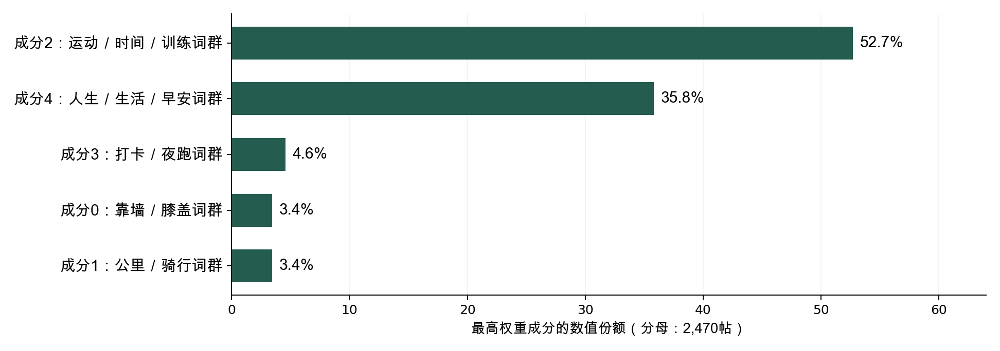

# Keep社区中的字面表达与互动反馈

**老师意见修订版｜2026年10月29日**

**摘要**

这批Keep数据里，文字与点赞的关系会随比较范围改变。积极表达词命中组的原始平均点赞为57.29，未命中组为35.76；控制作者、日期和已记录情境后，估计方向转为负向。进一步区分正文是否真正可观察，五项字面特征的联合检验p从全样本的0.130，变为原始正文可见样本的0.067和清理后非空正文样本的0.040。这意味着，现有数据既不能支持固定文案稳定增赞，也不能把一种样本口径下的不显著概括为文字普遍没有关联。

内容分类需要比原先更谨慎地解释。三类词汇和问号只识别局部字面线索；5,414条非空正文中，71.9%未命中这些规则。原来提取的五个NMF成分仅覆盖2,470帖，且语义抽查和删重对照表明，成分名称、重复模板和作者产量都会影响“这批帖子主要谈什么”的判断。因此，本报告将五成分保留为探索性用词结构，不再将其份额直接解释为五类真实内容的完整分布。

评论结果呈现另一种较具体的反馈形式：4,902次明确回复中，89.0%由帖主发给其他用户；接收量相近的账号，可能分别来自53人或1,091人。评论的次数、参与人数和留言是否得到回应，需要分开理解。评论与网络两章沿用上一版数据结果，本轮修订不构成对该部分的重新全面审查。

本版把新证据整合进研究范围、变量定义、结果和结论。原M3与原五成分模型保留作历史对照；本轮补充分析均按探索性结果报告，不依据p值挑选最终模型，也不将候选语义编码规则冒充已经完成验证的新分类。

## 1. 研究背景、意义与研究问题

### 1.1 为什么研究健身社区中的表达与互动

健身社区既是用户记录运动的空间，也是分享感受、交流经验和获得同伴反馈的场所。点赞是平台内最容易观察的反馈信号，评论则记录了用户之间如何交谈、谁在回应谁。对创作者来说，了解什么样的分享更容易获得反馈，有助于判断内容投入的方向；对平台来说，了解互动如何分配，有助于发现容易被忽视的用户，并评估是否需要设计新的互动支持。

不过，点赞并不只取决于文字怎么写。作者原有的受众规模、图片或视频等内容形式、平台提供的曝光机会，都可能同时影响一条帖子能获得多少点赞。因此，仅比较“用了某类词的帖子与没用的帖子” 容易把作者差异误当成表达差异，需要在控制作者与内容情境之后再看文字表达的关联。

已有研究提示，社区参与和行为结果应当分别衡量。Richardson 等（2010）的随机对照试验发现，为在线健走项目增加社区功能有助于降低项目流失，但各组之间步数增幅并无显著差异。[1] 据此，本报告只讨论平台内部可以观察到的反馈与互动，不把结论延伸到运动坚持、身体健康或用户留存。

### 1.2 研究问题

| 编号 | 研究问题 | 主要方法 | 对应章节 |
| --- | --- | --- | --- |
| RQ1 | 样本中的帖子、内容形式和点赞如何分布？数据覆盖有哪些边界？ | 数据核查、描述统计 | 第3 章 |
| RQ2 | 在正文实际可观察的帖子中，指定字面线索与点赞有何条件关联？探索性用词成分能补充什么信息、受到哪些覆盖限制？ | 字面编码、作者和日期固定效应、正文口径及标签对照、NMF成分与分类诊断 | 第4—5章 |
| RQ3 | 评论说了什么、谁在回应谁、互动集中在哪些账号？ | 评论文本字面统计、直接回复配对、有向加权网络 | 第6—7 章 |

### 1.3 研究预期与分析定位

目标行动用词、面向他人的称呼、积极感受用词和问号，分别提供了不同的可观察表达线索。它们值得比较，是因为读者可能在运动记录、交流邀请或日常感受中遇到这些表达；这里不把词汇命中视为作者的真实人格、情绪或行为意图。

原分析使用固定词表及全样本M3模型，并固定提取五个NMF成分。本轮针对老师提出的分类理由、共线性、非互斥、少帖作者和话题标签问题补充核查。新增的正文口径、标签控制及成分诊断都在原结果之后开展，属于探索性重分析。修订后的文字问题限定于能够观察到正文的帖子；全样本模型保留为历史对照，不因为某个结果更显著就更换原分析记录。

## 2. 数据来源、清洗与分析方法

### 2.1 先区分没有记录到正文、清理后为空和正文可分析

研究使用课程提供的帖子表、评论表和字段说明。9,532帖来自100位作者，帖子实际发表于2020年11—12月（UTC）；转换为北京时间后末端跨至2021年1月1日。去重后的11,595条评论最晚延续至2021年8月26日。文件名中的“2022”不代表观测年份。

| 核查项 | 发现 | 处理与解释 |
| --- | --- | --- |
| 帖子与评论主键 | 帖子ID唯一；评论有1,916行相同ID重复且无字段冲突 | 评论按ID去重，保留11,595条 |
| 原始正文 | 5,548帖有可见字符，3,984帖没有可用正文 | 未观察到正文不能视为确实没有内容 |
| 清理后正文 | 5,414帖仍非空，134帖原始可见但清理后为空 | 修订文字比较明确使用非空清理正文；同时保留其他口径对照 |
| 主题拟合与归类 | 2,478条达到拟合条件，8条贡献接近零，最终2,470帖 | 未入模帖保持未分配，不能编码为“五个主题均不存在” |
| 评论关联 | 所有去重评论均可关联到帖子，仅1,323帖采到评论 | 其余帖子的评论覆盖未知，不作全样本评论数回归 |
| 点赞与浏览 | 8,286帖点赞数高于记录浏览数 | 不计算点赞率，使用累计点赞并保留观察时长限制 |
| 时间与极端值 | 模型时间统一为北京时间，点赞有长尾 | 保留原始累计点赞，另列极端值敏感性分析 |

正文清理依次还原转义换行、移除URL、成对的课程分享后缀、方括号表情并统一空白，不把独立hashTags字段拼进正文。原全样本模型将未观察正文的文本值设0并加入正文可见标记，这只能区分记录状态和平均水平，不能恢复真实缺失内容或自动校正非随机缺失。

### 2.2 三类词汇加问号，观察的是不同表达线索

正文长度取ln(1+清理后非空白字符数)。另外四项均按字面规则编码：命中任一词或标点记1，重复出现不累加；同一帖子可以同时命中多项。它们不构成互斥内容类别。

| 线索 | 分类理由与例子 | 解释边界 |
| --- | --- | --- |
| 自律／目标词命中 | 目标与行动表述；坚持、目标、打卡、完成 | 加油也可能用于鼓励他人；命中不等于作者具有自律人格或真实完成训练。 |
| 社交称呼／互助词命中 | 面向他人的称呼与互动邀请；大家、一起、谢谢、请教 | 感谢可能同时带有积极含义；命中不等于已发生互助，也不代表关系强度。 |
| 积极表达词命中 | 积极感受与赞许的表面用词；开心、快乐、喜欢、棒 | 未处理否定、反讽和子串歧义；命中不是经过验证的情绪或情感判断。 |
| 问号出现 | 句式标点线索；?、？ | 反问、修辞问句也会命中，未使用问号的提问会漏判；不等于求助意图。 |

自律词侧重目标与行动的表述；社交词侧重称呼、感谢和交流邀请；积极词侧重表面感受与赞许；问号只是句式标点。这些选择使规则可复查，但并不证明它们是四个独立心理维度。一个“谢谢”可能兼具积极含义，“加油”既可能指自我坚持，也可能在鼓励别人；这种语义交叉需要与数值共线性分别检查。

辅助控制保留原始正文可见状态、是否有原始话题标签、表情数量、课程分享标记、媒体形式、业务类型与发帖时段。原始tag是作者选择的元数据，五个NMF成分是模型提取的词群，后续候选人工主题则需要独立语义标注，三者不能混为一类“标签”。

### 2.3 固定效应与检验沿用统一口径，比较范围单独列明

因变量为ln(1+点赞数)。原M3同时包含五项字面特征、已记录控制项、作者固定效应和北京时间发帖日期固定效应。作者固定效应扣除作者间不随帖子变化的差别；日期固定效应扣除同一天共有的差别。标准误按各模型实际包含的作者聚类，并使用有限样本修正及t／F推断。各模型的样本数和作者数分别报告，不将全样本的100位作者套到子样本。

五项核心字面系数在每个设定内用Benjamini–Hochberg方法作BH校正[6]，并作联合检验。原M3、原始正文可见模型和非空清理正文模型并列展示，避免只选择一个显著或不显著的口径。其他诊断包括正文覆盖、完整设计矩阵VIF、剔除少帖作者、标签身份控制、正文与标签拼接、极端值、作者等权、PPML及逐作者剔除。不同模型的BH家族没有合并为一次覆盖全部探索性比较的校正。

### 2.4 用词成分、主导成分与二元多标签分开处理

对至少含3个有效词的正文构建TF-IDF矩阵[4]，再以NMF提取五个用词成分[3]。原始词群名称来自关键词和正文抽查，不使用点赞。成分贡献经尺度校正并逐帖归一化，得到五项范围为0到1、合计为1的连续权重；它们不是五个0／1虚拟变量。每帖权重最大的成分只用于原描述图的互斥统计，回归仍使用连续权重。

为核对非互斥编码，另从冻结权重构建0／1多标记：某成分权重至少0.20时记1，允许同帖有多项；并用0.15与0.25作敏感性对照。阈值是本轮提出的便捷诊断，未经过语义验证。分类质量另外检查覆盖、60条分层已分配帖及20条未入模正文的单轮AI辅助语义筛查、完全重复正文去重、K=3—8和作者等权拟合目标。模型可复现或数值满秩，均不能替代标签语义验证。

评论文本、直接回复配对和有向加权网络的方法沿用上一版：根评论指向帖主，明确回复指向被回复账号，多次同向事件合并为边权。评论发生于发帖之后，不作为发帖前特征放入点赞回归。第6—7章及相关图表保留原有结果，本轮未对其进行新的完整方法复审。

## 3. 这批数据如何影响内容与评论的比较

本报告关心两个问题：文字表达与点赞差异怎样联系，评论中的交流具体如何发生。本章回应RQ1，说明这批数据的覆盖与分布，为第4—5 章的文字比较和第6—7章的评论分析确定比较范围。

### 3.1 正文覆盖随内容形式变化，评论记录集中在部分帖子

文字记录的覆盖随内容形式和作者而变化。9,532 帖中，5,548 帖有可见正文，3,984 帖无可用正文；清理后仍非空的正文为5,414 条。图片帖的正文覆盖率为76.0%，视频帖为89.1%，纯文字帖为100.0%，无媒体帖仅为0.1%。100 位作者中，5 位完全没有可用正文，26 位每帖都有正文，正文覆盖率中位数为84.3%。文本分析因此主要呈现正文较充分的内容形式与作者的表达。

图1 　不同内容形式的正文覆盖率，以及100 位作者的发帖数与正文覆盖率。覆盖按原始正文是否存在可见字符界定。

原M3以全部帖子为历史比较范围，修订后的字面分析同时列出原始正文可见与清理后非空的样本。NMF最终只有2,470帖获得可用权重，占全样本25.9%、非空正文45.6%；另有2,944条非空正文未进入该主题表。未入模不等于没有主题，正文缺失也不等于图片和视频没有内容。图片文字和视频语音尚未观察，不能用现有文字类目补齐。

图S1　全样本按正文与原主题模型的覆盖状态划分，三类互斥，合计9,532帖。它显示分析能看到哪些记录，不是五类之外的语义比例。

评论数据覆盖的是已采集到的互动。原始13,511 行按评论ID 去重，删除1,916 行无字段冲突的重复记录后，剩下11,595 条，全部能够关联到帖子，分布在1,323 帖下；其余帖子的评论情况记为覆盖未知。不同ID 下的相同短句仍然保留，以记录不同账号或时点实际发生的发言。

按实际时间字段，帖子发表于2020 年11—12 月（UTC）；转换成北京时间后，末端少量帖子跨至2021 年1 月1 日。评论最晚延续至2021 年8 月26 日。分析范围为课程提供的这批历史样本，抽样机制和统一采集时点未提供，全文据此讨论样本中的内容与互动。

### 3.2 点赞分布有长尾，作者发帖量也不均衡

样本包含100 位作者的9,532 条帖子。平均每帖获得37.05 个赞，中位数为25，最高一帖达到5,126，零点赞占3.8%。均值高于中位数，反映少量高反馈帖子将平均水平向上拉；中位数则更贴近分布中间的帖子。作者发帖数中位数为66，最多一位发布783帖，高产作者的内容习惯因而会在按帖统计的结果中出现更多次。

图2 　全部9,532 帖的点赞分布与北京时间逐日发帖数。首末本地日期的观察时长均不足完整一天。

不同内容形式的反馈差别也很大。图片和视频帖的平均点赞分别为51.03 和48.05，纯文字帖为7.94，无媒体帖为3.91；中位数保留了相同的排序。读者实际看到的是，不同形式的帖子处在很不一样的反馈水平上。因此，讨论文字表达之前，必须把媒体形式及其对应的作者和内容情境纳入比较。

图3 　按原始内容形式字段划分的帖子数、平均点赞与点赞中位数；内容形式与有无可用正文分别统计。

媒体形式对应着不同的累计点赞水平，后续文字比较据此同时控制媒体形式、作者和帖子情境。但样本中8,286 帖的点赞大于记录浏览数，两个字段的统计口径存在差异。完整媒体分组数值见附录A。

## 4. 字面表达的关联对正文可观测范围敏感

### 4.1 原始均值有差异，但词典只能覆盖部分表达

以下原始均值沿用历史9,532帖的编码比较，“未命中”组包含没有观察到正文的记录，不能视为已经确认这些帖子不使用相应用词。未调整时，四项字面线索的命中组平均点赞均较高：自律／目标词63.67对34.36，社交／互助词89.96对36.16，积极表达词57.29对35.76，问号111.15对36.07。两组的作者、媒体和发帖情境并不相同，这些均值描述的是组别构成与反馈的共同差别，不能直接解释为措辞效果。

图4　指定字面特征的命中数与高频词。它们可重叠，词频以含该词的帖子数计，每帖至多一次。

| 字面线索 | 命中帖数 | 全部帖子占比 | 有作者内变化的作者数 | 完整原M3 VIF |
| --- | --- | --- | --- | --- |
| 自律／目标词命中 | 877 | 9.2% | 76 | 1.750 |
| 社交称呼／互助词命中 | 159 | 1.7% | 42 | 1.149 |
| 积极表达词命中 | 574 | 6.0% | 64 | 1.186 |
| 问号出现 | 125 | 1.3% | 32 | 1.112 |

非空清理正文中，只有1,523帖命中至少一项，3,891帖没有命中任何规则，占71.9%。全样本未命中数为8,009，其中包含未观察到正文的记录。这不是“多数帖子没有表达”，而是说明指定词表只捕捉了局部线索。RQ2的结论因而必须限定为这些规则的关联，不能概括全部内容的作用。

四项全样本最大两两φ相关为0.119，作者内最大相关为0.085；完整M3的四项VIF为1.11—1.75，设计矩阵9,532×182且满秩。182帖同时命中至少两项。现有数值未呈现明显共线性，不支持仅因担心重复而合并规则；低VIF也不能证明语义独立或量表有效。[10]

### 4.2 原M3的估计可复算，但不能替代可观测正文中的比较

原全样本M3中，积极表达系数为−0.086，原始95%区间为[−0.155, −0.016]，原始p=0.016；对五项同时作BH校正后q=0.079。五项联合p=0.130，新增R²为0.065个百分点。这些是原设定下可以复算的结果。

图5　原全样本M3的系数与原始95%作者聚类区间，N=9,532、100位作者；非空正文结果另列下表。

原始算术均值与模型的对数条件关联也不在同一尺度，不能将方向差别单独归因于作者固定效应或某一个控制项。把研究对象限定为正文实际可见的帖子后，比较范围发生了变化。原始正文可见的5,548帖仍包含134条清理后为空的记录；非空清理正文为5,414帖。三个口径的结果并列如下：

| 正文口径 | 帖数／作者数 | 五项联合p | 长度BH q | 积极表达BH q |
| --- | --- | --- | --- | --- |
| 原全样本＋缺失标记 | 9,532／100 | 0.130 | 0.293 | 0.079 |
| 原始正文可见 | 5,548／95 | 0.067 | 0.106 | 0.093 |
| 清理后正文非空 | 5,414／95 | 0.040 | 0.048 | 0.048 |

在非空正文模型中，长度系数为0.046、积极表达系数为−0.089，两项在该模型内的BH q均约0.048，整组p约0.040。不能因此挑选这个模型来宣布稳定效果，也不能继续把全样本p=0.130概括为所有正文处理都没有关联。该重分析是在原结果之后开展，且没有对所有探索性模型统一校正；结果靠近阈值，仍受到正文可观察范围的选择限制。

修订后的问题明确聚焦“可观察的正文中的指定线索”。选择这个范围的理由是变量确实能够被测量，不是它的p值更小。原全样本模型作为历史对照保留。两者都缺少实际曝光、完整媒体内容和统一累计观察时长，不能识别词汇的因果作用。

### 4.3 少帖作者没有主导原字面结果，稀少特征的支持仍有限

全样本100位作者的发帖数最少1、中位数66、最多783。2位作者只发1帖；不超过10帖的14位作者合计80帖，占0.84%。单帖作者没有作者内变化，不为共同斜率提供这种信息，但少帖存在本身不使固定效应整体失效。

分别剔除发帖少于5帖或10帖的作者，原字面模型得到以下结果：

| 保留规则 | 帖数／作者数 | 五项联合p | 积极表达β／BH q |
| --- | --- | --- | --- |
| 原全样本 | 9,532／100 | 0.130 | −0.086／0.079 |
| 每位作者至少5帖 | 9,524／95 | 0.131 | −0.086／0.080 |
| 每位作者至少10帖 | 9,462／87 | 0.130 | −0.085／0.095 |

这些门槛没有实质改变原M3的统计判断，提示少帖作者不是这项结果的主要来源。不过，长度在93位作者内有变化，社交词只有42位、问号只有32位；不能把100个作者理解为每个特征都有100个充分的变化来源。固定效应也不能排除同一作者随帖变化的曝光和内容差别。

### 4.4 原始话题标签值得控制，但拼进正文会改变测量

5,209帖有原始tag，占54.6%，共269种；其中1,517帖没有原始正文。原M3已经控制“有无标签”，并非没有考虑tag，但没有控制具体标签身份。

本轮只依据频数与作者覆盖，选择至少30帖、至少5位作者使用的9个tag身份作为补充控制，并保留原正文编码。另把正文与tag拼接后重编码，作为测量范围变化的对照：

| 设定 | 五项联合p | 积极表达β／BH q | 实际比较 |
| --- | --- | --- | --- |
| 原M3 | 0.130 | −0.086／0.079 | 正文线索，已有has_tag |
| 加9个tag身份控制 | 0.102 | −0.083／0.088 | 正文范围不变，调整常见标签差别 |
| 正文＋tag重编码 | 0.173 | −0.070／0.167 | 被测文字范围改变 |

拼接后，自律词命中从877增到3,342帖，问号从125增到354帖。统一的“坚持 Keep 的那些天”或带问号的活动标题可以机械地增加命中，不能等同为作者在正文中表现了更强自律或提出了问题。原始tag本身也不保证与正文主题一致，因此用作并行元数据和敏感性对照，不作为语义标签的标准答案。

9个常见tag是控制项，不是新的九类内容。没有进一步加入标签数量，是因为5,207帖只有一个tag，仅2帖有两个；在有无tag之外加数量，额外变化几乎只来自这两帖。

### 4.5 方向相近，不等于所有统计判断都稳定

原有的可见正文、去除最高1%点赞、作者等权和逐作者剔除分析中，积极表达的点估计方向较一致；100次逐作者剔除均为负，范围为[−0.100, −0.074]。PPML计数模型也给出负向点估计，但原始区间跨零。

图6　沿用原分析的三类词汇系数与原始95%作者聚类区间。原“仅可见正文”是5,548帖口径，不含本轮新增的5,414帖模型；不同尺度不能直接比较系数幅度。

图7　原全样本设定中逐一剔除作者后的系数分布。这项检查处理单个作者影响，不处理语义效度或正文非随机缺失。

因此，本章保留的判断是：积极词的负向点估计在若干处理下相近，但整组证据与多重检验结论会随正文口径改变。数据提供的是受测量、样本和已记录控制条件限制的关联，不能据此建议通过减少积极表达来提高点赞。

## 5. 五个用词成分不能直接当作完整内容分类

### 5.1 模型捕捉到反复出现的词群，覆盖边界仍然明显

原NMF最终使用2,470帖、86位作者。各成分的最高权重份额如下；为避免将模型结果误读为经过验证的五类内容，新图使用中性的成分编号与关键词。

图8　原冻结模型中最高权重成分的数值份额。每帖取一个最大权重用于描述，比例不是人工语义分类的精度或覆盖率；回归使用连续权重。

原名称分别为静蹲、骑行、运动训练交流、跑步打卡、生活感悟问候。其中有具体运动项目、上位内容域，也有表达功能，层级并不一致。52.7%与35.8%只能保留为原成分2和成分4的主导份额，不能直接认定为这些比例的帖子在语义上确实属于两个真实类别。

五类覆盖完整性的疑问有依据，但不能把2,944条未入模正文直接当作五类之外的帖子。未入模部分既有被词数门槛排除的明确运动或问候短句，也有饮食、装备等遗漏领域和信息不足的记录。

### 5.2 语义筛查发现具体错配，不能据此估计全样本错误率

本轮固定随机种子，对每个原主导成分抽12帖，共60帖，另抽20条未入模的非空正文；抽样不使用点赞。单轮AI辅助筛查发现，60条中40条明确支持原名称、6条只部分支持、12条不支持被分配的名称、2条信息不足。

例如，山河保护人的感悟、囤口罩提醒被分到静蹲；餐食配菜和食品品牌推荐被分到运动训练交流；绘画进展、出行和学期结束感受被分到跑步打卡。高归一化权重不能排除这种错配，因为它只给出几个成分之间的相对份额，不是类别正确的概率。[11]

各成分等额抽取使小成分被有意放大，不能用60条的未经加权比例推断全样本错误率。“不支持分配到的名称”也不等于不属于其余四类。本轮没有双人独立人工标注，不能声称已证明多数帖子都在五类之外。

### 5.3 事后给作者等权，不能消除拟合阶段的模板影响

原静蹲成分的85条主导文档中，78条来自一位作者；骑行成分的85条中，58条来自一位作者。沿用旧成分标签再计算作者平均份额，静蹲由3.4%降至0.6%，骑行由3.4%变为2.9%。这些数值说明产量与作者平均构成不同，但没有重新估计词群，因而不能证明分类已摆脱作者习惯。

2,478条拟合正文里有2,374种不同清理文本，104条为完全重复行。保持同一TF-IDF词表及IDF，删除完全重复正文后，原来独立的静蹲成分不再单列，相关词进入更宽的打卡成分；另出现包含三明治、咖啡、鸡蛋、早餐等词的成分。将拟合目标调整为作者等权时，词群结构也变化。作者等权诊断仍保留原始IDF，不是完整解决作者偏重的新文本管线。

K=3、4、6、7、8的对照与上述结果一起保留，未根据点赞、显著性或单纯拟合误差挑选新K。旧三次随机种子产生相近关键词，只证明同一设定容易复现；它不能代替语义、删重或作者构成稳健性。新出现的词群同样尚未完成语义验证。

### 5.4 连续权重可共存；二元多标记是另一种编码

原模型每帖有五项连续权重，合计为1，可以同时为正。带截距时省去成分2，是避免五项权重和为1带来的完全共线；省略不意味着语义互斥。回归系数表示其他权重和控制不变时，某一权重替代成分2权重的条件差异。

权重≥0.20的补充二元编码中，1,088帖有至少两个标记，成分2与成分4同时出现894帖。各标记比例合计145.9%，不能画成互斥饼图。五个标记同时进入回归时，设计矩阵171／171满秩，不能因存在五个变量就机械删除其中一个。

| 权重阈值 | 至少两个标记的帖数 | 五标记联合p | 最小BH q |
| --- | --- | --- | --- |
| 0.15 | 1,331 | 0.289 | 0.205 |
| 0.20 | 1,088 | 0.286 | 0.296 |
| 0.25 | 835 | 0.517 | 0.479 |

0.20取自1／5，只是便捷诊断；0.15与0.25用于观察阈值敏感性，并非语义金标准。三个阈值下都没有观测到“五项全零”组，二元系数不是相对于真实无主题组的差异。每个模型内五项BH也不覆盖整个阈值探索家族。给旧成分增加多标记没有修好其名称和覆盖问题，不能据此宣布已经获得新的真实主题回归。

### 5.5 成分回归仍是探索性关联，作者支持应在子样本内核算

原连续成分模型的联合p=0.166，四项BH校正后均未达到5%。成分4的原始p=0.035、BH q=0.107，不能据此给真实内容类型作稳定反馈排序。区间以冻结成分为给定输入，未纳入NMF估计与阈值选择的不确定性。

主题子样本有10位单帖作者，作者发帖数中位数为14；40位不超过10帖，合计181帖。不能用全样本只有2位单帖作者来替这个子模型保证支持充分。

| 主题子样本内最低发帖数 | 保留帖数／作者数 | 原连续成分联合p |
| --- | --- | --- |
| 1 | 2,470／86 | 0.166 |
| 2 | 2,460／76 | 0.166 |
| 5 | 2,423／64 | 0.179 |
| 10 | 2,309／48 | 0.266 |

剔除少帖作者没有带来明确整组证据，但保留至少10条主题入模帖时只剩48位作者。它检查的是估计支持，并不修复成分的语义效度。也没有开展“积极表达×主题”的交互或分层检验，因此不能把积极词的关联反转归因于生活问候帖。

### 5.6 新的内容框架先统一分类轴，再做独立验证

候选一级内容域只回答“谈什么”，运动项目放到子层；“怎么表达”另列记录、经验建议、求助、问候或推荐等目的。帖文允许多标记，并分别保留其他可辨识内容、信息不足和无可用正文。

| 候选内容域 | 拟覆盖的内容 |
| --- | --- |
| 运动与训练 | 训练、课程、运动过程、成绩与方法 |
| 饮食与营养 | 餐食、食谱、营养补充、食物推荐 |
| 身体状态、健康与恢复 | 疼痛、疾病、疲劳、康复和体重状态 |
| 日常生活与兴趣 | 工作学习、家庭、旅行、绘画、节日、生活感悟与问候 |
| 装备与产品体验 | 手环、鞋服、运动器材等体验或推荐 |
| 平台功能与社区活动 | 加入圈子、平台挑战、功能或服务体验 |
| 其他可辨识主题 | 正文语义可判断但目前类别无法表达的内容 |

这份框架尚未用于生成全样本新标签，也不是新增一组已验证回归结果。下一步需两名同学独立标注覆盖作者、媒体、已入模和未入模帖的样本，讨论分歧后冻结边界，再用未参与修改的样本核查覆盖、各类一致性和“其他”占比。没有足够正文时保持未知，不仅凭原始tag补出主题；类数与边界也不由点赞或p值决定。

## 6. 鼓励与感谢有角色分工，回应覆盖另有差别

### 6.1 大量评论很短，词频背后的参与面差别很大

这批评论以简短发言为主要形式。清理后的字符数中位数为6，75 分位数为10；1,373 条评论只留下标记或符号，占11.8%。加上后文常见的“加油” “谢谢” 等词，可以看到评论中存在大量简短的赞许、感谢和招呼，交流经常通过少量文字完成。

图9 　以11,595 条去重评论为分母展示常见词的出现占比。每条评论内同一词至多计一次，词语至少覆盖5 位发言用户，各词可共同出现。

“加油” 出现在612 条评论中，覆盖431 位用户；“谢谢” 出现在359 条评论中，覆盖53 位用户。前者在更多不同参与者之间出现，后者则更集中地由较少发言者反复使用。两种高频词由此呈现了不同的参与面：一种使用更广，一种在使用者内部出现得更频繁。

3,362 条评论具有重复的标准化文本。连同评论长度和常见词分布看，这份样本有一部分交流反复采用相同的简短表达。发言次数记录这些表达出现的份量，去重用户数则补充说明它们由多广的参与者使用；两者合在一起，才能看清短句交流的规模与分布。

### 6.2 其他用户更常表达赞许，帖主更常回应感谢

把发言者按“是不是这条帖子的作者” 分开后，语言差异具有清楚的角色对应。其他用户发言中，鼓励或赞许词命中率为16.9%，帖主为4.5%；感谢词则相反，其他用户为0.6%，帖主为7.9%。这与一种可理解的交流方式相容：其他用户给帖主留言，帖主在回话中表达感谢。

图10 　按发言者是否为所属帖子的作者分组，比较四类字面线索。分母为各角色全部已采集评论，各项可以重叠。

| 字面线索 | 全部评论命中数 | 全部评论占比 | 其他用户命中率 | 帖主命中率 |
| --- | --- | --- | --- | --- |
| 鼓励或赞许词 | 1,413 | 12.2% | 16.9% | 4.5% |
| 感谢词 | 389 | 3.4% | 0.6% | 7.9% |
| 问候词 | 551 | 4.8% | 4.4% | 5.4% |
| 问号 | 427 | 3.7% | 4.1% | 2.9% |

其他用户发言7,192 条，帖主发言4,403 条；评论内容统计包括根评论、回复及84 次自我互动。

同一个人在自己的帖子下是帖主，到别人的帖子下又成为其他用户。按每条发言所在的帖子划分角色，赞许更多出现在外来留言中，感谢更多出现在帖主发言中，显示两种表达在交流中占据不同位置。感谢词类还包括“感谢” “多谢” 等，因此其计数大于单独统计“谢谢” 的词项频数。

### 6.3 鼓励性留言的回复更常含感谢，但其观测到的直接回复覆盖较低

为观察具体的前后承接，补充分析从6,609 条其他用户发给帖主的根评论出发，查找帖主在该评论后7 天内、明确指向该条评论及其作者的回复。每条根评论只取最早观测到的符合条件的回复，最终有3,568 条根评论观察到这样的回应。

| 根评论的文字线索 | 根评论数 | 涉及帖主数 | 观察到7 天内直接回复 | 已回复记录中，最早回复含感谢词 |
| --- | --- | --- | --- | --- |
| 命中鼓励或赞许词 | 1,180 | 54 | 513（43.5%） | 137（26.7%） |
| 未命中鼓励或赞许词 | 5,429 | 77 | 3,055（56.3%） | 195（6.4%） |

直接回复比例以各组全部根评论为分母；最后一列比例只以已观察到直接回复的根评论为分母。同一帖主可出现在两组。

在已经观察到直接回复的留言中，含鼓励或赞许词的组别中，最早回复含感谢词的比例为26.7%，高于另一组的6.4%。这让前一节的语言角色分工具有了部分明确的前后对应：确实有一部分赞许留言随后接到了带感谢词的帖主回复。若把分母扩展到各组全部根评论，这种“最早观测回复含感谢词” 的比例分别为11.6% 和3.6%。

另一方面，鼓励词命中组有43.5% 观察到直接回复，另一组为56.3%。因此，这组留言呈现出“已回复内容中感谢较常见、全部留言中观测直接回复覆盖较低” 的组合。回应内容与覆盖在同一批留言中走向不同，展示了交流的两个侧面：回话如何表达，以及哪些留言被接住。

这些比例描述两组已采集留言的分布，涉及的帖主和具体情境各有差别。感谢表达较集中的回复，体现了部分赞许留言得到怎样的承接；根评论层面的回复覆盖，则呈现这种承接在整组留言中的范围。七天追踪的采集条件与直接匹配规则见附录A。

## 7. 评论区围绕帖主往来，互动量与人数需分看

### 7.1 评论指向和重复次数，构成用户间的关系网络

图11 中的每个点是一位用户账号。线从评论发送者指向接收者：根评论按归属指向帖主，明确回复指向记录中的被回复用户。同一发送者向同一接收者评论多次，合并成一条有向边，次数累加为权重。十次同方向留言在图中对应一条权重为十的边，记录的是这对账号之间累计发生的事件。

排除84 次自我互动后，11,511 次评论事件合并为4,069 条有向边，涉及2,932 个有边账号。节点同时包含发送者和接收者，文本统计中的2,910 位发言者则只计算实际发出评论的用户。网络由此把每次发言放回到它所指向的对象上，呈现谁向谁留言或回话。

为回答不同问题，原有分析实际用了三种网络范围。

| 网络范围 | 节点与边 | 权重与所含事件 | 它主要帮助理解什么 |
| --- | --- | --- | --- |
| 全部已采集互动 | 2,932 个账号、4,069 条有向边 | 同方向事件次数为权重；包括6,609 次根评论及4,902 次明确回复 | 留言与回话合在一起，向谁集中 |
| 仅明确回复 | 1,074 个账号、1,271 条有向边 | 同方向重复回复合并为边；既有互惠统计不赋权、不计重复次数 | 去掉根评论归属后，明确回复关系是否双向存在 |
| 发帖后7 天内 | 1,376 个账号、2,278 条有向边 | 同方向事件次数为权重；包括该窗口内的根评论和明确回复 | 限定发帖后首周，结构描述如何变化 |

三类网络都排除自我互动，方向均为发送者指向接收者；首周网络来自全部已采集事件的时间截取。

图11 　全部2,932 个有边节点与4,069 条有向边。为便于阅读，图中省略箭头；金色为样本帖子作者，蓝色为其他参与者，节点大小按接收事件数的对数缩放，仅标注前5 位接收者。位置按网络布局排列。

### 7.2 大多数账号可以间接连起来，实际回话却主要由帖主承担

忽略线的方向后，网络分为35 个互不相连的部分，其中最大部分包含2,768 个账号，占有边账号的94.4%。网络密度为0.0473%，即全部可能的有向账号配对中，实际出现直接连接的比例很小。这两项结果合起来呈现了一种“间接联系广、直接联系稀疏” 的结构：大多数账号能够通过已有连接串在一起，日常评论则发生在有限的账号关系中。

评论角色进一步说明这个结构里发生了什么。在4,902 次明确回复中，帖主回复其他用户4,361 次，占89.0%；其他用户回复帖主444 次，占9.1%；其他用户彼此回复97 次，占2.0%。采集到的明确回话，大部分是帖主在承接留言，其他参与者相互接话的事件份额很小。而根评论按规则指向帖主，因此结合根评论与明确回复，可以确定评论区围绕帖主展开的清晰特征。

评论区的活动主要由面向帖主的留言与帖主回话构成，其他用户彼此交流则是其中较少的一部分。同一条帖子下，多人留言形成了参与的广度，帖主持续回复形成了来回承接；这两种活动共同解释了样本中评论量的主要来源。横向回复的97 次事件，则记录了帖主之外参与者直接接话的部分。

### 7.3 同样接收很多评论，可能是接触面广，也可能是少数人反复往来

前10 位账号接收了54.0% 的非自我评论事件，样本帖子作者接收了61.3%。评论去向集中在部分账号上；进一步对照接收次数与发送者人数，可以看清这些接收量是怎样积累起来的。

图12 　接收事件前10 位与累计接收分布。按接收事件次数排序，分母为11,511 次非自我事件，同一用户的多次事件分别计数。

现有匿名节点表提供了一个很直观的比较。U1528 收到1,378 次互动，发送者有53 位；U0948 收到1,275 次，发送者却有1,091 位。前者的接收量更多包含已有发送者的重复发言，后者的发送者覆盖面更广。不属于样本帖子作者的U0112 也收到180 次互动，但只来自4 位发送者，说明较高接收量还可能出现在很有限的账号往来中。

| 匿名账号 | 是否为样本帖子作者 | 接收事件次数 | 不同发送者人数 | 记录中更突出的特征 |
| --- | --- | --- | --- | --- |
| U1528 | 是 | 1,378 | 53 | 相对于人数，重复发来的事件较多 |
| U0948 | 是 | 1,275 | 1,091 | 与相近接收量相比，涉及更多不同发送者 |
| U0112 | 否 | 180 | 4 | 接收事件集中来自很少几位发送者 |

接收事件数为加权入度，不同发送者数为入度；统计同时包含根评论和明确回复。

多少个不同账号向其发来评论（入度），反映接收关系的范围；累计收到多少次评论（加权入度），反映事件量。将这两个中心性指标联系起来，U0948 突出的是较广的发送者覆盖，U1528 突出的是已有发送者的多次发言。两者在网络中承担的接收形态因此有所不同。

### 7.4 双向往来体现留言与回话，首周关系较为互惠

全部互动网络的互惠率为49.6%，表示近一半有向连接同时存在反方向的连接。例如，用户给帖主留言，帖主又回话给该用户，这对账号便形成双向连接。指标按账号之间是否存在双向关系计量[8]，每条连接贡献相同权重，概括了关系层面的往来。

只保留明确回复后，互惠率为29.9%。整体网络中，用户的根评论与帖主的回复可以组成一对双向连接；限定为明确回复后，其中一部分关系保留的是帖主发出的回话。两项互惠率的差异，使“留言加回话” 这一主要往来形式在结构上更加清楚。

图13 　已采集评论距发帖的时间分布，以及4,902 次非自我明确回复的角色分布。时序比例以全部11,595 条去重评论为分母。

已采集评论中，64.5% 发生在发帖后24 小时内，82.2% 在7 天内，距发帖时间的中位数为11.3 小时，评论集中在发帖后的较早阶段。首周网络的互惠率为74.1%，前10 位接收占比为48.3%；全部记录对应为49.6% 和54.0%。首周记录呈现更多双向连接、较分散的事件接收；纳入较晚的账号和评论后，整体关系构成随之变化。

| 观察窗口 | 非自我事件数 | 有边账号数 | 有向边数 | 互惠率 | 前10 位接收占比 |
| --- | --- | --- | --- | --- | --- |
| 全部已采集互动 | 11,511 | 2,932 | 4,069 | 49.6% | 54.0% |
| 发帖后7 天内 | 9,451 | 1,376 | 2,278 | 74.1% | 48.3% |

互惠按边是否双向存在计量，接收占比按事件次数计量；每个窗口分别确定接收量前10 位账号。

在线程层面，6,609 个根评论线程中，57.0% 观察到帖主参与；在这些已参与线程里，最早观测到的帖主回复距根评论的中位时间为2.05 小时。这说明样本中相当一部分留言线程有帖主接话，且在已接话的线程里，回应时间的中位数约为两小时。互惠率描述账号关系的双向性，线程参与描述留言串里的承接，第六章的直接回复比例则定位到根评论本身；三种结果分别补充了交流过程的不同层面。

## 8. 对表达与互动的整体理解

### 8.1 先区分观测到了什么，再解释点赞差异

原始均值、原M3和非空正文模型并非同一个比较。前者混合不同作者、媒体与发布情境；固定效应模型扣除已记录条件后给出关联；正文口径又决定哪些帖子的文字确实可以被测量。积极词的点估计在几个模型中为负，但五项联合检验p值从0.130、0.067变化到0.040，表明观察范围会影响结论。

四项字面特征没有明显共线性，少帖作者也没有主导原M3结果，但这两项检查不能替代内容测量。词典未命中不等于没有相关语义，tag存在不等于正文主题已知，NMF高权重也不等于名称判断正确。把这些边界分开，才能避免给局部结果加上过宽的“内容效果”解释。

作者和日期控制能改善已记录条件下的比较，但R²上升并不能分解真实的因果贡献，也不能证明“谁发、用什么媒体”比措辞更决定点赞。当前没有实际曝光、统一累计时长和完整媒体内容，不能据此安排增赞策略的优先级。

### 8.2 评论的活跃，主要体现为围绕帖主的留言与回应

沿用的评论结果显示，其他用户更常出现赞许词，帖主更常出现感谢词；多数明确回复由帖主发给其他用户。直接配对把部分赞许留言与感谢回复联系起来，但它仍是已采集评论的描述，不能解释为鼓励留言造成更多回复。

评论总量、参与范围和回应覆盖可以彼此分离。接收事件量相近的U1528与U0948分别来自53人和1,091人；鼓励组在已回复内容中更常出现感谢，但根评论的观测直接回复比例更低。研究互动时，应同时看谁参与、向谁发言、往来了多少次及多少留言得到承接。

### 8.3 文字关联与评论结构尚未组成经验证的机制链条

现有分析分别描述字面线索与点赞关联、评论语言和回复网络。它没有检验特定文字引起何种回复、再由回复带来更多点赞，也没有验证积极词反转集中于某个内容主题。接下来的解释应从完整帖文、实际曝光与直接承接记录出发，而不是用一个负向成分系数替代机制检验。

## 9. 建议、局限与后续研究

### 9.1 当前能够采用的判断

数据足以描述样本内的长尾点赞、媒体组差别、字面规则的覆盖，以及已采集评论的角色和连接结构。字面关联则对正文可观察范围敏感，五个用词成分也尚不能代表完整真实内容分类。因此，本报告不推出固定关键词、减少积极措辞或选择某个主题能够稳定提高点赞。

对于内容创作者，当前结果改变的是比较方式：不能只看高赞帖常用什么词，就把作者、媒体与观察时长的差别当作措辞收益。对于研究者和平台运营者，应先提高内容与曝光记录的可比较性，再评估表达提示或互动干预。

### 9.2 可参考的工作方向

| 对象 | 下一步可做什么 | 证据依据与条件 |
| --- | --- | --- |
| 研究小组 | 冻结正文可观察范围，分开字面、原始tag与人工主题 | 本轮口径对照改变统计判断；不同表示不能混用 |
| 研究小组 | 对候选内容框架开展双人独立标注和留出验证 | 语义筛查发现错配，删重改变成分；当前尚无金标准 |
| 平台分析者 | 统一记录发帖后7天曝光、反馈和不同参与者数 | 现有累计点赞时长未知，事件数与参与人数含义不同 |
| 平台运营者 | 将内容或回复提示作为可检验干预，而非既定有效策略 | 观察性结果没有识别因果；实验方案见9.4 |

### 9.3 仍限制结论的条件

样本来自课程提供的100位作者，抽样机制未知，不能代表Keep全平台。正文缺失和主题入模都带来选择，缺失标记与仅正文分析均不能恢复未记录内容；图片文字和视频语音尚未观察。

三类词汇加问号不是经过验证的心理量表或语义分类器，原始tag也不是人工真值。五个NMF成分对模板和作者产量敏感，单轮AI筛查不能估计全样本分类精度。候选框架尚未完成独立人工验证。

正文口径、作者门槛、tag和阈值对照是在原结果后开展的探索；各模型内的BH不覆盖全部模型探索。固定效应与作者聚类不能解决实际曝光、粉丝随时间变化、媒体内容和累计时长的缺失。点赞不等于训练效果、自律程度或留存。

评论与网络结果来自已采集互动，不能把未采到回复视为实际没有回复。第6—7章与相关旧图本轮未全面重审，帖子模型的复核不代表这些部分已获得新的完整验证。

### 9.4 后续研究设计

先完成候选内容域与表达目的的独立标注和留出核查，再以冻结规则开展新的主题比较。需要公布各类覆盖、混淆与未知状态，保留饮食、健康、装备、平台和日常等真实出现的内容，不为提高覆盖而无限扩大生活类。

若获得平台实验权限，可按作者随机分组比较运动记录提示、面向伙伴的问题提示与常规发布，并统一7天观察窗口，记录实际曝光、独立互动用户数、后续发布和回复质量。样本量应在试点后按方差及最小有意义差异估算。这是尚未实施的后续设计，不是当前关联结果证明有效的做法。

### 9.5 结论

本研究保留可复算的字面与互动描述，同时收窄了内容结论。四项字面规则的共线性不突出、少帖作者不是原结果的主要来源；但文字关联随正文可观察范围变化，五个用词成分也尚不足以作为完整真实内容分类。评论部分则显示，在已采集记录中，回话主要围绕帖主，互动次数与参与人数反映不同面貌。现有证据适合提出更明确的测量和验证问题，不适合给关键词或主题作稳定的增赞排序。

## 附录A　模型口径与复现证据

### A.1 原全样本模型与非空正文模型的完整五项结果

以下原始区间是各单项95%作者聚类区间，BH q在每个模型内对五项校正。修订正文范围是5,414帖、95位作者；原M3是9,532帖、100位作者，作为历史基线保留。

| 模型 | 字面特征 | β | 聚类SE | 原始95%区间 | 原始p | BH q |
| --- | --- | --- | --- | --- | --- | --- |
| 原M3 | 正文长度 ln(1+字数) | 0.028 | 0.018 | [−0.008, 0.064] | 0.130 | 0.293 |
| 原M3 | 自律／目标词 | −0.119 | 0.087 | [−0.293, 0.054] | 0.176 | 0.293 |
| 原M3 | 社交／互助词 | −0.004 | 0.064 | [−0.131, 0.122] | 0.946 | 0.946 |
| 原M3 | 积极表达词 | −0.086 | 0.035 | [−0.155, −0.016] | 0.016 | 0.079 |
| 原M3 | 问号 | 0.108 | 0.105 | [−0.100, 0.316] | 0.307 | 0.383 |
| 非空正文 | 正文长度 ln(1+字数) | 0.046 | 0.018 | [0.011, 0.081] | 0.010 | 0.048 |
| 非空正文 | 自律／目标词 | −0.137 | 0.072 | [−0.281, 0.006] | 0.060 | 0.101 |
| 非空正文 | 社交／互助词 | 0.028 | 0.064 | [−0.099, 0.156] | 0.659 | 0.659 |
| 非空正文 | 积极表达词 | −0.089 | 0.037 | [−0.163, −0.015] | 0.019 | 0.048 |
| 非空正文 | 问号 | 0.096 | 0.099 | [−0.101, 0.292] | 0.338 | 0.422 |

### A.2 原有敏感性分析的保留范围

原有可见正文、最高1%剔除、作者等权与PPML结果仍在冻结结果表中，五项变量和控制项定义未改。原“仅可见正文”为5,548帖，不能与新增5,414帖混称。

| 补充设定 | 样本量 | 系数 | 原始95% 置信区间 | 原始p 值 |
| --- | --- | --- | --- | --- |
| 仅可见正文 | 5,548 | -0.090 | [-0.164, -0.015] | 0.019 |
| 去除点赞最高1% | 9,436 | -0.082 | [-0.152, -0.012] | 0.022 |
| 作者等权 | 9,532 | -0.128 | [-0.219, -0.036] | 0.007 |
| PPML 计数模型 | 9,532 | -0.135 | [-0.299, 0.028] | 0.103 |

本表保留各设定的原始区间和p 值；主分析的多重检验结果列于A.1。

OLS 刻画对数变换后反馈的条件均值，PPML 刻画原始点赞数的条件期望，两者分别对应各自尺度上的关联。逐作者剔除中，积极表达系数100 次均为负，范围为[-0.100, -0.074]；社交称呼或互助词的系数则会变号。各检验分别检查正文缺失处理、极端值、高产作者权重、模型尺度及单一作者影响，情境解释以已有文本与记录字段为基础。

### A.3 原连续成分回归及二元多标记口径

原TF-IDF词表含1,046项，NMF拟合2,478帖，8帖近零贡献被排除，最终2,470帖。连续权重在每帖合计为1，省略成分2作参照。下表名称仅用于对照历史结果，不表示类别已验证。

| 冻结成分 | 主导帖数 | 连续权重β | 原始95%区间 | 原始p | BH q |
| --- | --- | --- | --- | --- | --- |
| 成分0（旧称靠墙静蹲记录） | 85 | −0.315 | [−0.636, 0.005] | 0.054 | 0.107 |
| 成分1（旧称骑行里程记录） | 85 | 0.018 | [−0.523, 0.558] | 0.948 | 0.948 |
| 成分2（旧称运动与训练交流） | 1302 | 参照 | 不适用 | 不适用 | 不适用 |
| 成分3（旧称跑步与训练打卡） | 113 | −0.471 | [−1.048, 0.105] | 0.108 | 0.144 |
| 成分4（旧称生活感悟与问候） | 885 | −0.144 | [−0.278, −0.010] | 0.035 | 0.107 |

连续系数按1单位权重变化计；解释10个百分点替代时需乘0.1。二元标记则定义为权重达到阈值，表示固定其余四个标记和控制后的条件差异；五项同时进入、没有单一参照类。三个阈值均没有真实全零组。所有区间未纳入主题估计、语义归类与阈值选择的不确定性。

### A.4 评论配对、网络与时间口径

网络从100 位样本作者的帖子出发构建，根评论按归属指向帖主。节点表另保留PageRank，记录沿评论方向分配、同时考虑来源账号位置及其互动去向的结构评分[9]。

评论内容处理统一全半角和空白，移除URL 与方括号标记，再分词并过滤停用词；同一评论内同一词只计一次。四类字面特征按固定词表匹配，可相互重叠，分母为相应角色的全部已采集评论。文本统计保留不同评论ID 下相同的短句和84次自我互动；网络则排除自我互动，因此两者分母分别为11,595 和11,511。

直接配对要求回复由帖主发出，所属帖子一致，reply 字段指向该根评论，replyUserId 为根评论作者，parentId 也与该根评论匹配；回复发生在根评论之后或同一时刻，间隔不超过168 小时。每条根评论取该窗口内最早观测回复，实际无首时点并列。配对到的3,606 次窗口内直接回复对应3,568 条根评论；分析感谢词时，每条根评论只贡献一次观察。全部评论中有781 条明确回复引用的评论ID 未在表内出现，完整对话仍有缺口。

网络接收者优先按replyUserId 确定，缺失时只从确实已观测的被回复评论补识别；无回复指向的根评论归到帖主。既有网络核查中，接收者均可确定，事件时间均不早于发帖。全部网络及首周网络的边权为同方向事件累计次数；仅明确回复网络的既有互惠统计只使用去重后的有向连接。互惠率为具有反向边的有向边占比，每条有向边按相同权重计数。

时间口径须分别保留：评论时序和首周网络从发帖起算；直接配对的7 天从根评论起算；57.0% 的线程帖主参与比例包括线程内回复，以该线程全部已采集记录为范围。各项时间统计均以实际采集到的事件为基础。

### A.5 媒体分组的完整描述数值

| 内容形式 | 帖子数 | 样本占比 | 平均点赞 | 点赞中位数 |
| --- | --- | --- | --- | --- |
| 图片 | 5,790 | 60.7% | 51.03 | 41 |
| 无媒体 | 2,493 | 26.2% | 3.91 | 3 |
| 纯文字 | 301 | 3.2% | 7.94 | 4 |
| 视频 | 948 | 9.9% | 48.05 | 36 |

### A.6 本轮新增证据的可复现位置

| 分析内容 | 汇总证据 |
| --- | --- |
| 分类理由、共线性与作者内变化 | results/teacher_feedback_dictionary.json及相关、VIF表 |
| 三种正文口径完整结果 | results/teacher_complete_body_model.json |
| 主样本作者门槛、tag身份和拼接 | results/teacher_author_tags_summary.json及系数表 |
| 连续权重与阈值多标记 | results/teacher_topic_summary.json及模型、系数表 |
| 主题子样本作者支持 | results/teacher_topic_author_support.json |
| 覆盖和单轮AI语义筛查 | results/teacher_label_coverage_summary.json |
| K、删重和作者拟合权重 | results/teacher_topic_structure_summary.json及关键词表 |
| 未验证的候选编码规则 | code/revised_content_codebook.json |

原始帖ID与正文筛查表仅保留本地，公开材料使用聚合统计和无原始帖ID的判定。完整复现入口沿用本项目Makefile；本报告生成脚本只读已有证据，不重算分析。正文、图表和附录均使用相同冻结结果。

## 附录B　成员分工

沿用当前正式汇报中已确认的实际分工：陈霖负责问题提出、数据清洗与RQ1；董依心负责RQ2与RQ3。本版不沿用早期建议框架中的空白成员或占位学号。

## 参考文献

[1] Richardson CR, Buis LR, Janney AW, et al. An Online Community Improves Adherence in an Internet-Mediated Walking Program. Part 1: Results of a Randomized Controlled Trial[J]. Journal of Medical Internet Research, 2010, 12(4): e71. doi:10.2196/jmir.1338.

[2] Tausczik YR, Pennebaker JW. The Psychological Meaning of Words: LIWC and Computerized Text Analysis Methods[J]. Journal of Language and Social Psychology, 2010, 29(1): 24–54.

[3] Lee DD, Seung HS. Learning the Parts of Objects by Non-negative Matrix Factorization[J]. Nature,1999, 401(6755): 788–791.

[4] Salton G, Buckley C. Term-weighting Approaches in Automatic Text Retrieval[J]. Information Processing & Management, 1988, 24(5): 513–523.

[5] Cameron AC, Miller DL. A Practitioner’s Guide to Cluster-Robust Inference[J]. Journal of Human Resources, 2015, 50(2): 317–372.

[6] Benjamini Y, Hochberg Y. Controlling the False Discovery Rate: A Practical and Powerful Approach to Multiple Testing[J]. Journal of the Royal Statistical Society: Series B, 1995, 57(1): 289–300.

[7] Santos Silva JMC, Tenreyro S. The Log of Gravity[J]. The Review of Economics and Statistics, 2006,88(4): 641–658.

[8] Wasserman S, Faust K. Social Network Analysis: Methods and Applications[M]. Cambridge: Cambridge University Press, 1994.

[9] Brin S, Page L. The Anatomy of a Large-Scale Hypertextual Web Search Engine[J]. Computer Networks and ISDN Systems, 1998, 30(1–7): 107–117.

[10] statsmodels. Variance inflation factor. 官方方法说明：[VIF文档](https://www.statsmodels.org/v0.14.6/generated/statsmodels.stats.outliers_influence.variance_inflation_factor.html)。

[11] scikit-learn. NMF. 官方实现说明：[NMF文档](https://scikit-learn.org/1.5/modules/generated/sklearn.decomposition.NMF.html)。本项目的贡献归一化、样本筛选和语义诊断另见代码与冻结结果；实现文档本身不能验证数据的类别名称。
