# Keep社区帖子特征与互动反馈

**正文表达细分、点赞关联与评论互动结构**

**摘要**

本研究使用课程提供的9,532条帖子和11,595条去重评论，考察可观察正文中的内容与表达，以及它们与累计点赞的关系，并描述已采集评论的互动结构。原四项词典变量与上一版五组合并变量作为历史对照保留；本版将正文表达进一步细分为行动记录、计划、目标、鼓励、个人体验、对象评价、问候、感谢和互动请求。

在5,414条清理后非空正文中，大模型按冻结手册分批重读4,156条不同正文并回填原帖；模型在3,791条中标出至少一项上述表达，不能仅凭该覆盖数判断标签准确。抽取120条不同正文开展两份同基座AI独立上下文盲审，要求可读状态、阳性与不确定标签全部一致时为82条。它衡量编码一致性，不是人工准确率。

对数据支持足够的表达变量分别估计探索性点赞回归，控制正文长度、媒体及作者、日期等因素；可估计的表达变量经本组BH校正后均未达到5%水平；这不等于已证明不存在任何关联。主题成分回归仍使用连续权重。评论分析中，4,902次明确回复中89.0%由帖主发给其他用户；互动次数和参与人数描述不同层面。

## 1. 研究背景、问题与范围

### 1.1 从运动社区中的发言与反馈出发

Keep的帖子同时含有正文、媒体和平台元数据。用户可能发布很短的记录，也可能在评论区与其他账号往来。只比较高赞帖常见用词，容易把作者、媒体和累计观察时间的差别一并归入文案。本研究因此分开描述样本覆盖、正文特征的条件关联，以及采集到的回复连接。

既有运动社区研究为讨论线上参与提供背景[1]，词项计数和文本矩阵方法提供可复核工具[2–4]。这些文献不能替本样本验证某个词组对应的心理构念。本报告结合正文中的内容对象、表达行为、点赞和互动结构，讨论样本中可观察的关联。

### 1.2 三个研究问题

| 问题 | 本轮问题 | 证据与章节 |
| --- | --- | --- |
| RQ1 | 样本的正文可观察范围、媒体形式、tag和点赞如何分布？ | 覆盖、媒体、tag与点赞描述；第3章 |
| RQ2 | 帖子内容对象、细分表达及探索性主题成分与点赞是否存在条件关联？ | 双轴分类、分项回归与探索性主题回归；第4—5章 |
| RQ3 | 已采集评论的字面线索、直接回复方向及用户连接如何分布？ | 评论词项、直接配对和有向网络；第6—7章 |

### 1.3 研究预期

我们预期，不同表达线索和正文中的词语组合可能与点赞有所关联；在比较时需要考虑作者、发帖日期和媒体形式等差异。评论区可能同时存在面向帖主的留言和用户之间的回复，因此也需区分互动次数与参与人数。这些预期用于说明研究关注的方向，是否存在关联以及关联方向以实际结果为准。

## 2. 数据来源、清洗与研究方法

### 2.1 数据来源和清理口径

研究使用课程提供的帖子表、评论表和字段说明。9,532帖来自100位作者，帖子发表于2020年11—12月（UTC）；北京时间末端跨至2021年1月1日。11,595条去重评论最晚延续至2021年8月26日。文件名中的“2022”不代表观测年份。

| 核查项 | 已有结果 | 本轮解释 |
| --- | --- | --- |
| 帖子与评论主键 | 帖子ID唯一；评论ID重复1,916行，无字段冲突 | 评论按ID去重，保留11,595条 |
| 原始正文 | 5,548帖有可见字符，3,984帖不可见 | 未记录正文不能视为原帖没有内容 |
| 清理正文 | 5,414帖非空；134帖原始可见但清理后为空 | 与全样本、原始可见口径并列 |
| 评论覆盖 | 去重评论均能关联帖子，分布在1,323帖下 | 其余帖子评论覆盖未知，不填成零评论 |
| 点赞与浏览 | 8,286帖点赞数高于记录浏览数 | 不计算点赞率，使用累计点赞 |
| 时间、媒体和长尾 | 累计观察时长未知，未读取图像或语音内容 | 不以正文补出媒体语义；保留极端值敏感性 |

正文清理还原转义换行，移除URL、成对的课程分享后缀和方括号表情，并统一空白；原始hashTags字段不拼入基本正文。新分类只判断清理后非空正文；原始正文不可见或清理后为空单独记录，不能当作没有任何内容或表达。原全样本词典模型的缺失处理仅作为附录B中的历史对照。

### 2.2 变量定义与研究方法

#### 2.2.1 正文表达变量和模型辅助编码

内容对象沿用此前的运动、身体状态、饮食及具体生活等多标签框架。表达轴按语义进一步区分九项：行动或进度记录、未来行动安排、目标或个人期待、鼓励或行动提醒、自身感受或体验、对象或情境评价、问候或祝愿、感谢或致谢、向他人征询或邀请。同一帖子可同时具有多项，九项也不穷尽所有表达。对鼓励另记录明确指向自己、他人、双方或对象不明；不推断真实关系或人格。

在旧分类基础上重新定义边界：记录与未来计划分开，目标与鼓励分开，自身感受与对象评价分开，问候、感谢与互动请求分别记录。模型不能根据旧标签推导子类：按照冻结手册分84批重读4,156条完全不同的清理后正文，为每个阳性变量保留原文依据，再映射回5,414条非空原帖。没有正文、清理后为空及信息不足不记为语义阴性；仅对已读且能判断的标签区分阳性与阴性，未知单独保存。旧细分中的感悟、建议和题注保留为历史辅助变量，不冒称本轮九项重读结果。

在排除旧开发、试点、盲审及同文重复后，冻结手册再从3,477条不同正文中随机抽取120条，交给两个互不查看答案的AI上下文逐条编码。可读状态一致119条；阳性标签集合一致102条；若同时要求未知标签及状态完全相同，一致82条。该样本按不同正文而非帖子等概率抽取，也未按作者隔离；这些正文曾在旧版模型分析中出现过。两次同基座AI编码的一致性不是人工信度或准确率，稀少标签的阳性支持尤其有限；独立人工复核尚未完成。

#### 2.2.2 点赞回归与共线性检查

因变量为ln(1+累计点赞数)。每个表达变量单独进入一个回顾性探索回归，比较该变量可判断为有和无的帖子；其余表达可并存但不同时作为该模型的额外控制。模型控制正文长度、有无原始tag、表情数量、课程分享标记、媒体及业务类型、发帖时段、作者和日期固定效应，标准误按作者聚类并作有限样本修正。旧四项词典变量不进入新主模型；它们作为附录B的历史对照。

每项模型只使用该项可判断记录；当阳性与阴性各至少40帖且至少10位作者内部存在变化时估计，未达门槛的类别只作描述。每个规格内对可估计的九项检验共同作BH校正；校正不覆盖此前其他变量设计和探索。另比较剔除各变量样本中最高1%点赞、仅保留至少10帖作者及作者等权三种设定。变量边界在看过此前探索之后确定，不能描述为事前注册，也不依据本次回归p值挑类。

为检查可能同时出现的表达变量是否在数值上重复，将九项均可判断的帖子用于单独的共线性诊断；在实际有支持的标签上，同时放入上述控制项、作者和日期固定效应，检查相关性、设计矩阵秩与VIF。此诊断是一个多变量设计，和正文中每项单独回归不同；低VIF不证明标签的语义有效性。

#### 2.2.3 主题分析与连续权重回归

对至少含3个有效词的正文构建TF-IDF矩阵，再用非负矩阵分解（NMF）提取五个词语成分。成分贡献经尺度调整并逐帖归一化，五项权重合计为1；一篇帖子可同时具有多个成分。分布图按每帖权重最高的成分概括，**主题回归仍使用连续权重**。带截距时省略成分2为参照，以避免权重和为1造成完全共线；系数描述在其他权重和控制项不变时，某一成分权重替代成分2权重的条件差异。重新估计的主题模型控制正文长度、元数据及作者和日期固定效应，不再纳入旧四项词典变量。主题权重是模型内部相对贡献，不是经过验证的语义类别概率。

#### 2.2.4 评论文本与互动网络分析

评论按ID去重，统一全半角与空白，移除URL和方括号标记。词项每条评论至多计一次，各组可交叉命中，分母为相应角色全部已采集评论。为使规则可复核，完整列出原评论词表；组名只指词项集合。

| 评论字面规则 | 全部固定词项 |
| --- | --- |
| 加油等词项（评论组1） | 加油、棒棒、真棒、太棒、很棒、厉害、优秀、佩服、精彩、漂亮、好看、点赞、好赞 |
| 谢谢等词项（评论组2） | 谢谢、感谢、多谢、谢啦、谢了、感恩 |
| 早安等词项（评论组3） | 早安、晚安、早上好、晚上好、下午好、中午好、周末好、节日快乐、新年快乐、生日快乐 |
| 问号（评论组4） | ?、？ |

直接配对以其他用户发给帖主的根评论为起点，要求所属帖子、reply、replyUserId和parentId共同匹配，在根评论后168小时内取最早观测到的帖主直接回复。未采到直接回复不等于实际上没有回复。

有向网络以账号为节点、发送者指向接收者：根评论按所属帖子指向帖主，明确回复指向被回复账号。同向多次事件合并为边权，排除84次自我互动。全部事件、仅明确回复与发帖后7天三种范围分别描述。评论词项与网络均不度量真实支持、情感或关系质量，也不放入发帖前点赞模型。完整配对、窗口和互惠口径见附录A。

## 3. 正文可观察范围、媒体、tag与点赞分布

本章回应RQ1，说明可以观察哪些正文、媒体和元数据，以及点赞分布的范围，为第4—5章的关联比较和第6—7章的评论描述确定分母。

### 3.1 正文覆盖随内容形式变化，评论记录集中在部分帖子

文字记录的覆盖随内容形式和作者而变化。9,532 帖中，5,548 帖有可见正文，3,984 帖无可用正文；清理后仍非空的正文为5,414 条。图片帖的正文覆盖率为76.0%，视频帖为89.1%，纯文字帖为100.0%，无媒体帖仅为0.1%。100 位作者中，5 位完全没有可用正文，26 位每帖都有正文，正文覆盖率中位数为84.3%。文本分析因此主要呈现正文较充分的内容形式与作者的表达。

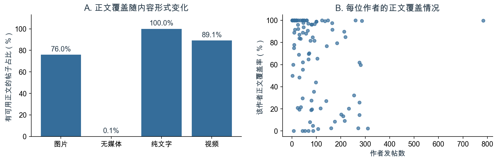

图1　不同内容形式的正文覆盖率，以及100 位作者的发帖数与正文覆盖率。覆盖按原始正文是否存在可见字符界定。

新分类与回归主要使用实际可读的正文；原全样本词典模型及不同正文口径保留为历史对照。3,984帖的原始正文不可见，另有134帖清理后为空。图片文字和视频语音尚未观察，不能用缺失标记或现有正文规则补齐。

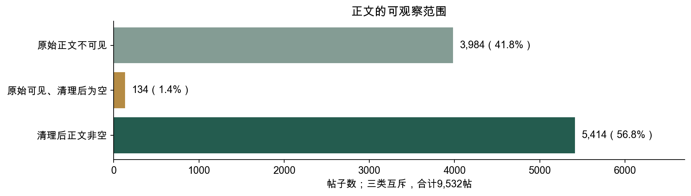

图2　按原始正文可见与清理状态划分，三类互斥，合计9,532帖。图中表示记录可观察范围，不是语义类别。

评论数据覆盖的是已采集到的互动。原始13,511 行按评论ID 去重，删除1,916 行无字段冲突的重复记录后，剩下11,595 条，全部能够关联到帖子，分布在1,323 帖下；其余帖子的评论情况记为覆盖未知。不同ID 下的相同短句仍然保留，以记录不同账号或时点实际发生的发言。

按实际时间字段，帖子发表于2020 年11—12 月（UTC）；转换成北京时间后，末端少量帖子跨至2021 年1 月1 日。评论最晚延续至2021 年8 月26 日。分析范围为课程提供的这批历史样本，抽样机制和统一采集时点未提供，全文据此讨论样本中的内容与互动。

### 3.2 点赞分布有长尾，作者发帖量也不均衡

样本包含100 位作者的9,532 条帖子。平均每帖获得37.05 个赞，中位数为25，最高一帖达到5,126，零点赞占3.8%。均值高于中位数，反映少量高反馈帖子将平均水平向上拉；中位数则更贴近分布中间的帖子。作者发帖数中位数为66，最多一位发布783帖，高产作者的内容习惯因而会在按帖统计的结果中出现更多次。

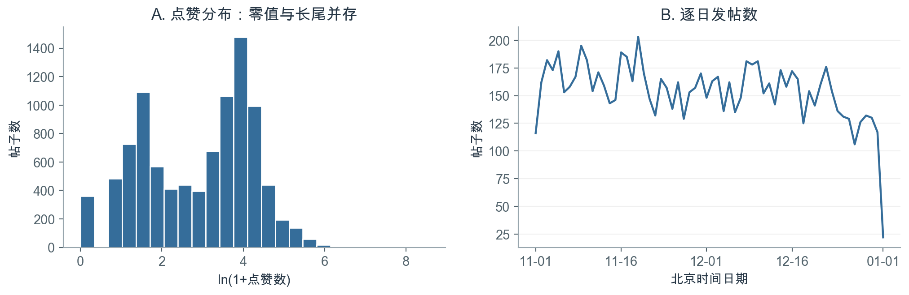

图3　全部9,532 帖的点赞分布与北京时间逐日发帖数。首末本地日期的观察时长均不足完整一天。

不同内容形式的反馈差别也很大。图片和视频帖的平均点赞分别为51.03 和48.05，纯文字帖为7.94，无媒体帖为3.91；中位数保留了相同的排序。读者实际看到的是，不同形式的帖子处在很不一样的反馈水平上。因此，讨论文字表达之前，必须把媒体形式及其对应的作者和内容情境纳入比较。

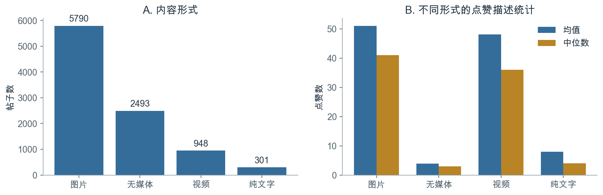

图4　按原始内容形式字段划分的帖子数、平均点赞与点赞中位数；内容形式与有无可用正文分别统计。

媒体形式对应着不同的累计点赞水平，后续文字比较据此同时控制媒体形式、作者和帖子情境。但样本中8,286 帖的点赞大于记录浏览数，两个字段的统计口径存在差异。完整媒体分组数值见附录A。

### 3.3 原始tag覆盖一半以上帖子，与正文可见并不相同

5,209帖带有原始tag，占54.6%，共269种；其中1,517帖没有原始正文。5,207帖只有一个tag，仅2帖有两个。有tag、正文可见和某条规则命中分别描述不同字段，不能相互替代。正文分析不将tag拼入正文，避免把平台活动标题中的固定用词当作正文表达。

## 4. 正文内容、细分表达与点赞的关系（RQ2）

### 4.1 细分变量的覆盖与不确定性

对5,414条清理后非空正文的模型重读中，5,085条被判为可读，329条被判信息不足。模型为3,791条标出九项中的至少一项，963条同时具有至少两项。705条九项均可判断且没有阳性，918条没有阳性且至少一项未知。无阳性不等于没有任何表达：一般观点、题注和其他可辨认表达并不全部属于这九项，因此九项与上一版五组的覆盖率也不应直接比较为准确性高低。

在没有九项阳性标签的帖子中，有999条在上一轮被标记为感悟、题注或建议等辅助表达：其中864条本轮判为可读，135条本轮判为信息不足。两轮对部分短文本的可读性判断不同；旧辅助标签仅作对照，不能将冲突或未知强行改成九项阳性。

内容对象轴仍使用上一轮模型编码：3,371条正文被标出至少一个内容对象。两个轴描述不同方面，数量不能相加；所有数字都是模型赋标签结果，不能等同于分类准确率。

| 表达变量 | 阳性帖数 | 阴性帖数 | 非空正文中该项未知 | 有作者内变化的作者数 |
| --- | ---: | ---: | ---: | ---: |
| 行动或进度记录 | 1,963 | 2,601 | 850 | 77 |
| 未来行动安排 | 183 | 4,633 | 598 | 41 |
| 目标或个人期待 | 101 | 4,960 | 353 | 33 |
| 鼓励或行动提醒 | 839 | 4,162 | 413 | 76 |
| 自身感受或体验 | 674 | 4,371 | 369 | 66 |
| 对象或情境评价 | 582 | 4,454 | 378 | 69 |
| 问候或祝愿 | 622 | 4,460 | 332 | 53 |
| 感谢或致谢 | 28 | 5,052 | 334 | 18 |
| 向他人征询或邀请 | 53 | 4,972 | 389 | 22 |

鼓励阳性帖中的对象标签分布如下，未指明和无法判断保持独立，不强行归入自我或他人：

| 鼓励对象 | 帖数 |
| --- | ---: |
| 明确自我 | 40 |
| 明确他人 | 190 |
| 明确双方 | 20 |
| 未指明 | 551 |
| 指向不确定 | 38 |

### 4.2 内容对象与点赞

为比较不同内容对象与点赞的关系，在领域明确且内容标签无不确定项的3,302帖、90位作者中，分别对四个主要内容变量估计回归。每次比较该标签出现与未出现的合格帖子；其他内容标签可以同时出现。控制正文长度、媒体形式、原始tag有无、表情数量、课程分享标记、业务类型、发帖时段以及作者和日期固定效应，标准误按作者聚类。以下q值对四个独立回归中的四项检验作BH校正；工具类因语境一致性问题不作为主结果展示。变量选择是回顾性的，校正不覆盖其他模型探索。

| 内容对象 | 标记帖数 | 系数 β | 原始95%区间 | 原始p | 四项BH q |
| --- | ---: | ---: | --- | ---: | ---: |
| 运动与身体活动 | 1,275 | -0.005 | [-0.095, 0.085] | 0.912 | 0.912 |
| 身体状态、体重与外形 | 844 | 0.064 | [-0.006, 0.135] | 0.074 | 0.296 |
| 饮食、食物与营养 | 591 | 0.014 | [-0.065, 0.092] | 0.730 | 0.912 |
| 具体生活、关系与社会文化话题 | 1,546 | 0.016 | [-0.056, 0.087] | 0.664 | 0.912 |

这四项在各自模型中的原始区间均跨零，四项BH校正后也均未达到5%水平。当前数据未提供足够证据判断这些内容对象与点赞存在稳定关联，不能把不显著理解为已经证明完全没有差异。

### 4.3 九项细分表达与点赞

每项分别使用自身可判断的样本，控制已记录的帖子和作者、日期条件。阳性与阴性组之外的未知记录不进入该项比较；其他表达可以同时出现。各项均为独立模型而非互相调整的同一模型，BH只覆盖本规格中满足支持门槛的变量。变量名后有 * 表示该标签在120条双AI盲审的可比较样本中，双方至少一方标为阳性的正文不足10条；即使全量回归有足够支持，其语义稳定性仍待核实。

| 表达变量 | 可判断帖数／作者 | 阳性帖数 | β | 原始95%区间 | 原始p | 组内BH q |
| --- | ---: | ---: | ---: | --- | ---: | ---: |
| 行动或进度记录 | 4,564／94 | 1,963 | 0.011 | [-0.075, 0.098] | 0.796 | 0.796 |
| 未来行动安排 * | 4,816／95 | 183 | 0.142 | [0.008, 0.275] | 0.037 | 0.299 |
| 目标或个人期待 * | 5,061／95 | 101 | 0.053 | [-0.154, 0.259] | 0.614 | 0.796 |
| 鼓励或行动提醒 | 5,001／95 | 839 | 0.033 | [-0.071, 0.137] | 0.536 | 0.796 |
| 自身感受或体验 | 5,045／95 | 674 | 0.027 | [-0.059, 0.113] | 0.539 | 0.796 |
| 对象或情境评价 | 5,036／95 | 582 | -0.022 | [-0.086, 0.042] | 0.496 | 0.796 |
| 问候或祝愿 | 5,082／95 | 622 | -0.052 | [-0.145, 0.040] | 0.266 | 0.796 |
| 感谢或致谢 * | 5,080／95 | 28 | — | 支持不足或设计矩阵不满秩 | — | — |
| 向他人征询或邀请 * | 5,025／95 | 53 | -0.048 | [-0.303, 0.206] | 0.708 | 0.796 |

可估计的表达变量经本组BH校正后均未达到5%水平；这不等于已证明不存在任何关联。 标签由AI辅助完成，且缺乏统一曝光与观察时长，不能将系数解释成表达导致点赞变化。

例如，“未来行动安排”的点估计为0.142，原始p=0.037，但组内BH q=0.299；盲审可比较样本中双方至少一方标阳性的只有5条，因此不能将这一结果作为稳定发现。

### 4.4 共线性与表达共现

为检查同一帖子同时包含多种表达时是否难以区分变量，我们在九项均可判断的4,316帖、94位作者中构建同时纳入非恒定且有作者内变化的标签的诊断模型；其中919帖被标记至少两项。设计矩阵为4,316×179，秩为179。受检变量在完整设计中的VIF范围为1.11—1.93。该检查同时考虑其他标签及作者、日期等控制项；若某标签没有正反例或作者内变化则不纳入诊断。低支持类别即使能计算VIF，也不能因此认为其回归有足够支持。

| 表达变量 | 阳性帖数 | 作者内有变化人数 | 完整模型VIF |
| --- | ---: | ---: | ---: |
| 行动或进度记录 | 1,889 | 76 | 1.93 |
| 未来行动安排 | 172 | 41 | 1.15 |
| 目标或个人期待 | 95 | 33 | 1.15 |
| 鼓励或行动提醒 | 800 | 73 | 1.48 |
| 自身感受或体验 | 624 | 66 | 1.30 |
| 对象或情境评价 | 544 | 69 | 1.28 |
| 问候或祝愿 | 605 | 53 | 1.76 |
| 感谢或致谢 | 26 | 17 | 1.11 |
| 向他人征询或邀请 | 52 | 22 | 1.14 |

历史五组合并变量在5,180条共同可判断帖子中的完整模型VIF为1.58—2.48；其结果不能替代上述九项检查。共线性不等于语义重叠，低VIF也不能验证类别含义。

### 4.5 表达回归的稳健性

分别剔除该变量样本中点赞最高1%的帖子、只保留该样本至少10帖的作者、以及按作者等权重估计；各项模型的可用样本可能不同。表内为点估计，完整区间和逐规格BH结果见 `results/v3_expression_analysis.json`。

| 表达变量 | 主模型 β | 剔除高赞 β | 保留至少10帖作者 β | 作者等权 β |
| --- | ---: | ---: | ---: | ---: |
| 行动或进度记录 | 0.011 | 0.016 | 0.011 | 0.100 |
| 未来行动安排 | 0.142 | 0.126 | 0.147 | 0.068 |
| 目标或个人期待 | 0.053 | 0.073 | 0.053 | 0.031 |
| 鼓励或行动提醒 | 0.033 | 0.021 | 0.030 | 0.012 |
| 自身感受或体验 | 0.027 | 0.029 | 0.026 | 0.099 |
| 对象或情境评价 | -0.022 | -0.022 | -0.023 | -0.014 |
| 问候或祝愿 | -0.052 | -0.059 | -0.056 | -0.064 |
| 感谢或致谢 | — | — | — | — |
| 向他人征询或邀请 | -0.048 | 0.002 | -0.057 | 0.043 |

这些对照不能修复分类误差或没有记录到的曝光；方向变化应结合原始区间及各规格BH结果理解，不能仅凭点估计判断稳定性。

### 4.6 双AI盲审能说明什么

下表按每个标签展示两次编码均可判断时的阳性一致情况；未知被单独排除。低阳性支持的比例很不稳定，同一模型基座还可能共同出错。

| 表达变量 | 双方均阳性 | 仅一方阳性 | 排除未知 | 阳性一致率 |
| --- | ---: | ---: | ---: | ---: |
| 行动或进度记录 | 37 | 3 | 24 | 96.1% |
| 未来行动安排 | 4 | 1 | 11 | 88.9% |
| 目标或个人期待 | 6 | 1 | 9 | 92.3% |
| 鼓励或行动提醒 | 16 | 0 | 17 | 100.0% |
| 自身感受或体验 | 20 | 1 | 6 | 97.6% |
| 对象或情境评价 | 12 | 7 | 9 | 77.4% |
| 问候或祝愿 | 10 | 0 | 9 | 100.0% |
| 感谢或致谢 | 1 | 0 | 6 | 100.0% |
| 向他人征询或邀请 | 1 | 0 | 7 | 100.0% |

两份编码都认定为鼓励的16条中，对象状态完全一致12条。该检查包含“未指明”和“不确定”状态，不能称为对象判断准确率。具体例子和分歧应继续由独立人工盲审，不能将该样本再用于修改码本后宣称独立验证。

## 5. 帖子主题成分与点赞的关系（RQ2）

为了从另一角度补充观察正文中反复出现的词语组合，本章使用主题模型提取成分，并检验其连续权重与点赞的关联。由于模型成分尚未经过独立语义验证，本章结果用于探索，不代表经过验证的真实主题分类。

### 5.1 正文中的词语成分分布

对包含至少3个有效词的2,478条正文建立TF-IDF矩阵并提取五个NMF成分；其中8条成分贡献接近零，未强制分类，最终2,470条帖子、86位作者进入分析。每条帖子可以同时包含多个成分，下图仅按权重最高者概括分布。成分2与成分4分别占52.7%和35.8%；这些比例是模型中的最高权重份额，不能解释为已验证的主题覆盖率。

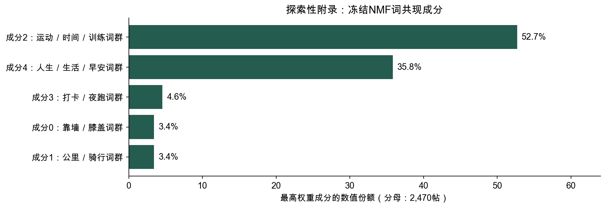

图5　每帖最高权重成分的数值份额；回归使用各成分的连续权重。

五个成分原分别被概括为靠墙静蹲、骑行、运动训练交流、跑步打卡、生活感悟与问候，但这些名称的层级不同，部分正文与名称存在错配。较小成分也集中于个别作者：静蹲成分的85条主导帖中78条来自一位作者，骑行成分的85条中58条来自一位作者。因此，成分分布可能受到作者习惯和重复模板影响，不宜直接作为全体用户内容偏好的比例。

### 5.2 使用连续权重进行主题回归

为检验词语成分与点赞的关联，在2,470条有效正文中保留各成分的连续权重，并控制正文长度、媒体、发帖时段和作者、日期固定效应等；重新估计时不再控制旧四项词典变量。五项权重之和为1，带截距时省略成分2作为参照；每项系数表示该成分替代成分2同等权重的条件差异，10个百分点的替代对应系数的0.1倍。

| 成分（旧名称，仅供识别） | 连续权重 β | 原始95%区间 | 原始p | 四项BH q |
| --- | ---: | --- | ---: | ---: |
| 成分0（靠墙静蹲） | -0.310 | [-0.627, 0.007] | 0.055 | 0.110 |
| 成分1（骑行） | -0.003 | [-0.556, 0.551] | 0.992 | 0.992 |
| 成分2（运动训练交流） | 参照 | 不适用 | 不适用 | 不适用 |
| 成分3（跑步打卡） | -0.520 | [-1.162, 0.122] | 0.111 | 0.148 |
| 成分4（生活感悟与问候） | -0.164 | [-0.315, -0.014] | 0.032 | 0.110 |

四项成分联合检验p=0.165，四项BH校正后均未达到5%水平，因此不能据此对真实内容类型的点赞表现排序。回归区间以既有成分为给定输入，没有纳入主题模型估计与语义命名的不确定性。

### 5.3 剔除少帖作者后的稳健性检验

为检查主题子样本中少帖作者的影响，按每位作者在主题子样本中的最低入模帖数重新估计连续权重模型。

| 每位作者至少入模帖数 | 保留帖数／作者数 | 成分联合检验p |
| --- | --- | ---: |
| 1 | 2,470／86 | 0.165 |
| 2 | 2,460／76 | 0.165 |
| 5 | 2,423／64 | 0.182 |
| 10 | 2,309／48 | 0.266 |

各门槛下联合检验仍未显示明确关联；但最高门槛只保留48位作者。该检查不能解决成分命名、覆盖和作者模板对主题结构的影响。

## 6. 评论内容与直接回复分析（RQ3）

### 6.1 短评论与重复词项有不同的用户覆盖

为了解评论区中常见的文字回应，我们先统计评论长度、词项出现次数与发言用户数。清理后评论字符数中位数为6、75分位数为10；1,373条只留下标记或符号，占11.8%。这些记录只支持评论长度与字面形式的描述，不能据此判断发言者的态度强度。

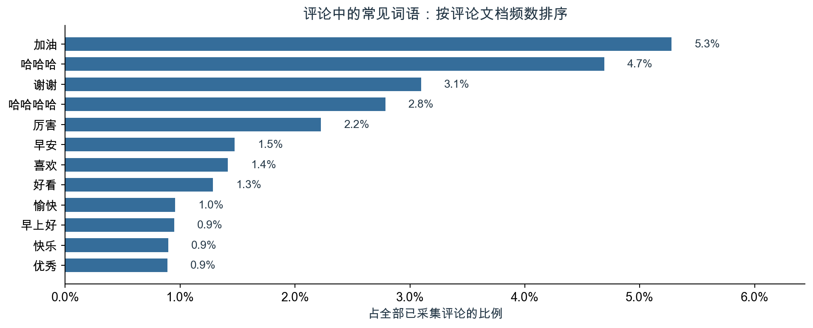

图6　以11,595条去重评论为分母展示常见词的出现占比。每条评论内同一词至多计一次，词项至少覆盖5位发言用户，各词可共同出现。

“加油”出现在612条评论中，涉及431位发言用户；“谢谢”出现在359条评论中，涉及53位用户。前者在更多用户之间出现，后者更集中于较少使用者。另有3,362条评论具有重复的标准化文本，按不同ID保留。评论次数和不同发言用户数应同时报告，不能把重复的短句直接当作更深的关系。

### 6.2 发言角色对应不同词项命中率

其他用户发言7,192条，帖主发言4,403条；同一用户可在不同帖子下切换角色。下表与图按每条评论的所属帖子定义角色，保留根评论、回复及84次自我互动。

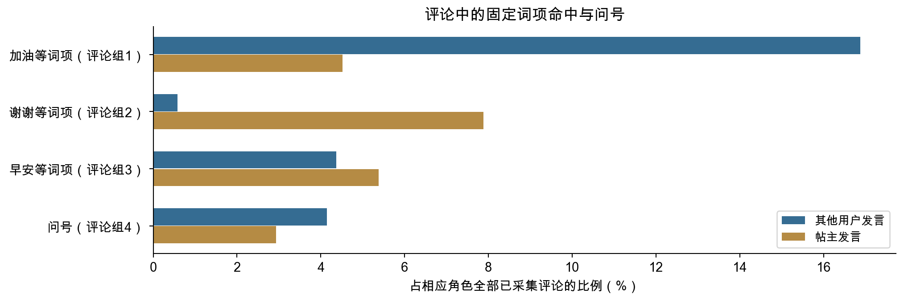

图7　按发言者是否为所属帖子的作者分组，比较四组固定字面规则。分母为各角色全部已采集评论，各项可以重叠。

| 评论字面规则 | 全部命中数 | 全部占比 | 其他用户命中率 | 帖主命中率 |
| --- | --- | --- | --- | --- |
| 加油等词项（评论组1） | 1,413 | 12.2% | 16.9% | 4.5% |
| 谢谢等词项（评论组2） | 389 | 3.4% | 0.6% | 7.9% |
| 早安等词项（评论组3） | 551 | 4.8% | 4.4% | 5.4% |
| 问号（评论组4） | 427 | 3.7% | 4.1% | 2.9% |

评论组1在其他用户发言中的比例较高，评论组2在帖主发言中的比例较高。这是词项与角色的对应分布。评论组2包含“感谢”“多谢”等完整表中所列词项，因此命中数389大于“谢谢”单词项的359。它们不能直接证明已经发生真实支持，或将“感谢”解释为支持效果。

### 6.3 根评论的直接回复覆盖与回复词项应分开看

从6,609条其他用户发给帖主的根评论出发，按冻结规则查找根评论后7天内、明确指向该条评论及其作者的帖主回复。每条根评论只取最早符合条件的观测回复，共有3,568条根评论配到回复。

| 根评论的字面规则 | 根评论数 | 涉及帖主数 | 观测到7天内直接回复 | 已回复记录中，最早回复命中评论组2 |
| --- | --- | --- | --- | --- |
| 命中加油等词项（评论组1） | 1,180 | 54 | 513（43.5%） | 137（26.7%） |
| 未命中加油等词项（评论组1） | 5,429 | 77 | 3,055（56.3%） | 195（6.4%） |

直接回复比例以各组全部根评论为分母；最后一列仅以已观察到直接回复的根评论为分母，同一帖主可以进入两组。命中评论组1的根评论中，最早回复命中评论组2的比例在已回复记录中为26.7%，另一组为6.4%；换成全部根评论作分母则为11.6%和3.6%。

同一批记录中，评论组1命中组的观测直接回复覆盖为43.5%，低于未命中组的56.3%。这说明回复词项分布和直接回复覆盖可以走向不同。它不证明某组留言更容易被忽视或得到更高质量回应，因为帖主、具体情境与采集完整程度各不相同。本轮没有对此新选显著性检验，也不把未命中组视为语义上缺乏鼓励或未获得支持的对照组。

## 7. 评论互动网络分析（RQ3）

### 7.1 评论指向和重复次数，构成用户间的关系网络

为了解用户之间的留言和回复如何连接，我们根据每条评论的发送者与接收者构建有向网络。图8中的每个点是一位用户账号。线从评论发送者指向接收者：根评论按归属指向帖主，明确回复指向记录中的被回复用户。同一发送者向同一接收者评论多次，合并成一条有向边，次数累加为权重。十次同方向留言在图中对应一条权重为十的边，记录的是这对账号之间累计发生的事件。

排除84 次自我互动后，11,511 次评论事件合并为4,069 条有向边，涉及2,932 个有边账号。节点同时包含发送者和接收者，文本统计中的2,910 位发言者则只计算实际发出评论的用户。网络由此把每次发言放回到它所指向的对象上，呈现谁向谁留言或回话。

为回答不同问题，原有分析实际用了三种网络范围。

| 网络范围 | 节点与边 | 权重与所含事件 | 它主要帮助理解什么 |
| --- | --- | --- | --- |
| 全部已采集互动 | 2,932 个账号、4,069 条有向边 | 同方向事件次数为权重；包括6,609 次根评论及4,902 次明确回复 | 留言与回话合在一起，向谁集中 |
| 仅明确回复 | 1,074 个账号、1,271 条有向边 | 同方向重复回复合并为边；既有互惠统计不赋权、不计重复次数 | 去掉根评论归属后，明确回复关系是否双向存在 |
| 发帖后7 天内 | 1,376 个账号、2,278 条有向边 | 同方向事件次数为权重；包括该窗口内的根评论和明确回复 | 限定发帖后首周，结构描述如何变化 |

三类网络都排除自我互动，方向均为发送者指向接收者；首周网络来自全部已采集事件的时间截取。

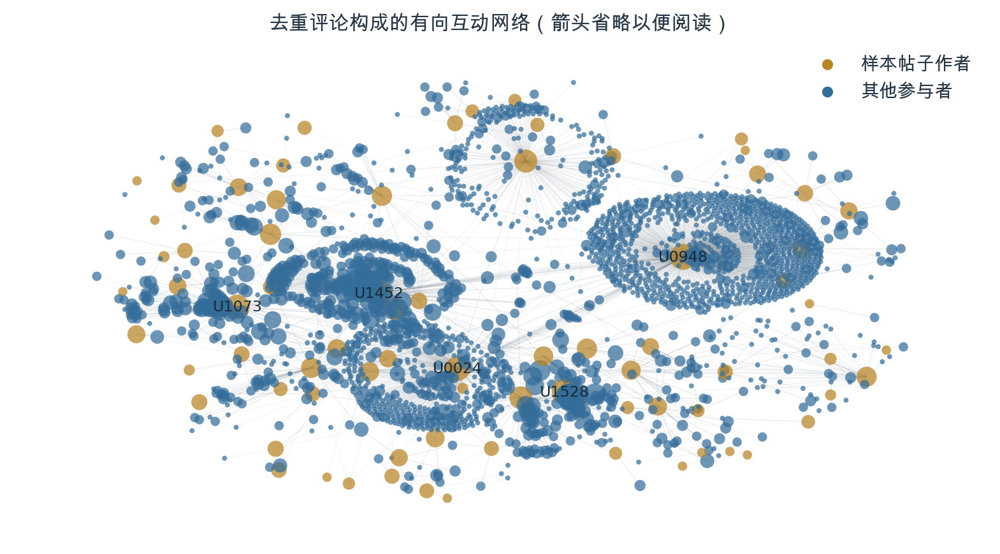

图8　全部2,932 个有边节点与4,069 条有向边。为便于阅读，图中省略箭头；金色为样本帖子作者，蓝色为其他参与者，节点大小按接收事件数的对数缩放，仅标注前5 位接收者。位置按网络布局排列。

### 7.2 大多数账号可以间接连起来，实际回话却主要由帖主承担

忽略线的方向后，网络分为35 个互不相连的部分，其中最大部分包含2,768 个账号，占有边账号的94.4%。网络密度为0.0473%，即全部可能的有向账号配对中，实际出现直接连接的比例很小。这两项结果合起来呈现了一种“间接联系广、直接联系稀疏” 的结构：大多数账号能够通过已有连接串在一起，日常评论则发生在有限的账号关系中。

评论角色进一步说明这个结构里发生了什么。在4,902 次明确回复中，帖主回复其他用户4,361 次，占89.0%；其他用户回复帖主444 次，占9.1%；其他用户彼此回复97 次，占2.0%。采集到的明确回话，大部分是帖主在承接留言，其他参与者相互接话的事件份额很小。而根评论按规则指向帖主，因此结合根评论与明确回复，可以确定评论区围绕帖主展开的清晰特征。

评论区的活动主要由面向帖主的留言与帖主回话构成，其他用户彼此交流则是其中较少的一部分。同一条帖子下，多人留言形成了参与的广度，帖主持续回复形成了来回承接；这两种活动共同解释了样本中评论量的主要来源。横向回复的97 次事件，则记录了帖主之外参与者直接接话的部分。

### 7.3 同样接收很多评论，可能是接触面广，也可能是少数人反复往来

前10 位账号接收了54.0% 的非自我评论事件，样本帖子作者接收了61.3%。评论去向集中在部分账号上；进一步对照接收次数与发送者人数，可以看清这些接收量是怎样积累起来的。

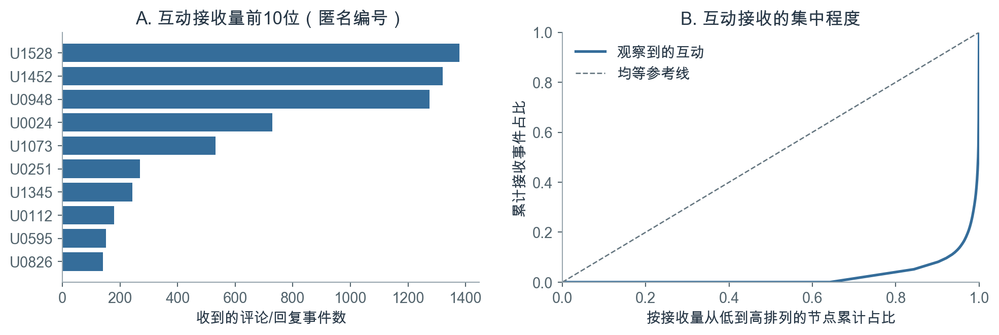

图9　接收事件前10 位与累计接收分布。按接收事件次数排序，分母为11,511 次非自我事件，同一用户的多次事件分别计数。

现有匿名节点表提供了一个很直观的比较。U1528 收到1,378 次互动，发送者有53 位；U0948 收到1,275 次，发送者却有1,091 位。前者的接收量更多包含已有发送者的重复发言，后者的发送者覆盖面更广。不属于样本帖子作者的U0112 也收到180 次互动，但只来自4 位发送者，说明较高接收量还可能出现在很有限的账号往来中。

| 匿名账号 | 是否为样本帖子作者 | 接收事件次数 | 不同发送者人数 | 记录中更突出的特征 |
| --- | --- | --- | --- | --- |
| U1528 | 是 | 1,378 | 53 | 相对于人数，重复发来的事件较多 |
| U0948 | 是 | 1,275 | 1,091 | 与相近接收量相比，涉及更多不同发送者 |
| U0112 | 否 | 180 | 4 | 接收事件集中来自很少几位发送者 |

接收事件数为加权入度，不同发送者数为入度；统计同时包含根评论和明确回复。

多少个不同账号向其发来评论（入度），反映接收关系的范围；累计收到多少次评论（加权入度），反映事件量。将这两个中心性指标联系起来，U0948 突出的是较广的发送者覆盖，U1528 突出的是已有发送者的多次发言。两者在网络中承担的接收形态因此有所不同。

### 7.4 双向连接与首周窗口的结构差别

全部互动网络的互惠率为49.6%，表示近一半有向连接同时存在反方向的连接。例如，用户给帖主留言，帖主又回话给该用户，这对账号便形成双向连接。指标按账号之间是否存在双向关系计量[8]，每条连接贡献相同权重，概括了关系层面的往来。

只保留明确回复后，互惠率为29.9%。整体网络中，用户的根评论与帖主的回复可以组成一对双向连接；限定为明确回复后，其中一部分关系保留的是帖主发出的回话。两项互惠率的差异，使“留言加回话” 这一主要往来形式在结构上更加清楚。

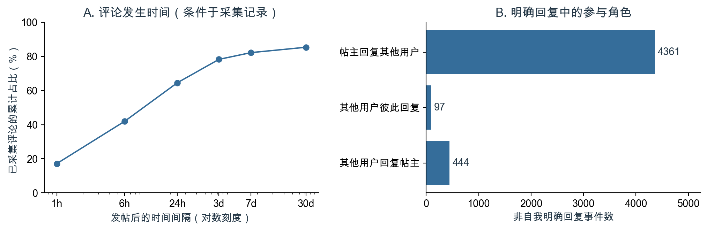

图10　已采集评论距发帖的时间分布，以及4,902 次非自我明确回复的角色分布。时序比例以全部11,595 条去重评论为分母。

已采集评论中，64.5% 发生在发帖后24 小时内，82.2% 在7 天内，距发帖时间的中位数为11.3 小时，评论集中在发帖后的较早阶段。首周网络的互惠率为74.1%，前10 位接收占比为48.3%；全部记录对应为49.6% 和54.0%。首周记录呈现更多双向连接、较分散的事件接收；纳入较晚的账号和评论后，整体关系构成随之变化。

| 观察窗口 | 非自我事件数 | 有边账号数 | 有向边数 | 互惠率 | 前10 位接收占比 |
| --- | --- | --- | --- | --- | --- |
| 全部已采集互动 | 11,511 | 2,932 | 4,069 | 49.6% | 54.0% |
| 发帖后7 天内 | 9,451 | 1,376 | 2,278 | 74.1% | 48.3% |

互惠按边是否双向存在计量，接收占比按事件次数计量；每个窗口分别确定接收量前10 位账号。

在线程层面，6,609 个根评论线程中，57.0% 观察到帖主参与；在这些已参与线程里，最早观测到的帖主回复距根评论的中位时间为2.05 小时。这说明样本中相当一部分留言线程有帖主接话，且在已接话的线程里，回应时间的中位数约为两小时。互惠率描述账号关系的双向性，线程参与描述留言串里的承接，第6章的直接回复比例则定位到根评论本身；三种结果分别补充了交流过程的不同层面。

上述网络图与数值沿用既有冻结结果，本轮重新核对描述范围与术语，未重估网络或全面重审评论采集过程。根评论指向帖主是构网规则的一部分；连通、互惠和中心性描述观测连接，不等于真实友谊、社区凝聚力或社会支持。

## 8. 研究结论

### 8.1 研究结论

RQ1：正文可观察范围随内容形式和作者变化，点赞呈长尾；缺少正文不等于原帖没有内容。

RQ2：模型对5,414条非空正文完成细分编码，3,791条至少有一项九类表达标签。可估计的表达变量经本组BH校正后均未达到5%水平；这不等于已证明不存在任何关联。共线性诊断和双AI复核结果需与模型的语义误差、未知状态及作者支持一起理解；连续主题权重回归仍是探索性补充。

RQ3：已采集评论中的词项随角色分布不同，明确回复主要由帖主发给其他用户；互动事件数和不同发送者人数反映不同接收形态。

### 8.2 研究局限与展望

未观察的正文、图片、视频语音、曝光及累计观察时长限制了可比性，作者和日期固定效应不能消除所有随帖子变化的差异。九项细分标签由模型分批阅读产生，同基座AI一致性不是人工准确率；类别定义、作者选择和多重模型均属回顾性探索。应优先对随机一致样本、分歧、未知和稀少类别进行独立人工盲审，再检验变量是否可靠、是否需要调整。

## 附录A　评论、网络与媒体口径

### A.1 评论配对、网络与时间口径

网络从100 位样本作者的帖子出发构建，根评论按归属指向帖主。节点表另保留PageRank，记录沿评论方向分配、同时考虑来源账号位置及其互动去向的结构评分[9]。

评论内容处理统一全半角和空白，移除URL 与方括号标记，再分词并过滤停用词；同一评论内同一词只计一次。四组评论字面规则按固定词表匹配，可相互重叠，分母为相应角色的全部已采集评论。文本统计保留不同评论ID 下相同的短句和84次自我互动；网络则排除自我互动，因此两者分母分别为11,595 和11,511。

直接配对要求回复由帖主发出，所属帖子一致，reply 字段指向该根评论，replyUserId 为根评论作者，parentId 也与该根评论匹配；回复发生在根评论之后或同一时刻，间隔不超过168 小时。每条根评论取该窗口内最早观测回复，实际无首时点并列。配对到的3,606 次窗口内直接回复对应3,568 条根评论；分析评论组2时，每条根评论只贡献一次观察。全部评论中有781 条明确回复引用的评论ID 未在表内出现，完整对话仍有缺口。

网络接收者优先按replyUserId 确定，缺失时只从确实已观测的被回复评论补识别；无回复指向的根评论归到帖主。既有网络核查中，接收者均可确定，事件时间均不早于发帖。全部网络及首周网络的边权为同方向事件累计次数；仅明确回复网络的既有互惠统计只使用去重后的有向连接。互惠率为具有反向边的有向边占比，每条有向边按相同权重计数。

时间口径须分别保留：评论时序和首周网络从发帖起算；直接配对的7 天从根评论起算；57.0% 的线程帖主参与比例包括线程内回复，以该线程全部已采集记录为范围。各项时间统计均以实际采集到的事件为基础。

### A.2 媒体分组的完整描述数值

| 内容形式 | 帖子数 | 样本占比 | 平均点赞 | 点赞中位数 |
| --- | --- | --- | --- | --- |
| 图片 | 5,790 | 60.7% | 51.03 | 41 |
| 无媒体 | 2,493 | 26.2% | 3.91 | 3 |
| 纯文字 | 301 | 3.2% | 7.94 | 4 |
| 视频 | 948 | 9.9% | 48.05 | 36 |

## 附录B　原四项字面变量的历史结果

本附录保留原四项词典与问号变量的模型、图表和稳健性检查，它们与正文中新分类模型使用不同变量与样本，不能将旧模型的结论直接套用到新变量。

### B.1 旧四项字面规则的定义

旧模型并未试图穷尽帖子全部表达，而是使用四项可从正文识别的语言线索：自律或目标相关用词、社交称呼或互助相关用词、积极用词，以及问号。它们分别为观察目标行动、面向他人的交流、积极表达和可能的疑问提供部分文字线索；问号不等同于完整识别问句。旧模型将它们作为局部字面线索，而非完整的表达风格分类；词语命中也不能直接证明作者的行为、意图或情绪。四类线索可以同时出现在同一帖子中。

正文长度为ln(1+清理后非空白字符数)。以下规则按固定子串或已冻结模式匹配，任一命中记1，重复出现不累加。A含下表末项正则模式，其余词项作字面子串匹配；B、C和D先对词项作正则转义再匹配，不是按分词频率编码。A、B、C、D可以交叉命中，既不互斥，也不完备。它们不直接测量人格、情绪、真实提问或社会支持。

为检查这些特征在实际正文中是否有对应的表达，我们在5,414条清理后非空正文中，按每项规则命中与未命中分别随机抽取8条，共抽查64条不同帖子。模型在未看到规则命中状态、点赞和作者信息的情况下，结合上下文判断表达是否明确。在每类各8条的命中样本中，模型分别认为6条包含目标或行动线索、5条包含面向他人的交流线索、7条包含积极表达；在8条含问号的样本中，4条被判断为有明确的询问，另有反问、感叹或难以判断的情形。

这轮抽查表明，上述线索能够在部分帖子中观察到，也提醒我们词项命中不总能支持预想的语境解释。每组仅有8条，且命中与未命中为分层抽取；上述数量不能代表总体比例，也不是分类准确率。审阅由模型辅助完成，并非独立人工验证；抽样及结果详见《四类表达特征_盲审初步核实记录》。

A—C最初按词语的直观含义编制，缺少独立词表评审和语义验证。旧分析将它们沿用为固定、可复算的探索性操作指标；中性改名不补上理论或经验效度，也不表明三组词项是语料自然形成的分类。本轮未因显著性保留、增删词项，既有匹配规则不变。

| 字面特征 | 全部固定词项／模式 | 操作与边界 |
| --- | --- | --- |
| 坚持等词项命中（A） | 坚持、自律、打卡、目标、计划、努力、加油、挑战、突破、完成、进步、不放弃、全勤、第[0-9一二三四五六七八九十百千]+天 | 末项为既有正则模式，其余按子串；不判断否定、反讽、意图或行为真实性。 |
| 大家等词项命中（B） | 大家、朋友们、小伙伴、你们、一起、互相、互勉、共勉、陪伴、谢谢、感谢、请教、求助、求推荐 | 任一子串命中记1；未处理否定、反讽或上下文含义。 |
| 开心等词项命中（C） | 开心、快乐、高兴、幸福、喜欢、美好、满足、舒服、棒、赞、愉快、美滋滋、哈哈、嘻嘻、嘿嘿 | 任一子串命中记1；未处理否定、反讽或上下文含义。 |
| 问号出现（D） | ?、？ | 任一问号出现记1；修辞问句会命中，无问号的提问可能漏掉。 |

同一条“加油”可能用于自我提醒或给别人留言；“谢谢”也不能证明已经发生互助。规则名称仅帮助读者辨认所列词项。数值共线性与语义含义是不同问题，低VIF不证明四项是独立心理维度。

辅助控制沿用原始正文可见状态、有无原始tag、表情数量、课程分享标记、媒体形式、业务类型和发帖时段。原始tag是用户选择的元数据，不能作为正文语义的标准答案。

### B.2 原始均值有差异，但词典只能覆盖部分表达

以下原始均值沿用历史9,532帖的编码比较，“未命中”组包含没有观察到正文的记录，不能视为已经确认这些帖子不使用相应用词。未调整时，四项字面线索的命中组平均点赞均较高：坚持等词项（A）63.67对34.36，大家等词项（B）89.96对36.16，开心等词项（C）57.29对35.76，问号111.15对36.07。两组的作者、媒体和发帖情境并不相同，这些均值描述的是组别构成与反馈的共同差别，不能直接解释为措辞效果。

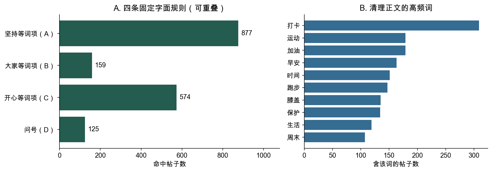

图11　指定字面特征的命中数与高频词。它们可重叠，词频以含该词的帖子数计，每帖至多一次。

| 字面线索 | 命中帖数 | 全部帖子占比 | 有作者内变化的作者数 | 全样本模型VIF |
| --- | --- | --- | --- | --- |
| 坚持等词项命中（A） | 877 | 9.2% | 76 | 1.750 |
| 大家等词项命中（B） | 159 | 1.7% | 42 | 1.149 |
| 开心等词项命中（C） | 574 | 6.0% | 64 | 1.186 |
| 问号出现（D） | 125 | 1.3% | 32 | 1.112 |

非空清理正文中，只有1,523帖命中至少一项，3,891帖没有命中任何规则，占71.9%。71.9%是四条非完备规则的未命中比例，不是分类错误率。全样本未命中数为8,009，其中包含未观察到正文的记录。这不是“多数帖子没有表达”，而是说明指定词表只捕捉了局部线索。旧词典模型的结论因而必须限定为这些规则的关联，不能概括全部内容的作用。

为判断同时放入四类线索是否会因高度相关而影响估计，我们检查变量相关性与方差膨胀因子（VIF）。四项全样本最大两两φ相关为0.119，作者内最大相关为0.085；完整M3的四项VIF为1.11—1.75，设计矩阵9,532×182且满秩。182帖同时命中至少两项。现有数值未呈现明显共线性，不支持仅因担心重复而合并规则；低VIF也不能证明语义独立或量表有效。[10]

### B.3 控制作者和帖子情境后的回归结果

为比较作者和帖子情境相近时，四类文字线索及正文长度与点赞的关系，我们先估计包含作者、日期和相关控制项的全样本回归，再比较不同正文可观察口径。原全样本模型（M3）中，开心等词项（C）系数为−0.086，原始95%区间为[−0.155, −0.016]，原始p=0.016；对五项同时作BH校正后q=0.079。五项联合p=0.130，新增R²为0.065个百分点。这些数值描述全样本模型的结果。

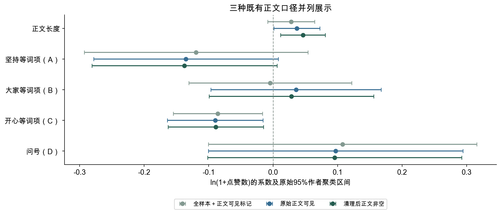

图12　三种既有正文口径的五项系数与原始95%作者聚类区间；样本数、作者数和模型内BH q见下表及附录B.6。

原始算术均值与模型的对数条件关联也不在同一尺度，不能将方向差别单独归因于作者固定效应或某一个控制项。把研究对象限定为正文实际可见的帖子后，比较范围发生了变化。原始正文可见的5,548帖仍包含134条清理后为空的记录；非空清理正文为5,414帖。三个口径的结果并列如下：

| 正文口径 | 帖数／作者数 | 五项联合p | 长度BH q | 开心等词项（C）BH q |
| --- | --- | --- | --- | --- |
| 原全样本＋缺失标记 | 9,532／100 | 0.130 | 0.293 | 0.079 |
| 原始正文可见 | 5,548／95 | 0.067 | 0.106 | 0.093 |
| 清理后正文非空 | 5,414／95 | 0.040 | 0.048 | 0.048 |

在非空正文模型中，长度系数为0.046、开心等词项（C）系数为−0.089，两项在该模型内的BH q均约0.048，整组p约0.040。不能因此挑选这个模型来宣布稳定效果，也不能继续把全样本p=0.130概括为所有正文处理都没有关联。该重分析是在原结果之后开展，且没有对所有探索性模型统一校正；结果靠近阈值，仍受到正文可观察范围的选择限制。三种p值的变化不是系数之间差异的显著性检验，也不能证明非随机正文缺失已被解决。

历史词典分析中，三种正文口径并列解释。非空正文口径的p=0.040和两项q=0.048不被追认为事前确定的唯一主模型；全样本p=0.130也不被概括为文字普遍没有关联。三者都缺少实际曝光、完整媒体内容和统一累计观察时长，不能识别词项的因果作用。

### B.4 剔除少帖作者后的稳健性检验

为检查发帖较少的作者是否影响回归结果，我们分别剔除低于不同发帖门槛的作者，并重新比较全样本模型。全样本100位作者的发帖数最少1、中位数66、最多783。2位作者只发1帖；不超过10帖的14位作者合计80帖，占0.84%。单帖作者没有作者内变化，不为共同斜率提供这种信息，但少帖存在本身不使固定效应整体失效。

分别剔除发帖少于5帖或10帖的作者，原字面模型得到以下结果：

| 保留规则 | 帖数／作者数 | 五项联合p | 开心等词项（C）β／BH q |
| --- | --- | --- | --- |
| 原全样本 | 9,532／100 | 0.130 | −0.086／0.079 |
| 每位作者至少5帖 | 9,524／95 | 0.131 | −0.086／0.080 |
| 每位作者至少10帖 | 9,462／87 | 0.130 | −0.085／0.095 |

这些门槛没有实质改变全样本回归的统计判断，提示少帖作者不是这项结果的主要来源。不过，长度在93位作者内有变化，大家等词项（B）只有42位、问号只有32位；不能把100个作者理解为每个特征都有100个充分的变化来源。固定效应也不能排除同一作者随帖变化的曝光和内容差别。

### B.5 更换样本和模型后的稳健性检验

为判断结果是否依赖正文范围、少数高赞帖子、高产作者或模型形式，我们分别更换样本和估计方法，并逐一剔除作者。总体上，多项系数的方向与全样本模型相近，但个别变量和统计判断会发生变化。原有的原始正文可见、去除最高1%点赞、作者等权和逐作者剔除分析中，开心等词项（C）的点估计方向较一致；100次逐作者剔除均为负，范围为[−0.100, −0.074]。PPML计数模型也给出负向点估计，但原始区间跨零。

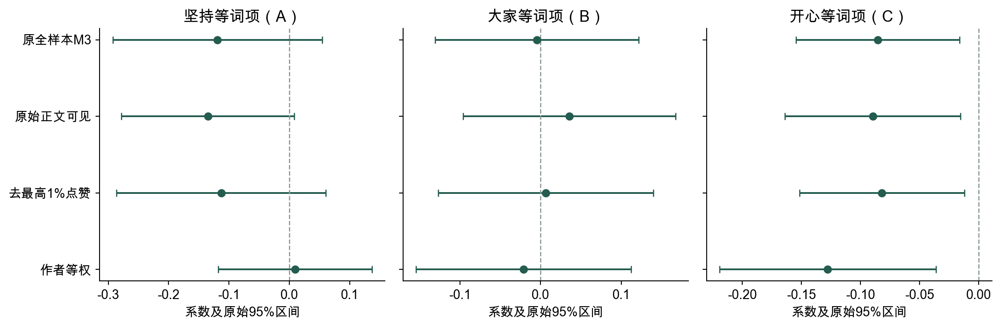

图13　从冻结结果表重画的A、B、C系数与原始95%作者聚类区间。原“仅可见正文”是5,548帖口径，不含本轮新增的5,414帖模型；不同尺度不能直接比较系数幅度。

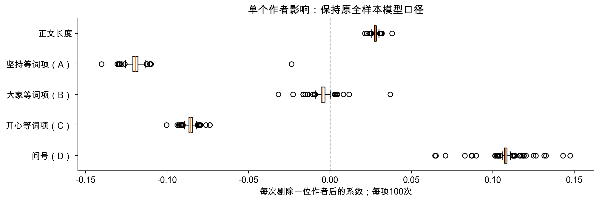

图14　原全样本设定中逐一剔除作者后的系数分布。这项检查处理单个作者影响，不处理语义效度或正文非随机缺失。

逐一剔除作者时，正文长度与问号的系数均为正，坚持等词项（A）与开心等词项（C）的系数均为负；大家等词项（B）在100次中有11次转为正。在作者等权设定下，坚持等词项（A）和问号的点估计也发生变号，且区间跨零；B在不同设定中同样会变号。总体看，长度和开心等词项（C）的方向在所列设定中一致，其他变量存在方向变化，整组检验及多重检验结论也随正文口径变化。数据提供的是受测量、样本和已记录控制条件限制的关联，不能据此建议通过减少开心等词项（C）来提高点赞。

### B.6 三种既有正文口径的五项结果

每个区间均为原始95%作者聚类区间；BH q分别在各模型内对五项校正。全样本／原始可见／清理非空三个口径分别包含9,532／5,548／5,414帖及100／95／95位作者。以下全部估计沿用冻结结果，未追认任何一个口径为事前唯一主模型。

| 模型 | 字面特征 | β | 聚类SE | 原始95%区间 | 原始p | BH q |
| --- | --- | --- | --- | --- | --- | --- |
| 全样本 | 正文长度 ln(1+字数) | 0.028 | 0.018 | [−0.008, 0.064] | 0.130 | 0.293 |
| 全样本 | 坚持等词项命中（A） | −0.119 | 0.087 | [−0.293, 0.054] | 0.176 | 0.293 |
| 全样本 | 大家等词项命中（B） | −0.004 | 0.064 | [−0.131, 0.122] | 0.946 | 0.946 |
| 全样本 | 开心等词项命中（C） | −0.086 | 0.035 | [−0.155, −0.016] | 0.016 | 0.079 |
| 全样本 | 问号出现（D） | 0.108 | 0.105 | [−0.100, 0.316] | 0.307 | 0.383 |
| 原始可见 | 正文长度 ln(1+字数) | 0.037 | 0.018 | [0.001, 0.073] | 0.043 | 0.106 |
| 原始可见 | 坚持等词项命中（A） | −0.135 | 0.072 | [−0.278, 0.008] | 0.064 | 0.107 |
| 原始可见 | 大家等词项命中（B） | 0.036 | 0.066 | [−0.096, 0.167] | 0.593 | 0.593 |
| 原始可见 | 开心等词项命中（C） | −0.090 | 0.037 | [−0.164, −0.015] | 0.019 | 0.093 |
| 原始可见 | 问号出现（D） | 0.097 | 0.099 | [−0.100, 0.294] | 0.332 | 0.415 |
| 清理非空 | 正文长度 ln(1+字数) | 0.046 | 0.018 | [0.011, 0.081] | 0.010 | 0.048 |
| 清理非空 | 坚持等词项命中（A） | −0.137 | 0.072 | [−0.281, 0.006] | 0.060 | 0.101 |
| 清理非空 | 大家等词项命中（B） | 0.028 | 0.064 | [−0.099, 0.156] | 0.659 | 0.659 |
| 清理非空 | 开心等词项命中（C） | −0.089 | 0.037 | [−0.163, −0.015] | 0.019 | 0.048 |
| 清理非空 | 问号出现（D） | 0.096 | 0.099 | [−0.101, 0.292] | 0.338 | 0.422 |

### B.7 稳健性分析补充结果

原有可见正文、最高1%剔除、作者等权与PPML结果仍在冻结结果表中，五项变量和控制项定义未改。原“仅可见正文”为5,548帖，不能与新增5,414帖混称。

| 补充设定 | 样本量 | 开心等词项（C）β | 原始95% 置信区间 | 原始p 值 |
| --- | --- | --- | --- | --- |
| 仅可见正文 | 5,548 | -0.090 | [-0.164, -0.015] | 0.019 |
| 去除点赞最高1% | 9,436 | -0.082 | [-0.152, -0.012] | 0.022 |
| 作者等权 | 9,532 | -0.128 | [-0.219, -0.036] | 0.007 |
| PPML 计数模型 | 9,532 | -0.135 | [-0.299, 0.028] | 0.103 |

本表保留各设定的原始区间和p 值；历史词典模型的多重检验结果列于B.6。

OLS 刻画对数变换后反馈的条件均值，PPML 刻画原始点赞数的条件期望，两者分别对应各自尺度上的关联。逐作者剔除中，开心等词项（C）系数100 次均为负，范围为[-0.100, -0.074]；大家等词项（B）的系数则会变号。各检验分别检查正文缺失处理、极端值、高产作者权重、模型尺度及单一作者影响，情境解释以已有文本与记录字段为基础。

## 附录C　上一版五组表达变量的历史对照

这些模型使用上一轮合并标签，不是本轮九项细分变量；保留供比较，不将其稳健性结果套用到新变量。

### C.1 五组合并表达的历史模型

为观察正文怎样表达与点赞的关系，分别估计五个表达变量；每项只纳入该项可判断的帖子，故各模型样本数略有不同。每个变量分别回归，其他表达标签允许并存；控制项与内容模型一致。下表q值对五个独立回归中的五项检验共同进行BH校正。

| 表达变量 | 帖数／作者数 | 阳性帖数 | 系数 β | 原始95%区间 | 原始p | 五项BH q |
| --- | ---: | ---: | ---: | --- | ---: | ---: |
| 记录或呈现 | 5,224／95 | 2,498 | 0.023 | [-0.088, 0.134] | 0.684 | 0.684 |
| 体验或评价 | 5,228／95 | 1,323 | -0.023 | [-0.074, 0.028] | 0.379 | 0.632 |
| 计划、期待或鼓励 | 5,215／95 | 1,193 | 0.070 | [-0.036, 0.176] | 0.191 | 0.632 |
| 问候、感谢或邀请交流 | 5,197／95 | 731 | -0.038 | [-0.120, 0.043] | 0.352 | 0.632 |
| 感悟或观点 | 5,228／95 | 814 | -0.022 | [-0.108, 0.064] | 0.610 | 0.684 |

五项表达变量的原始区间均跨零，五项BH校正后均未达到5%水平。这些结果说明模型没有提供明确的稳定关联证据；分类由AI辅助完成、曝光与累计观察时长未知，不能将结果理解为表达方式对点赞的因果效果。

### C.2 历史五组的稳健性检验

为了检查结果是否受少数高赞帖子或高产作者影响，我们对每个表达变量分别比较原模型、剔除该变量合格样本中点赞最高1%的帖子、仅保留该样本内至少发10帖的作者，以及作者等权的回归。下表为各模型的点估计；高赞阈值和可用样本因变量而略有不同。

| 表达变量 | 原模型 β | 剔除高赞 β | 剔除少帖作者 β | 作者等权 β |
| --- | ---: | ---: | ---: | ---: |
| 记录或呈现 | 0.023 | 0.028 | 0.023 | 0.089 |
| 体验或评价 | -0.023 | -0.028 | -0.021 | -0.009 |
| 计划、期待或鼓励 | 0.070 | 0.068 | 0.074 | 0.008 |
| 问候、感谢或邀请交流 | -0.038 | -0.047 | -0.044 | -0.025 |
| 感悟或观点 | -0.022 | -0.019 | -0.026 | 0.008 |

剔除高赞帖和少帖作者后，五项点估计方向与原模型相同；作者等权时，“感悟或观点”由负转正，其他四项方向保持一致，其中“计划、期待或鼓励”的估计更接近零。各设定内五项BH校正后均未达到5%水平；这些比较不消除模型标注误差，也不能替代对内容变量开展对应的稳健性分析。

## 参考文献

[1] Richardson CR, Buis LR, Janney AW, et al. An Online Community Improves Adherence in an Internet-Mediated Walking Program. Part 1: Results of a Randomized Controlled Trial[J]. Journal of Medical Internet Research, 2010, 12(4): e71. doi:10.2196/jmir.1338.

[2] Tausczik YR, Pennebaker JW. The Psychological Meaning of Words: LIWC and Computerized Text Analysis Methods[J]. Journal of Language and Social Psychology, 2010, 29(1): 24–54.

[3] Lee DD, Seung HS. Learning the Parts of Objects by Non-negative Matrix Factorization[J]. Nature,1999, 401(6755): 788–791.

[4] Salton G, Buckley C. Term-weighting Approaches in Automatic Text Retrieval[J]. Information Processing & Management, 1988, 24(5): 513–523.

[5] Cameron AC, Miller DL. A Practitioner’s Guide to Cluster-Robust Inference[J]. Journal of Human Resources, 2015, 50(2): 317–372.

[6] Benjamini Y, Hochberg Y. Controlling the False Discovery Rate: A Practical and Powerful Approach to Multiple Testing[J]. Journal of the Royal Statistical Society: Series B, 1995, 57(1): 289–300.

[7] Santos Silva JMC, Tenreyro S. The Log of Gravity[J]. The Review of Economics and Statistics, 2006,88(4): 641–658.

[8] Wasserman S, Faust K. Social Network Analysis: Methods and Applications[M]. Cambridge: Cambridge University Press, 1994.

[9] Brin S, Page L. The Anatomy of a Large-Scale Hypertextual Web Search Engine[J]. Computer Networks and ISDN Systems, 1998, 30(1–7): 107–117.

[10] statsmodels. Variance inflation factor. 官方方法说明：[VIF文档](https://www.statsmodels.org/v0.14.6/generated/statsmodels.stats.outliers_influence.variance_inflation_factor.html)。

[11] scikit-learn. NMF. 官方实现说明：[NMF文档](https://scikit-learn.org/1.5/modules/generated/sklearn.decomposition.NMF.html)。本项目的贡献归一化、样本筛选和语义诊断另见代码与冻结结果；实现文档本身不能验证数据的类别名称。
