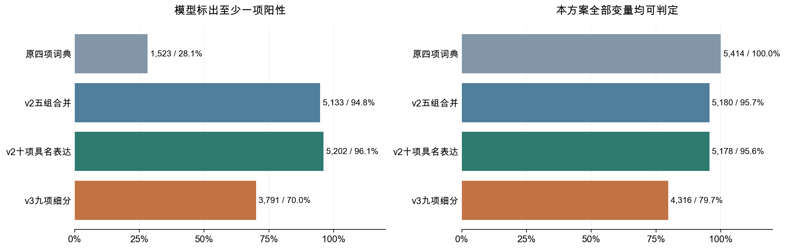
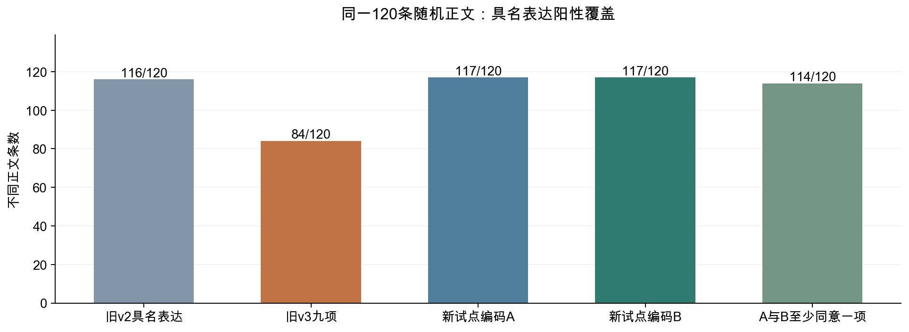

# 新版覆盖下降的原因，以及更合理的变量方案

**变量方案反思与对比评估 · 可编辑方法修订**

本次复核确认了新版覆盖下降的实质问题。上一轮把表达分得更细，却删去了题注、感悟、建议等常见表达，还让时态或细分不明确影响上层信息的保留。结果是类别增加，研究实际覆盖的表达范围反而缩小。**继续把九类当作整体正文分类的主方案，并不合适。**

以全部5,414条清理后非空正文为共同分母，旧五组的模型阳性覆盖是94.8%，新九类降到70.0%；恢复旧版十项具名表达，可以达到96.1%，并未依赖“其他”补足。这个96.1%是历史AI编码的阳性覆盖，尚不能当作分类准确率或新方案已经验证通过。

本次比较支持的方向是：保留完整表达范围，内容对象与表达行为分轴记录，把事件是否发生、具体计划还是目标、问候还是感谢放到下层属性。既有结果按原定义保留作基线；新规则先做独立试点，不能把新旧标签直接拼起来冒充统一重编码。

## 1. 覆盖下降是实际设计问题，也需要把三个口径说清楚

为检验各版变量是否充分利用同一批可观察正文，以下以5,414条清理后非空正文为共同分母，分别核算至少一项阳性与全部变量可判断的比例。保留每版的未知状态，不通过填零提高可判定率。

| 方案 | 至少一项阳性 | 阳性覆盖 | 全项可判定 | 可判定占比 |
| --- | --- | --- | --- | --- |
| 原四项词典 | 1,523 | 28.1% | 5,414 | 100.0% |
| v2五组合并表达 | 5,133 | 94.8% | 5,180 | 95.7% |
| v2十项具名表达，排除其他 | 5,202 | 96.1% | 5,178 | 95.6% |
| v3九项细分表达 | 3,791 | 70.0% | 4,316 | 79.7% |

图1　左图为模型至少标出一项阳性的帖子数；右图为同一方案全部变量可判定的帖子数。共同分母5,414，其他正文未补成语义阴性。词典可判定表示规则能运行，不意味着语义已经判断正确。方案变量数不同，完整可判定率也受待判断项目数量影响。

“至少一项阳性”回答模型是否识别到研究选定的表达；“变量可判定”还包括明确阴性；“回归样本”取决于具体模型需要哪些变量。新九类有3,791帖出现阳性，另有705条正文的九项均被明确判为阴性，仍可提供比较。此前八项可估计的逐项回归，实际使用4,564—5,082帖，即非空正文的84.3%—93.9%。不能把70.0%称为所有分析的数据利用率，也不能因阴性可作比较就忽略表达范围的遗漏。

正文可观察边界始终存在。全部9,532帖中，3,984帖无可用原始正文，134帖清理后为空；5,414帖占全样本56.8%。元数据描述可以保留全部帖子，正文语义分析不能推回未观察的图片、视频或缺失文字。新方案解决的是已观察文字的利用方式。

## 2. 前几轮真正需要纠正的地方

第一，把“更细”误当成“更好”。旧五组合并确实混淆了计划与鼓励、问候与邀请；但拆分时不该把其他常见表达移出主体系。旧五组有阳性、新九类无阳性的有1,399帖，反方向只有57帖。新版的1,623条无阳性正文中，有999条带有旧版感悟、建议、题注等被遗漏表达标签。这些旧标签需要复核，但足以说明不能把这批正文直接理解成“没有可分析表达”。

第二，把属性不明扩展成整个表达不明。批量阅读设计样本时，一些短正文能明确呈现活动、餐食或地点，但不足以判断已完成还是计划进行。保留“展示具体内容”与“事件是否明示发生”两个变量，就能同时保留确定信息和真实的不确定性。这里扩大了测量范围，不能说原“行动记录”已经得到验证。

第三，给正文设置一个全局可读门槛，可能抹去其他维度的信息。食物对象可识别而说话目的不清，或抽象感悟可识别而具体话题不明，应该允许两个轴有不同的可用状态。

第四，标签重叠本身不是分类失败。旧十项具名表达有1,304帖至少两项阳性，占24.1%；同一正文记录训练、表达疲惫并鼓励自己，是合理共存。需要检查的是类别是否重复、证据能否支持、模型是否能区分，而不是要求一帖只能进入一类。

第五，低共线性没有解决测量是否合理的问题。新九类VIF较低，不能为范围缩窄背书；反过来，完整表达方案也没有出现要求删掉这些表达的高VIF。类别少、罕见类回归跑不动、某个系数显著与否，都不能替代语义边界的论证。

## 3. 可继承方案已经实际比较，简单拼接不如先统一定义

为判断哪些既有成果可以继承，本节比较恢复完整表达、保留父子属性、跨轮拼接和内容表达双轴等方案。除已有逐帖标签外不增加推断性标签，也不使用点赞或显著性选择类别。

|方案|实际阳性或表示覆盖|主要收益|主要问题与处理|
|---|---|---|---|
|恢复v2十项具名表达|5,202/5,414，96.1%|恢复议论、建议、题注等范围；已有全量标签可追溯|保留历史基线；仍需复核边界与编码一致性|
|旧父标签＋v3子属性|父标签覆盖同为96.1%|尽量继承细分结果|跨轮父子冲突保留，不能自动推导新真值|
|v3＋旧辅助标签|排除其他后4,790/5,414，88.5%|可观察遗漏范围|两轮全局状态冲突161帖，不作为统一新版|
|六内容轴＋十表达轴|任一轴阳性5,217/5,414，96.4%|区分谈什么和怎样表达|仅比表达轴多覆盖15帖；价值主要是解释维度，内容轴含其他明确对象|
|强制主类＋次类|没有凭优先级另造全量答案|便于做互斥分布图|至少1,304帖原本多表达；缺少主次证据时，主类只是人为顺序|
|正文形式＋语义变量|形式特征可保留全部5,414条非空正文|短文、标点及符号也保留为形式信息|形式可计算不等于语义可识别；不能把两种覆盖合成一个百分比|

父子继承并不天然成立。例如，旧“未来表达”409帖中，新计划/目标均明确阴性的有105帖，没有子类阳性且存在未知的有83帖；旧行动记录父类阴性而新行动标签阳性的也有429帖。这可能混合定义变化和编码差异，不能靠把父标签复制给子标签来消除。既有标签的来源和冲突应保留，统一规则下的重新判断才是新版。

同一正文可有多项表达，这些变量也可能与长度、媒体及作者特征重复反映相似信息，影响联合估计的稳定性。为判断恢复完整范围后能否在同一模型中区分各项信息，我们在实际控制设计中检查矩阵秩和VIF。旧十项中九项达到固定的样本支持门槛，供给告知仅2帖保留描述；九项加长度、媒体、时段、作者和日期控制，VIF为1.17—2.69。内容和表达联合诊断中，支持足够的14项变量VIF为1.15—2.78，两种设计均满秩。这里只说明这些候选变量在数值上仍可区分，不能推断全部类别已通过语义验证。

旧版90条AI复核中，建议类的可比阳性一致性只有40%，题注约66.7%，且建议类阳性支持很少；邀请、供给等更缺少足够复核阳性。因此恢复范围之后，仍应先解决这些边界，不能只凭96.1%就宣布旧版胜出。

## 4. 连续权重、聚类与降维已经计算，但不能把能生成数字当成分类合理

本次对4,156种不同正文拟合字符TF-IDF，再映射回全部原帖；保留中英文与数字的词汇字符后，5,273帖有非零向量，占97.4%，另141帖没有这类字符。把符号也作为特征可达到5,411帖，但这只说明能数出字符，不代表能解释内容。

| 实际计算方案 | 可生成变量的帖子 | 数值诊断 | 解释范围 |
| --- | --- | --- | --- |
| 字符SVD 5维 | 5,273 | 解释字符矩阵方差 3.71% | 连续坐标缺少直接语义定义 |
| 字符NMF 5成分 | 5,273 | 相对重建误差 0.975 | 权重是相对字符成分贡献，不是类别概率 |
| KMeans 5类 | 5,273 | 两种子ARI 0.954 | 固定同一低维空间，强制互斥，语义待核对 |
| 字符SVD 8维 | 5,273 | 解释字符矩阵方差 5.39% | 连续坐标缺少直接语义定义 |
| 字符NMF 8成分 | 5,273 | 相对重建误差 0.967 | 权重是相对字符成分贡献，不是类别概率 |
| KMeans 8类 | 5,273 | 两种子ARI 0.945 | 固定同一低维空间，强制互斥，语义待核对 |
| 字符SVD 12维 | 5,273 | 解释字符矩阵方差 7.23% | 连续坐标缺少直接语义定义 |
| 字符NMF 12成分 | 5,273 | 相对重建误差 0.958 | 权重是相对字符成分贡献，不是类别概率 |
| KMeans 12类 | 5,273 | 两种子ARI 0.944 | 固定同一低维空间，强制互斥，语义待核对 |
| 旧十项标签PCA 3维 | 5,178 | 解释标签方差 39.23% | 没有增加原始标签可用样本；部分稀少表达信息被压低 |
| 旧十项标签PCA 5维 | 5,178 | 解释标签方差 60.08% | 没有增加原始标签可用样本；部分稀少表达信息被压低 |

字符SVD在12维下解释7.23%的矩阵方差，独立正文的投影平方范数中位数仅约2.73%。KMeans是在这同一个12维SVD空间再归一化后计算；两种随机种子相近，只说明固定表征下的局部优化结果接近，没有检验表示变换、抽样或语义的稳定性。NMF与SVD的低维信息损失是需要检查的代价，不是单凭一个阈值就能宣布算法失败。

PCA同样没有自动解决问题。3个成分只保留39.2%的标签方差；对未来表达和问候，分别只保留约6.9%与5.8%的单项方差。压成少数数学上近似正交的指标，会遮蔽研究关心的表达差异。它们适合作为补充表示或稳健性对照，目前不足以直接取代可解释的主变量。此处没有运行语义嵌入、BERTopic或MCA，也没有声称穷尽所有算法。

## 5. 新的多轴分层方案做了冻结后的双编码试点

本次大模型实际分批阅读了131条不同正文做设计诊断，其中120条来自新版无阳性文本的不同分层，另有对照和冲突文本。逐条阅读记录留在私有目录；其中44条主要涉及遗漏表达家族，31条涉及细分类边界，10条涉及其他轴仍能利用的信息。这是有意抽取、旧标签可见的开发诊断，不能当作全体错误比例。

据此冻结新的多轴手册后，排除已记录的开发与复核材料，再从3,253种符合排除条件的不同正文中简单随机抽120条，另抽40条旧v3无阳性正文作诊断。两份同基座AI在不同上下文中只看到匿名正文和冻结手册，逐条阅读并提供阳性原文证据。两组样本分开统计，既不按帖子等概率，也不宣称语料从未被旧模型看过。

| 同一随机样本方案 | 具名表达阳性 / 120 | 内容或表达任一具名阳性 / 120 |
| --- | --- | --- |
| 旧v2具名表达 | 116 | — |
| 旧v3九项 | 84 | — |
| 新多轴方案A | 117 | 117 |
| 新多轴方案B | 117 | 117 |
| A与B至少共同标出一项 | 114 | 115 |

图2　仅比较同一120条不同正文，不能把这张图的比例当作5,414帖的全量结果。“A与B至少共同标出一项”表示存在同一阳性标签，不意味着其他标签、未知或全部属性一致。

随机样本中，A与B各有117条具名表达阳性，均为97.5%；其中114条至少有一个相同阳性标签。旧v2在同一样本已有116条阳性，因此本轮改善主要是恢复相较v3丢失的范围，并让主表达与属性分别可用，尚没有证据表明总体覆盖大幅超过v2。不能把97.5%的不同正文试点比例与96.1%的全量帖子比例直接作效果比较。

本次随机试点中，两份编码各自的“内容或表达任一阳性”仍为117条，内容轴没有在无表达阳性之外再增加覆盖。多轴的价值在于分开记录信息；不能把它写成已经证明能显著扩样。A、B分别有114条、117条全部具名表达可判定；如果再要求全部内容变量同时可判定，就降到104条、105条。因此模型应按研究问题选择需要的维度，不能把所有轴和属性一起要求完整。

A与B的表达阳性集合完全相同94/120条；同时要求表达未知集合相同为91/120条。在额外40条旧v3无阳性的诊断样本里，旧v2已标出36条具名表达；A、B分别标出38条、37条，双方至少同意一项的有37条。这主要恢复了v3缩小的范围，不能解释成相较所有旧方案新增37条，更不能认定真实漏判已全部纠正。

困难正文仍有边界问题：定向组鼓励标签的可比阳性一致性为50%（至少一方阳性且双方可判的支持仅6条）；双方都标出展示的18条中，9条的事件属性至少一方仍未知。这些正文可以保留明确的展示信息，事件状态和鼓励边界继续单列核查。

| 表达变量 | A阳性 | B阳性 | 双方阳性 | 可比阳性一致性 | 任一未知 | 可比阳性支持 |
| --- | --- | --- | --- | --- | --- | --- |
| 记录或展示 | 78 | 73 | 71 | 95.3% | 6 | 78 |
| 自身体验 | 22 | 21 | 21 | 97.7% | 5 | 22 |
| 对象评价 | 21 | 20 | 17 | 85.0% | 6 | 23 |
| 未来安排或目标 | 19 | 17 | 16 | 88.9% | 6 | 20 |
| 鼓励或提醒 | 20 | 20 | 18 | 90.0% | 5 | 22 |
| 观点或感悟 | 26 | 26 | 24 | 94.1% | 5 | 27 |
| 解释或建议 | 5 | 5 | 4 | 80.0% | 5 | 6 |
| 问候祝愿或感谢 | 7 | 8 | 7 | 93.3% | 5 | 8 |
| 征询或邀请 | 3 | 2 | 2 | 80.0% | 5 | 少于5条 |
| 供给告知 | 0 | 0 | 0 | 无可比阳性 | 5 | 少于5条 |

表中“可比阳性一致性”为2×共同阳性/（2×共同阳性＋A独阳＋B独阳），任一未知先单列。大量共同阴性不能替代阳性支持；稀少标签即使总一致很高也不能据此宣布可靠。同基座AI仍可能共同误判，人工复核尚未完成。

## 6. 建议采用的变量结构

|层次|记录的信息|如何利用不完整信息|
|---|---|---|
|内容轴|运动、身体、饮食、具体生活、工具服务及其他明确对象|内容可识别时保留；不要求先识别表达意图|
|表达主变量|记录或展示、自身体验、对象评价、未来安排或目标、鼓励、观点、解释建议、问候致谢、征询邀请、供给告知|允许多项共存；其他明确表达单列，不用来包装具名覆盖|
|下层属性|展示是否明示事件发生；未来表达中的计划/目标；社交表达中的问候/感谢|父类确定而子属性未知时，保留父类；未知不填0|
|形式与可观察状态|正文是否存在、清理后是否为空、长度、词汇字符、标点、表情及元数据|保留全部帖子和短文的信息；不推断缺失媒体语义|

相较原五组，新结构将计划与鼓励分开，体验与对象评价分开，征询邀请与问候分开；同时把被遗漏的观点、建议和展示恢复为具名主变量。将计划/目标、问候/感谢放在下层，是为了允许较宽表达明确而细节不明，也便于对罕见子类只做描述。

回归设计应跟着测量结构改变。正文表达之间可共存，主分析需要在同一明确样本中评估有支持的表达变量联合进入后的条件关联，原逐项模型留作对照；内容轴可作另一组控制。父类和穷尽子类不能整套同时放入同一设计，子类比较只在父类阳性且子类可判的样本里做。缺失不补成无表达，多标签不按优先级消掉，变量选择不看点赞显著性。

第3节VIF来自旧标签可复用方案，不是新试点变量的全量VIF。新规则推广后仍须按实际可用样本重新检查满秩、共线性、阳性作者集中和作者内变化，不能直接继承旧VIF。

## 7. 既有结果怎样继承，哪些结论需要重估

样本清理、媒体与tag分布、点赞长尾、评论和回复网络可按原定义继承；原四词典结果保留为字面特征历史对照。旧v2十项表达可以作为完整范围的历史基线，v3细分标签可以作为待核查的候选属性。跨轮冲突与未判断状态已经单列。

上一轮九项回归回答的是那九个特定变量的问题，不能在变量改名或扩大范围后继续搬用系数。新多轴方案尚未全量重编，本次也没有重跑其点赞回归；不能把120条试点的覆盖包装成全量96%或已更新的实证结论。此前NMF主题回归仍使用连续权重，原2,470帖的词分词分析与本次字符方案是不同口径，不能直接把后者的5,273帖覆盖当成原模型扩样结果。

本轮已经完成范围审计、可复用候选全量比较、完整设计共线性复核、连续表示实验及新规则双编码试点。下一步全量编码应沿用冻结规则并保留每项证据，先报告可判定与分歧，再按同一设计重估关联；这一步不能用旧标签拼接或试点比例推算替代。独立人工抽查应覆盖双方一致、分歧、原先无阳性和低频类，而不只挑模型看起来正确的例子。

## 8. 方法依据与可核查结果

自动文本方法需要针对研究问题验证，不能用处理规模代替近读与验证；参见[Grimmer与Stewart（2013）](https://www.cambridge.org/core/journals/political-analysis/article/text-as-data-the-promise-and-pitfalls-of-automatic-content-analysis-methods-for-political-texts/F7AAC8B2909441603FEB25C156448F20)。本次关于覆盖、边界与取舍的判断来自本项目实算，文献不替本项目证明类别正确。

在同批数据上发现变量后反复估计，会增加过拟合风险；[Egami等（2022）](https://naokiegami.com/paper/CausalText.pdf)提出在文本测量发现与估计之间分样本。本项目既有探索已被看过，新试点仅与已记录设计材料分离，不能据此恢复事前注册或因果识别。

|结果与规则|文件|
|---|---|
|同口径历史审计|[variable_scheme_independent_audit.json](results/variable_scheme_independent_audit.json)|
|可复用方案、父子冲突和全设计VIF|[reusable_variable_scheme_comparison.json](results/reusable_variable_scheme_comparison.json)|
|字符表示、NMF、SVD、KMeans与PCA实算|[continuous_text_scheme_comparison.json](results/continuous_text_scheme_comparison.json)|
|131条开发诊断聚合|[variable_scheme_design_diagnostics.json](results/variable_scheme_design_diagnostics.json)|
|新试点双编码聚合|[multiaxis_v4_pilot_evaluation.json](results/multiaxis_v4_pilot_evaluation.json)|
|事后来源完整性核查|[multiaxis_v4_source_audit.json](results/multiaxis_v4_source_audit.json)|
|冻结方案正文|[多轴分层变量试点_编码手册_v4.md](多轴分层变量试点_编码手册_v4.md)|

原始正文、逐条注释、盲样本、证据及ID映射均保存在忽略目录；公开聚合不包含原帖或作者标识。试点规则在抽样前冻结；逐批来源哈希另作了事后完整性检查，v3定向抽样来源哈希未在抽样前冻结的追溯限制保留在核查文件中。
