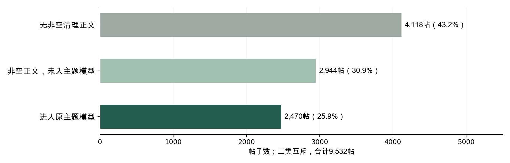

# Keep分析：方法复核与修订结论

2026年10月29日｜基于当前12分钟合并版及其冻结结果｜状态：**需实质修订**

## 1. 先给判断：分类与测量问题比共线性更值得优先处理

老师的疑问有实质依据。当前最需要修正的是：避免把研究者选定的字面词汇和五个NMF成分解释成完整内容分类，以及避免把某一种样本口径下的不显著结果说成普遍稳定的内容结论。现有证据并不支持把所有帖子塞进五类，也不支持直接给五类增加0–1变量后就认为分类问题已经解决。

旧版已经注明词典不等于心理量表、主题只代表2,470帖，这些限定是正确的，应当保留。本轮新增的语义错配、拟合权重和正文口径对照，进一步限制了主题名称和整组稳健性的解释；不能把旧版没有声称过的全样本精度或因果结论当作已发现的计算错误。

不过，这不等于全部计算错误。原主模型和主题模型系数可以复算；四个字面变量的数值共线性很低；剔除少帖作者后的结果基本不变。应把“计算是否正确”“变量是否测到了研究概念”“结论能推广到哪里”分开判断。

本次保留旧文件和旧模型作为历史结果，不因为某个新模型更显著就将它宣布为确认性结论。修订后的文字问题应明确限定于正文确实可观测的帖子；全样本旧模型保留为对照，不能继续充当真实文字缺失已被解决的证明。新的主题分类框架是候选编码方案，尚未对全样本生成经验证的新标签。

| 层次 | 原先容易混淆的对象 | 修订后的定位 |
| --- | --- | --- |
| 字面特征 | 三类词汇规则和问号 | 可重叠的局部表达线索，不是穷尽全部帖子的四种内容类型 |
| 数据中的原始标签 | hashTags字段中的269种话题名 | 作者选择的元数据，不是正文语义的标准答案 |
| NMF成分 | 固定提取的五个词群及事后名称 | 探索性文本结构，尚不能当作五类真实主题的分类器 |

## 2. 五类标签确有设计和覆盖问题

### 2.1 技术上得到五个成分，不代表语义上覆盖全部内容

9,532帖中，5,414帖清理后正文非空；只有2,470帖进入冻结的主题权重表，占全样本25.9%、非空正文45.6%。另有2,944帖虽然有非空正文，但没有进入该主题分析。文本先经过有效词数、词频和词表筛选，另有8条近零贡献文档被排除。

图1　三类是记录与模型覆盖状态。未进入模型不等于没有主题，更不等于一定属于五类之外；无正文也不等于图像、视频没有内容。

五个旧名称还混合了不同层级：“静蹲”“骑行”“跑步”是具体运动或记录方式，“运动与训练交流”是上位内容域，“生活感悟与问候”又混合内容和表达功能。一个跑步经验帖可能同时满足多项。仅将编码改为多标签不能修复这种边界与层级问题。

### 2.2 语义抽查发现错配；尚不能声称多数帖子都在五类之外

按固定随机种子，每个原主导成分抽12帖，共60帖；另抽20条有正文但未入模的帖子。抽样不使用点赞。对正文做单轮AI辅助语义筛查，不把原始tag作为正文语义的真值。结果如下：

| 原主导主题名称 | 正文支持 | 仅部分支持 | 不支持该名称 | 信息不足 |
| --- | --- | --- | --- | --- |
| 靠墙静蹲记录 | 8 | 2 | 2 | 0 |
| 骑行里程记录 | 10 | 1 | 0 | 1 |
| 运动与训练交流 | 7 | 1 | 4 | 0 |
| 跑步与训练打卡 | 7 | 0 | 4 | 1 |
| 生活感悟与问候 | 8 | 2 | 2 | 0 |

60条中有12条正文不支持被分配到的具体名称，另有6条仅部分支持、2条信息不足。**这是有意等额抽取各成分的诊断样本，不能用其未经加权的比例推算全样本错误率。**“不支持这个名称”也不等于不属于其余四类。

例如，单轮筛查中发现：山河保护人的感悟被放进“静蹲”；囤口罩的提醒也被放进“静蹲”；餐食配菜和食品品牌推荐被放进“运动与训练交流”；绘画进度、昆明出行、学期结束等被放进“跑步与训练打卡”。这些只是语义概述，不暴露作者和原始帖ID。个别生活类错配可能通过改名缓解，运动类的明显错配则表明不能仅靠改名解决。

未入模样本里也同时出现了明确的跑步状态、晚安问候、餐食、手环故障、加入圈子，以及仅品牌名、符号或数字的记录。因此，未入模部分既有原分类可能覆盖的短文本，也有遗漏领域和无法判断的内容，不能统一处理为“其他主题”。

**这份筛查没有双人独立标注，不能作为最终分类精度评估。**它足以发现具体反例和修订方向，不能证明全样本的大多数帖子都不属于现有五类。

### 2.3 高权重与跨随机种子稳定，均不能证明标签语义正确

NMF归一化权重只表示五个成分之间的相对贡献，不是分类正确的概率。抽查中，山河感悟被分到静蹲的最高权重约0.913；陪孩子上课的“打卡”被分到跑步训练的权重约0.973。不能用0.8、0.9这类高权重阈值替代语义验证。

旧稳定性检查只改变同一语料、同一K和同一初始化方法下的随机种子，关键词几乎一致。这证明该设定容易复现，未检查删重、作者构成、类别数或语义效度。

本轮在同一个TF-IDF词表和IDF下改变拟合权重：2,478条拟合文档有2,374种完全不同的清理正文，104条为重复行。删除完全重复正文后，独立的静蹲成分不再单列，相关词进入更宽的打卡成分；另出现包含三明治、咖啡、鸡蛋、早餐等词的成分。调整为作者等权的拟合目标后，关键词结构也明显变化。这说明原词群受重复模板和作者产量影响，不能把“词群稳定”直接解释为“社区天然只有五类内容”。

原静蹲主导成分的85帖中78帖来自一位作者，骑行成分的85帖中58帖来自一位作者。旧版先拟合主题、再对主导标签作作者等权描述，只改变统计份额，不能消除拟合阶段的模板影响。

K=3、4、6、7、8的诊断也已保留；它们不用于根据点赞、显著性或单纯拟合误差挑选新K。删重后的新成分同样尚未通过语义验证。

## 3. 四个词典变量：共线性不突出，概念解释需要收窄

### 3.1 分类理由应解释“观察什么”，不要声称四个独立心理维度

| 变量 | 观察角度及分类理由 | 主要解释边界 |
| --- | --- | --- |
| 自律／目标词命中 | 目标与行动表述；以坚持、目标、计划、完成等词识别运动记录中的目标追求和行动进度，与RQ2关注的内容表达相对应。 | 加油也可能用于鼓励他人；命中不等于作者具有自律人格或真实完成训练。 |
| 社交称呼／互助词命中 | 面向他人的称呼与互动邀请；以大家、一起、谢谢、请教等词识别对读者的称呼、感谢、互助和邀请交流的字面线索。 | 感谢可能同时带有积极含义；命中不等于已发生互助，也不代表关系强度。 |
| 积极表达词命中 | 积极感受与赞许的表面用词；以开心、快乐、喜欢、棒等词识别积极感受和赞许，区别于说什么目标、对谁说及是否使用问号。 | 未处理否定、反讽和子串歧义；命中不是经过验证的情绪或情感判断。 |
| 问号出现 | 句式标点线索；正文含中文或英文问号即记1，用作疑问句式的可观察标记；它是标点规则，与前三类词汇规则性质不同。 | 反问、修辞问句也会命中，未使用问号的提问会漏判；不等于求助意图。 |

严格说是三类词汇规则加一类标点规则。它们可以描述不同表达线索，但不在同一个内容分类轴上，不要求互斥。

有非空正文的5,414帖中，3,891帖没有命中任何一个规则，占71.9%；全样本未命中数为8,009。这个低覆盖不是程序自动错误，因为词典本来可以只测局部线索；但它限制了RQ2能回答的范围。原回归只能说明“这些指定字面线索与点赞的条件关联”，不能代替“各类内容与点赞的关系”，更不能判定作者的真实自律、互助或情绪状态。

### 3.2 允许语义交叉，与是否数值共线是两回事

| 字面变量 | 命中帖数 | 完整M3的VIF | 有作者内变化的作者数 |
| --- | --- | --- | --- |
| 自律／目标词命中 | 877 | 1.750 | 76 |
| 社交称呼／互助词命中 | 159 | 1.149 | 42 |
| 积极表达词命中 | 574 | 1.186 | 64 |
| 问号出现 | 125 | 1.112 | 32 |

完整M3设计矩阵为9,532×182且满秩，四变量VIF为1.11–1.75；全样本最大两两φ相关约0.119，作者内最大约0.085。182帖同时命中两项及以上。现有数值不支持因高度线性重复而合并变量，但也不能证明语义独立、词典没有漏判或误判。低VIF不能弥补测量效度不足。

## 4. 少帖作者与正文缺失：前者较小，后者会改变统计判断

### 4.1 作者固定效应并未因少帖作者而整体失效

100位作者在本课程样本中的发帖数最小1、中位数66、最大783。2位作者只发1帖；发帖不超过10帖的14位作者合计80帖，占0.84%。这些是样本内次数，不能推断他们在平台上总共只发过这些帖子。

固定效应的共同斜率依赖作者内变化，单帖作者本身不提供这种变化。不同变量的支持也不同：长度在93位作者内有变化，自律76位、社交42位、积极表达64位、问号32位。不能把100个作者等同为每个稀少特征都有100个有效变化来源。

| 样本设定 | 帖数／作者数 | 五项联合p | 积极表达β／BH q |
| --- | --- | --- | --- |
| 原M3 | 9,532／100 | 0.130 | -0.086／0.079 |
| 保留至少5帖作者 | 9,524／95 | 0.131 | -0.086／0.080 |
| 保留至少10帖作者 | 9,462／87 | 0.130 | -0.085／0.095 |

以上剔除没有实质改变原主结论。它支持“少帖作者不是当前结果的主要来源”，不证明作者固定效应排除了曝光、粉丝变化或其他时变混杂。

**主题回归必须重新计算其自身样本的作者支持。**2,470帖来自86位作者，其中10位只有1帖；40位在主题子样本中不超过10帖，合计181帖。作者发帖中位数是14帖，不是全样本的66帖。按主题子样本的发帖数设置门槛后：

| 每位作者至少有几条主题入模帖 | N／作者数 | 原连续成分联合p |
| --- | --- | --- |
| 1 | 2,470／86 | 0.166 |
| 2 | 2,460／76 | 0.166 |
| 5 | 2,423／64 | 0.179 |
| 10 | 2,309／48 | 0.266 |

剔除后未出现明确的整组显著证据，但作者支持范围由86人降至48人，不能简单称为所有作者都充分支持了主题比较。以上仍只核查旧成分回归的估计支持，不修复标签的语义问题。

### 4.2 缺失正文填0加标记，不等于真正观察到没有相应用词

原全样本将缺失正文的词典与长度值设0，并控制has_text。has_text标记原始正文是否有可见字符，而非清理后是否还有内容。原始正文可见5,548帖，清理后非空5,414帖，两者相差134帖。

这种缺失指示变量可以区分平均水平，不能恢复未观察的内容、也不能自动校正非随机缺失。因此，全样本模型和仅正文可观测模型对应不同的比较范围，需要并列报告。重新估计结果如下：

| 样本口径 | N／作者数 | 五项联合p | 长度BH q | 积极表达BH q |
| --- | --- | --- | --- | --- |
| 原全样本＋缺失标记 | 9,532／100 | 0.130 | 0.293 | 0.079 |
| 原始正文可见 | 5,548／95 | 0.067 | 0.106 | 0.093 |
| 清理后正文非空 | 5,414／95 | 0.040 | 0.048 | 0.048 |

清理后非空子样本的联合p约0.040，长度和积极表达在该模型内的BH q均约0.048。因此不能说“所有样本处理下五项都没有显著证据”。这也不能反过来让我们挑选这个模型作为更显著的答案：它改变了研究人群，结果接近阈值，而且BH仅针对每个模型内五项检验，没有对本轮全部探索性设定统一校正。

更适当的判断是：**字面变量的统计证据对正文可观测范围敏感，尚不能推广为全部内容的稳定效果，也不能解释为用词的因果作用。**正文缺失带来的选择问题仍未解决。

## 5. 原始话题标签：值得纳入对照，但不能直接补成正文真值

5,209帖有原始话题标签，占54.6%，共269种；其中1,517帖缺少原始正文却有标签。原主模型已经含“有无标签”控制has_tag，未控制每个标签身份。

本轮按不使用点赞的频数规则，选取至少30帖、至少5位作者使用的9个标签身份，保留原正文编码并加控制。另做正文与标签拼接后重新编码，两种做法回答的问题不同：前者调整可见标签差异，后者改变了被测文字的范围。

| 设定 | 五项联合p | 积极表达β／BH q | 解释 |
| --- | --- | --- | --- |
| 原M3 | 0.130 | -0.086／0.079 | 正文词汇，已有has_tag |
| 加9个标签身份控制 | 0.102 | -0.083／0.088 | 正文范围相同；不是穷尽269种tag |
| 正文＋tag重新编码 | 0.173 | -0.070／0.167 | 改变测量范围，不能冒充原正文系数 |

拼接后自律词命中877→3,342帖，问号125→354帖。这种增加很大一部分来自“坚持 Keep 的那些天”等统一话题措辞；标签中的问号也可能是平台活动标题，不是作者在正文中提问。它们不能直接解释成帖子具有更强自律意图或更多求助。

原始tag也不保证与正文相符：语义抽查发现，健身日常tag下可以出现牙痛记录，立旗tag下可以出现水果或生活感受。因此，**tag应作为并行元数据和敏感性对照，不能充当人工主题标签的金标准。**9个频繁标签是控制项，不是新的九类内容分类。未加入标签数控制，是因为5,207帖只有1个标签，仅2帖有2个；在has_tag之外再加数量，额外识别几乎只靠这2帖。

## 6. 五类主题的0–1问题：先纠正概念，再看补充模型

原回归的五项输入是位于0到1之间的连续归一化权重，并非五个0／1虚拟变量；每帖可以同时有多个正权重。五项和为1，所以带截距时省去一项权重作参照，避免完全共线。主导主题argmax只是旧描述图的互斥统计方式，不证明一帖只能谈一个主题。

作为编码诊断，保留冻结权重，另外定义权重≥0.20时标记该成分存在。2,470帖中1,088帖有两个及以上标记，训练与生活两成分同时出现894帖。五项比例合计145.9%，不能用饼图表现为互斥分区。

| 阈值 | 多标记帖数／2,470 | 联合p | 最小BH q |
| --- | --- | --- | --- |
| 0.15 | 1,331 | 0.289 | 0.205 |
| 0.20 | 1,088 | 0.286 | 0.296 |
| 0.25 | 835 | 0.517 | 0.479 |

五个二元标记一起进入补充回归，主阈值完整设计矩阵171／171满秩；不需要因为恰有五个标记就机械删掉一类。系数表示固定其他标记和控制项后的条件差异，不是与某个单一基准主题的差异。三个阈值下不存在观测到的“五项全零”组，也不能把系数解释为相对于真实无主题组。

这些阈值是本轮提出、未事先注册的便捷诊断，0.20仅取1／5。它们没有语义效度验证，区间未纳入主题估计和阈值选择不确定性。**原成分名称有问题时，阈值多标签仍继承该问题；本轮算得出的p值只能作技术核查，不能当作分类已经修好的最终回归。**

## 7. 具体修订：先统一分类轴与可观测状态，再谈新主题效应

### 7.1 已经完成且可采用的修订

1. 明确三类词汇和问号是可重叠的字面特征，列出分类理由、覆盖与误判边界；共线性诊断保留，但不把低VIF当作有效量表证明。
2. 分开原始tag、NMF成分、人工语义标签；将旧主题解释降为探索性。避免“这五类完整覆盖帖子”的表述，将旧PPT中“前两类合计88.5%”限制为模型主导成分的数值份额，不能据此认定88.5%的正文在语义上确实属于这两类。52.7%和35.8%也只是旧模型主导成分份额。
3. 并列报告9,532、5,548、5,414三个正文口径的模型，说明统计判断会变化；原M3保留为历史基线。修订的文字关联问题限定于可观察到非空正文的帖子，理由是变量确实可测，不是该模型更显著。当前重分析属于探索性结果，不能恢复成事先注册的确认性检验。
4. 保留少帖作者剔除与标签身份对照；它们分别检查估计支持和元数据差异，不能替代分类验证。

### 7.2 已拟好的候选编码框架，不冒充已验证的新分类

一级只回答“谈什么”；跑步、骑行、静蹲归为运动子类型。表达目的另设一个维度，例如记录、经验建议、求助、问候、推广线索。允许多标签，并将“其他可辨识主题”“信息不足”“无可用正文”分开。

| 候选内容域 | 包括 | 边界 |
| --- | --- | --- |
| 运动与训练 | 训练、课程、运动过程、成绩与方法 | 跑步、骑行、静蹲作为子类，不与上级运动类并列解释为互斥类别 |
| 饮食与营养 | 餐食、食谱、营养补充、食物推荐 | 不能仅因出现在健身平台就自动归为训练知识 |
| 身体状态、健康与恢复 | 疼痛、疾病、疲劳、康复和体重状态 | 若同时明确运动过程，可与运动类并标；不作医疗诊断 |
| 日常生活与兴趣 | 工作学习、家庭、旅行、绘画、节日、生活感悟与问候 | 情绪可以作为第二维度标记，不因开心一词就认定正文只谈生活 |
| 装备与产品体验 | 手环、鞋服、运动器材等体验或推荐 | 是否推广另作表达目的标签，不把所有产品推荐视作商业广告 |
| 平台功能与社区活动 | 加入圈子、平台挑战、功能或服务体验 | 平台原始挑战tag本身不充分证明正文属于此类 |
| 其他可辨识主题 | 正文语义可判断但目前类别无法表达的内容 | 保留开放类并记录理由，反复出现的新领域用于修订codebook |

不能为追求覆盖而把生活类无限扩大，也不能将无正文和短文本统一视为其他。候选类数仍可调整；当前没有声称已为9,532帖获得新的真实主题标签。

下一步需两名同学对一批覆盖作者、媒体、已入模和未入模帖的样本独立标注，记录分歧与其他类；修改边界后，再用未参与修改的样本验证覆盖和各类一致性。正文没有信息时保持未知，不能仅凭tag补出“真主题”。完成后才能冻结新编码并重新拟合主题回归。单轮AI辅助筛查不足以替代这项人工语义判断。

### 7.3 当前可以用于报告和答辩的结论

“现有词典覆盖的是指定字面表达。数值共线性较低，少帖作者剔除后结果变化不大；但文字关联对正文可观测范围敏感。五个NMF成分尚不足以作为完整内容分类，语义抽查和删重诊断均提示需要重新验证。因而我们保留其探索性结果，暂不据此给内容类型做稳定点赞排序。”

对老师“很多帖子不属于现有几类”的回应可说：“目前确实没有证据证明这几类足以覆盖数据。我们查到了具体错配和未覆盖领域，也发现大量短文本没有进入模型；但还没有全样本人工标注，因此不会把未入模数直接当作五类之外的帖子数。”

## 8. 原成果怎样处理

| 原成果位置 | 当前处理 |
| --- | --- |
| 12分钟合并版第5—7页主题内容描述 | 需修订：成分份额不应直接表述为真实内容分类占比；作者等权描述不能修复原拟合 |
| 第8页四类变量，第10—12页模型与敏感性 | 补分类依据与覆盖；加入完整正文口径对照，收窄“稳定不显著”的表达 |
| 第13页主题回归 | 可保留原模型的计算，但应降为探索性成分关联，不能解释成真实主题效应 |
| 第14页RQ2结论 | 改为测量与可观测范围受限、样本口径敏感；不得只引用全样本p值概括全部结果 |
| 评论与网络部分 | 本轮未全面重审，不因帖子词典或主题检查通过就视为这些部分已通过新审查 |

旧PPT、旧报告和冻结模型结果均保留。本次优先交付方法复核及可复现证据，不把未完成语义验证的候选框架包装成定稿PPT。

## 9. 本轮审查覆盖与剩余问题

以下分母是本轮界定的组件或解释单元，不代表全项目审查完成；“0／N”只表示没有观察到错误，不等于验证了所有潜在问题。

### 表述与用途

| 类别 | 观察到的剩余问题／范围 | 判断 |
| --- | --- | --- |
| 分类是否回答内容问题 | 1／1 | 旧五类尚不能作为经过验证的完整内容分类；候选方案仍待人工验证 |
| 结论清晰度 | 0／3 | 本复核已区分词典、tag和成分；旧成果对应页仍标记为需修订 |
| 界面交互 | 不适用 | 静态方法复核文件 |

### 数值与方法

| 类别 | 观察到的剩余问题／范围 | 判断 |
| --- | --- | --- |
| 来源与口径 | 0／4 | 核对原始帖子、逐帖特征、冻结权重与词典；不代表抽样机制已知 |
| 模型数值 | 0／4 | 原M3、原连续主题、多标签主阈值、完整正文模型已复算；后两者含独立矩阵核查 |
| 跨口径解释 | 0／3 | 本复核并列全样本、原始正文、非空清理正文，未隐去阈值变化 |
| 缺失数据与语义效度 | 2／2 | 缺失选择未解决，语义尚无独立人工金标准 |
| 核心结论支持 | 1／3 | 局部字面关联与少帖诊断可报告；完整真实主题排序仍无充分支持 |

本轮不是整个评论网络、课程材料或每一张历史图的完整审查。审查结论为“需修订”，其中已确认的解释错误已在本复核中更正；重新定义全样本语义标签尚未完成，不能宣称已经解决。

## 10. 证据与复现

原始数据和包含文本的抽查表仅保留本地，遵守项目已有的公开范围。公开证据使用汇总统计和无原始帖ID的抽查判定。

| 复现脚本 | 主要结果 |
| --- | --- |
| code/analyze_dictionary_diagnostics.py | results/teacher_feedback_dictionary.json及相关、VIF表 |
| code/analyze_author_tags_feedback.py | results/teacher_author_tags_summary.json及系数、样本与tag表 |
| code/analyze_topic_overlap.py | results/teacher_topic_summary.json及阈值模型表 |
| code/audit_label_coverage.py | results/teacher_label_coverage_summary.json；本地抽查表 |
| code/audit_topic_structure.py | results/teacher_topic_structure_summary.json及K、删重、作者权重的关键词 |
| code/analyze_complete_body.py | results/teacher_complete_body_model.json |
| code/analyze_topic_author_support.py | results/teacher_topic_author_support.json |
| code/revised_content_codebook.json | 尚待验证的候选人工编码规则 |

项目分析依赖已满足时，用python依次运行上述七个分析脚本；为避免线性代数过度并行，可设置OPENBLAS_NUM_THREADS=1和OMP_NUM_THREADS=1。最后运行python code/validate_teacher_feedback.py和python code/build_teacher_feedback_report.py。无需在线API或新增Notebook。主要统计沿用作者聚类、有限样本修正、t／F推断和各模型内预先说明的检验家族；没有对所有探索性模型统一校正。

方法参考：[statsmodels VIF说明](https://www.statsmodels.org/v0.14.6/generated/statsmodels.stats.outliers_influence.variance_inflation_factor.html)、[scikit-learn NMF说明](https://scikit-learn.org/1.5/modules/generated/sklearn.decomposition.NMF.html)、[Stata关于作者内变换的说明](https://www.stata.com/support/faqs/statistics/intercept-in-fixed-effects-model/)。NMF权重归一化、主题筛选与本报告的具体统计均来自本项目代码；文档本身不能验证本数据的语义分类。
