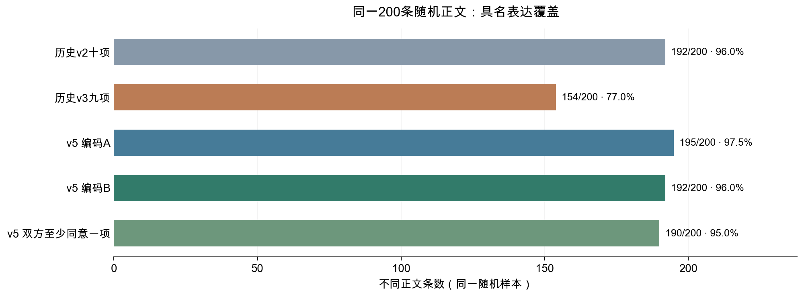
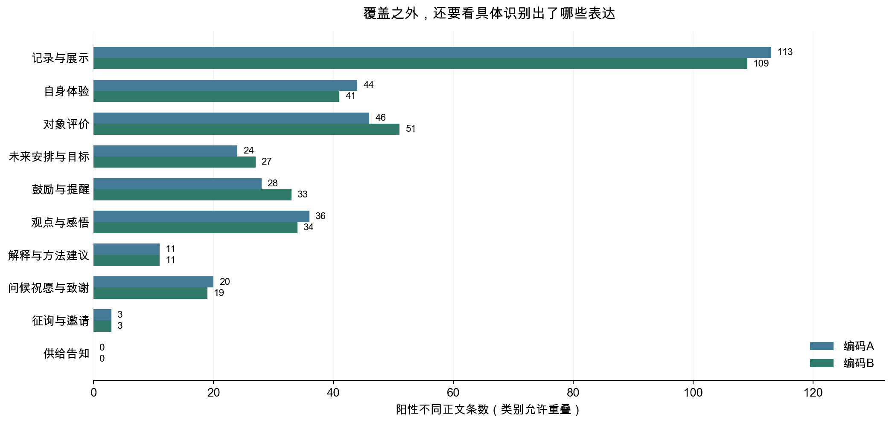

# 正文变量新方案 v5：把内容、表达行为和主观褒贬分开测量

**可编辑研究方案 · 2026年11月5日 · 已冻结规则并完成新样本双编码**

建议用本方案作为下一轮全量重编的统一规则。它保留记录展示、感受评价、未来安排、观点建议和人际交流的完整范围；将“谈到什么”与“在做什么”分开；再在相应表达中记录事件断言、计划目标和正负方向。帖子可以同时有几种表达，不再为了给每帖安排一个主类而消除原有信息。

这轮真正新增的是**体验与评价中的显性正负方向**，以及对展示、鼓励、感悟之间边界的收紧。正负方向可以并存，单纯“加油”不推断为积极情绪，纯表情也不靠猜测进入语义类别。新增属性不成为主变量必须齐全的门槛。

新抽取的同一200条随机不同正文中，历史v2识别出192条具名表达，v3为154条；v5两份独立上下文编码分别为195和192条，双方至少同意一项表达的有190条。它是新方案可操作性的实测，不能当成5,414帖的全量覆盖或人工准确率。本文件是已实施验证的变量方案，正式全量重编与点赞回归尚未完成。

## 1. 研究问题决定变量，不再用一个含混的分类包办所有信息

本研究希望比较不同正文表达与互动反馈的关系。为此，变量应对应可直接读到的语言行为，而不是替作者判断人格、动机或心理。内容对象描述帖子围绕什么展开，表达变量描述正文明确完成了哪些交流行为，条件属性记录其中能够进一步确定的细节。三个层次分别回答问题，不相互充当删样本的前提。

|层次|测量什么|为什么值得保留|
|---|---|---|
|内容对象|运动、身体、饮食、具体生活、工具服务；其他明确对象另记|区分讨论对象；同样的鼓励可能发生在运动、身体或日常生活语境。|
|表达行为|十项可重叠的具名表达|区分记录、体验、评价、安排、动员、观点、建议与交流，避免把不同作用合并。|
|条件属性|事件是否被明示发生；计划与目标；问候与感谢；体验评价的显性正负方向|大类明确时先保留，只在相应父类内继续比较细节。|
|形式与可观察状态|正文是否存在、清理后是否为空、长度、表情与问号等|保留短帖和符号帖的真实形式信息；不把可计算形式当成已经读懂语义。|

同一条正文可能记录训练、表达疲惫并鼓励继续，这三种信息允许共存。多标签不意味着分类失败；需要避免的是同一个意思因边界不清被重复算成很多功能。新规则要求每项阳性都有精确正文证据，不能因出现一个名词、问号或励志词便自动叠加标签。

## 2. 十项表达围绕五类问题组织，各变量仍独立测量

为让报告更容易理解，可以按以下五类问题安排章节。它们是解释结构，**不合并成五个新的统计变量**。十项指标及其已明确的阴性均保留，低频类别可以描述而不强行回归。

|正文表达的问题|分别记录的主变量|保留边界的理由|
|---|---|---|
|呈现了什么事情或对象|记录与展示|题注和活动名称有可观察信息，但不等于证明行动已经完成。|
|有什么感受，怎样评价对象|自身体验；对象评价|身体疲惫与认为一门课程好用是不同信息；正负方向另记。|
|准备做什么，是否动员行动|未来安排与目标；鼓励与提醒|未来计划不等于口号；鼓励也可能没有具体计划。|
|提出了什么看法或方法|观点与感悟；解释与方法建议|一般性判断与可执行方法分开，恢复v3遗漏的表达范围。|
|怎样向他人交流|问候祝愿与致谢；征询与邀请；供给告知|问候、索取回应和提供服务的交流行为不同，不能合并成笼统的社交强度。|

这套设计的合理性来自三个可检查的方面：各项对应不同的可观察行为；常见表达范围没有因细分而被移除；新样本能够检验编码者是否按同一边界判断。它不是完整的表达风格理论，也不凭覆盖率高就宣称所有类别正确。无法解释的文本与其他明确表达分别保留，其他类不计入具名覆盖。

类别来源也应明确：研究问题提供需要区分的方面，先前全量结果和有记录的正文近读用于发现遗漏，冻结后的新样本检验操作边界。不能把这一过程写成纯粹由理论推出十个天然类别，也不能写成大模型自动发现了客观真分类。这里测量的是正文中可观察的多个方面。

原四项词典退出新主模型，保留为历史字面特征对照；新变量有实际定义变化，不能只改名称继续使用旧系数。

|原字面变量|新方案怎样回答相应问题|
|---|---|
|自律或目标词|分别记录未来安排/目标与鼓励，已发生的事件另看展示中的事件断言；不把三者混成一项。|
|社交称呼或互助词|区分问候致谢、向他人索取回应、解释建议；仅出现称呼不等于已经发生互助。|
|积极词|先识别体验或评价，再测显性正负方向；鼓励和祝愿保留其表达身份，不自动充当作者的积极感受。|
|问号|问号保留为形式特征；只有明确征询、请求联络或邀请才进入语义请求变量。|

相较v4，纯表情不再视作内容展示；计划里的运动名词不自动兼标展示；普通评价不自动成为感悟；方法建议不自动成为鼓励；一般性观点必须能复述为超出眼前单一事件的命题。活动名称作为独立题注仍可保留，事件断言属性为“未断言”也不等于事件没有发生。详细的纳入、排除和构造示例见[冻结编码手册](正文多维测量方案_v5_编码手册.md)。

## 3. 正负方向改为语境中的体验与评价，避免把积极词当成情绪

原四项中的“积极表达”只靠字面词汇，容易把鼓励、祝福、对象评价与自身感受混为一体。新方案先识别明确的体验或对象评价，再分别判断显性正向和负向。身体不适与疲惫属于负向体验的范围，因此这个属性不能直接称为“心理情绪”。

两个方向允许同时出现。研究者构造的规则示例“今天跑完五公里，腿酸但很开心”，可以同时支持展示、体验、负向身体感受和正向感受；示例不属于本项目实测材料。单独加油、祝人开心或陈述晴天，不自动支持作者的正向体验。否定、反讽或引述关系不明时保留未知。

没有体验或评价时，条件极性记为不适用；有相应表达而方向不明时记未知。两项都是明确否定，只表示没有上述显性方向，不表示作者心理中性。正式补充分析应限定在体验或评价明确的正文中，比较正向、负向、混合和均未出现的表达组合；它回答的范围比“所有积极语言”更具体，不能直接继承旧积极词变量的系数。

## 4. 新样本检验了覆盖，也保留不一致和支持不足

本轮先审查历史结果，并由大模型实际阅读18条v4分歧正文作规则开发；这些材料均排除在新验证样本外。随后冻结手册、分析安排、原始批次和旧标签来源哈希，从排除既有已记录开发/复核与v4试点后剩余的3,093种不同正文中简单随机抽200条，再从未选中的旧v3无阳性正文另抽60条作困难诊断。

两份同基座AI在独立上下文分批阅读全文，只看到匿名正文与冻结手册，分别给出逐项判断与阳性原文证据。代码核对字段、父子逻辑、原文子串和样本映射，没有用正则或关键词代替本轮语义阅读。此前全体正文已由旧模型编码；本轮只是与有记录的开发/复核材料分离，不是从未接触过的语料或作者留出验证。

图1　共同分母为新抽取的200种不同正文，不是全部5,414帖。最后一项表示双方至少同意一个相同表达标签，不表示全套标签一致。历史v2、v3与v5在同一样本上比较，v4另有不同样本，未用两轮原始一致率判断改进幅度。

相较同一样本的历史v2，两份新编码的阳性覆盖净差只有3条与0条，不能据此认定总体覆盖大幅提高。新方案的主要收益是恢复v3缩窄的范围、澄清重复计数的边界，并把主观正负方向放到有语境的独立属性中。

|编码者|至少一项具名表达|阳性覆盖|至少两项表达|七项主候选全可判|十项表达全可判|具名内容与表达全可判|各适用属性也可判|
|---|---|---|---|---|---|---|---|
| A | 195 | 97.5% | 83 | 195 | 195 | 189 | 189 |
| B | 192 | 96.0% | 83 | 189 | 188 | 184 | 183 |

阳性覆盖、可判定和模型样本回答不同问题。正文没有任何阳性但各项明确阴性，仍可进入相应比较；某个属性未知也不使其他表达失效。上表最后一列用于展示过度要求信息齐全会造成怎样的样本损失，不作为主模型的统一纳入条件。

两份编码的表达阳性集合完全相同为163/200条，同时要求未知集合也相同为163/200条。以下逐项报告只在双方均可判的文本上计算阳性一致，未知另列；不以大量共同阴性凑成很高的所谓准确率。

| 表达 | A阳性 | B阳性 | 共同阳性 | 可比阳性并集 | 阳性一致 | 任一未知 | 筛查结论 |
| --- | --- | --- | --- | --- | --- | --- | --- |
| 记录与展示 | 113 | 109 | 108 | 113 | 97.7% | 6 | 通过本轮一致性筛查 |
| 自身体验 | 44 | 41 | 40 | 44 | 95.2% | 6 | 通过本轮一致性筛查 |
| 对象评价 | 46 | 51 | 42 | 54 | 87.5% | 8 | 通过本轮一致性筛查 |
| 未来安排与目标 | 24 | 27 | 21 | 28 | 85.7% | 7 | 通过本轮一致性筛查 |
| 鼓励与提醒 | 28 | 33 | 27 | 34 | 88.5% | 5 | 通过本轮一致性筛查 |
| 观点与感悟 | 36 | 34 | 33 | 36 | 95.7% | 6 | 通过本轮一致性筛查 |
| 解释与方法建议 | 11 | 11 | 10 | 12 | 90.9% | 5 | 阳性支持不足 |
| 问候祝愿与致谢 | 20 | 19 | 19 | 20 | 97.4% | 5 | 通过本轮一致性筛查 |
| 征询与邀请 | 3 | 3 | 3 | 3 | 100.0% | 6 | 阳性支持不足 |
| 供给告知 | 0 | 0 | 0 | 0 | 无可比阳性 | 5 | 阳性支持不足 |

本轮事先约定的筛查要求为：可比阳性并集至少20条、阳性一致至少80%、两份各自可判至少90%、三状态判断相同至少85%。它是筛选需复核指标的工作标准，不是准确率或效度认证。通过者为：记录与展示、自身体验、对象评价、未来安排与目标、鼓励与提醒、观点与感悟、问候祝愿与致谢。需要边界复核者为：无。阳性支持不足者为：解释与方法建议、征询与邀请、供给告知；这些类别不应因缺少证据而直接宣告可靠，也不因少见就从描述体系删除。

因此当前建议以通过筛查的七项作为主分析测量候选，其余三项保留完整描述并补充阳性复核。七项能否最终联合回归，还需全量样本支持和实际设计矩阵检查；不能把本轮筛查等同于最终回归资格。

图2　同一200条随机正文，各表达允许共存，因此各柱不相加为样本总数。两份数量相近也不保证标中同一批正文，需结合上表的共同阳性与未知判断。

额外60条困难诊断中，历史v2已有55条具名表达；v5两份分别为55和52条，双方至少同意一项的为50条。这只用于检查v3遗漏范围，不能写成相对所有旧版本新增了这么多，也不能与随机组混合估计总体覆盖。

困难组仍有不能忽略的分歧。例如鼓励在双方均可判的阳性并集中只有2条，双方各标出1条、共同阳性为0；支持很少，不能估计稳定的一致水平，也不能因随机组通过就认为这类短句边界已解决。后续人工复核要包含这些分歧。

新增正负属性的可比总体，是双方都识别出体验或评价的72条正文。双方对该父集合状态不一致的另有11条，不能只看属性一致而忽略父集合差异。

| 条件属性 | 双方方向可判 | A阳性 | B阳性 | 共同阳性 | 可比阳性并集 | 阳性一致 | 任一未知 |
| --- | --- | --- | --- | --- | --- | --- | --- |
| 显性正向体验/评价 | 71 | 46 | 45 | 45 | 46 | 98.9% | 1 |
| 显性负向体验/评价 | 72 | 37 | 37 | 37 | 37 | 100.0% | 0 |

本表A、B阳性与一致性都在双方父项阳性、该方向又均可判的子集中计算；“任一未知”在双方父项阳性的集合中另计，不混入可比阳性分母。

在双方父集合一致且两方向均明确的71条中，正负组合完全相同70条。少量分歧和同基座模型可能共同误判的风险仍需人工抽查；这些结果支持试用与继续检查，不替代人工语义效度证据。

## 5. 共线性需要检查，但不能据此把含义不同的变量合并

展示、体验、评价等表达可在同帖共存，是否造成估计不稳定需要看实际矩阵。这里先对随机试点中各自至少10条阳性和10条阴性的父表达做数值诊断；它只含这些二元表达，不含长度、媒体、作者与日期固定效应，也没有点赞结果。

| 编码者 | 该编码者诊断变量共同可判 | 诊断变量数 | 矩阵秩（含截距） | 表达矩阵VIF |
| --- | --- | --- | --- | --- |
| A | 195 | 8 | 9 | 1.06—1.23 |
| B | 189 | 8 | 9 | 1.05—1.30 |

这组VIF只反映小样本中表达指标的线性重叠，不能当成最终全设计共线性已经通过。全量重编后，应在每个实际回归样本中重新检查矩阵秩、VIF、阳性作者集中和作者内变化；旧版本低VIF也不转移为v5证据。VIF达到5时先检查重复编码、固定效应吸收与结构约束，不自动合并语义不同的表达。

## 6. 分析按信息层次展开，避免所有变量一起完整才留样本

主分析联合放入支持足够、边界可用的表达父变量，控制原有正文形式、媒体、作者与日期；这样比较某种表达在其他已测表达相同条件下与点赞的关联。逐项模型作为对照。每个父变量在全量中的支持门槛延续为至少40条阳性、40条阴性、10位作者有作者内变化，并在联合样本重新核查；这些门槛是实践约定，不代表功效或测量质量自动足够。编码一致性不足的变量先复核，不能只因全量数量多就直接采用。

内容对象作为补充模型加入。先在两组变量都明确的同一样本上比较加内容前后，再另报各模型的最大可用样本；否则系数变化可能只是删去了不同正文。事件断言只在展示阳性中比较，计划目标只在未来表达中比较，极性只在体验或评价阳性中比较。父项与整套互斥穷尽子类不能机械全放，条件不适用与未知都保留原状态。

点赞结果仍使用log(1＋点赞数)，按作者聚类报告不确定性，并在事先约定的表达或条件属性检验组内做BH校正。变量不按点赞或显著性挑选。反复探索过的同一数据不能恢复成事前验证，这些结果应称条件关联与探索性证据。

原NMF主题回归继续保留为独立历史分析，**使用连续主题权重，不用最大权重的主类代替**。权重和为1时，含截距的回归省去一个参照成分。原词分词模型2,470帖与后续字符表示实验的范围不同；不能把字符模型5,273帖当成原主题回归已扩样。

## 7. 全部数据保留在哪些分析中，下一轮怎样统一重编

|数据层次|实际范围|本方案的使用方式|
|---|---|---|
|全部帖子|9,532帖|保留元数据和正文可观察状态，不把未观察的文字或图片语义补出来。|
|清理后非空正文|5,414帖，占全部56.8%|形式分析保留全部；语义能否判断按轴、按变量保存。|
|不同正文|4,156种|统一语义重读一次，按映射回填各原帖；保持重复次数与帖子分析单位。|
|本轮双编码|200条随机＋60条困难正文|分别诊断新方案，不外推全量覆盖；分别映射231帖、63帖只是样本对应范围。|
|全量输入准备|84批匿名正文|已导出并核对来源，包含全部4,156种正文；尚未产生全量v5语义答案。|

可直接继承的成果是清洗口径、元数据描述、点赞分布以及原定义下的评论与回复网络。旧v2、v3标签和系数保留历史身份；定义变了的变量必须重估，不能把旧标签拼成新版本，再沿用系数。

生产输入包已把全部正文分成每批50条、末批6条，并冻结手册、分析安排、84个原始批次及映射来源。260条试点也纳入统一重读；它们用于对照，不能当人工金标准自动导入。编码后先核对每项证据、未知和回填行数，再报告具名覆盖、逐项可判、重叠与作者支持；对分歧、双方一致、短帖和罕见类分别人工复核，随后按上节安排估计。

本版已经完成变量定义、边界修订、冻结抽样、新样本双编码与生产输入准备。**尚未完成的是4,156种正文的统一生产编码、独立人工复核，以及由此生成的全量回归。** 因而当前可交付的是一套已经检验过可操作性的新方案，而不是声称全量覆盖已经达到某个新的百分比。

## 8. 方法依据与可编辑规则

自动文本测量需要围绕具体研究问题验证，计算规模不能替代对正文的阅读与检查；参见[Grimmer与Stewart（2013）](https://www.cambridge.org/core/journals/political-analysis/article/text-as-data-the-promise-and-pitfalls-of-automatic-content-analysis-methods-for-political-texts/F7AAC8B2909441603FEB25C156448F20)。本项目的类别是否合适仍由本项目的正文证据和复核决定，文献不替它背书。

使用同一批文本发现测量方式并估计关系存在过拟合风险；[Egami等（2022）](https://naokiegami.com/paper/CausalText.pdf)提出发现与估计分样本的工作流。本轮只将有记录的设计材料与新试点分离，不能宣称完成该文的完整因果设计，也没有消除此前探索的影响。

|规则或结果|可编辑文件与聚合|
|---|---|
|逐项定义、排除规则与边界示例|[v5编码手册](正文多维测量方案_v5_编码手册.md)|
|抽样、支持与回归安排|[冻结分析安排](code/variable_scheme_v5_protocol.json)|
|新双编码结果|[逐项聚合与一致性](results/variable_scheme_v5_evaluation.json)|
|全量生产准备|[输入来源与计数](results/v5_production_preparation.json)|
|此前完整反思与候选实算|[变量方案反思与对比评估](变量方案反思与对比评估_可编辑.md)|

Word可直接微调表述，Markdown是重新生成文档的文字来源；直接改Word不会自动写回Markdown。冻结手册不能在查看本轮结果后悄悄修改：需要改规则时另建版本，并明确哪些样本已转为开发材料。原始正文、逐条证据、盲包及原帖映射均保留在被Git忽略的私有目录，公开文件只含规则和聚合。
